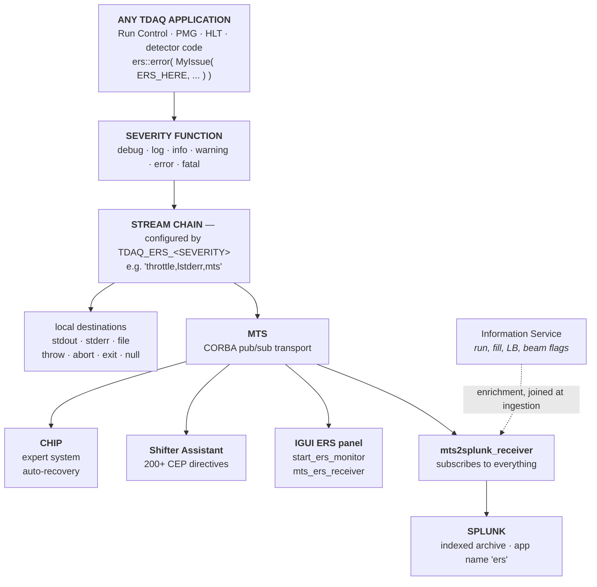
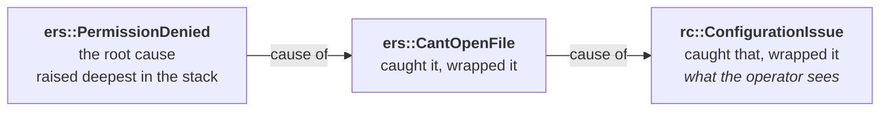
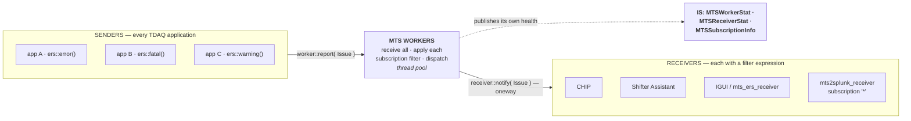
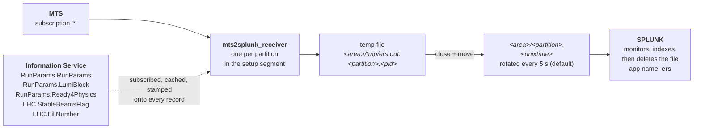
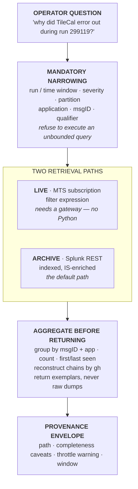

# The Error Reporting System (ERS)

**A complete working guide to how ATLAS TDAQ reports, transports and archives errors — and what that means for an LLM agent built on top.**

Everything factual here is verified against the current source of the `ers`, `mts`, `ers2idl` and `Jers` repositories, plus the design documents shipped inside the `ers` repository itself. All clone anonymously — no CERN credentials, no SSO:

```bash
git clone --depth 1 https://gitlab.cern.ch/atlas-tdaq-software/ers.git
git clone --depth 1 https://gitlab.cern.ch/atlas-tdaq-software/mts.git
git clone --depth 1 https://gitlab.cern.ch/atlas-tdaq-software/ers2idl.git
git clone --depth 1 https://gitlab.cern.ch/atlas-tdaq-software/Jers.git
```

> ### Why ERS is the most agent-friendly of the five services
>
> Run Control and Process Management make you reconstruct meaning from state enumerations that collide by name. ERS does not. Every error in ATLAS TDAQ is a **typed object** with a stable class name, a structured attribute map, a full source-code context, and an optional causal chain. It is the closest thing in the system to data that was designed to be queried.
>
> The difficulty with ERS is not semantics — it is **volume, coverage and access**. Roughly 10⁴ messages per second during data taking, with two structurally different retrieval paths and a live path that has no Python client.

---

## Contents

1. [Where ERS sits](#1-where-ers-sits)
2. [The data model](#2-the-data-model)
3. [How error types come into existence](#3-how-error-types-come-into-existence)
4. [Streams: the configurable destination chain](#4-streams-the-configurable-destination-chain)
5. [Crashes become issues](#5-crashes-become-issues)
6. [MTS: the live transport](#6-mts-the-live-transport)
7. [The Splunk archive](#7-the-splunk-archive)
8. [Language support — and the Python gap](#8-language-support--and-the-python-gap)
9. [Traps](#9-traps)
10. [Building an MCP agent for ERS](#10-building-an-mcp-agent-for-ers)
11. [Source index and bibliography](#11-source-index-and-bibliography)

---

## 1. Where ERS sits

ERS is the common error-reporting API for **every** application in ATLAS TDAQ — all 40,000+ of them. An application creates a typed `Issue` and hands it to one of six severity functions. Where it ends up is decided entirely by configuration, not by the code that raised it.

That separation is the whole design: **the raising site declares what happened; the deployment decides who hears about it.**



### Scale

| Quantity | Value |
|---|---|
| Peak message rate during data taking | ~10⁴ messages/second |
| MTS delivered-message rate (2018 measurement) | up to **100 kHz** |
| Total archived in Run 1 | ~30 million messages |
| Applications using ERS | every TDAQ application (40,000+) |
| Default severity streams | 6 |

> **MTS is the transport layer under ERS.** In the Controls and Configuration literature MTS is described as the "fast and reliable transport layer for the TDAQ Error Reporting System"; it was completely redesigned for Run 2 and handled peaks of 100 kHz of delivered messages during 2018 operations. When you read "ERS" in an architecture diagram, the wire underneath it is MTS.

---

## 2. The data model

### 2.1 Issue

An `Issue` is a **typed C++ exception class**, not a string. This is the single most important property of ERS for an agent: the error *type* is a first-class, stable, machine-comparable identifier.

| Member | Meaning |
|---|---|
| `get_class_name()` | The type identifier, e.g. `rc::ApplicationSignaled`. Globally unique, namespace-qualified. This is the `msgID` in the archive. |
| `message()` | Human-readable text, generated from a format expression declared with the class |
| `context()` | Where in the source and on which machine it was raised — see §2.3 |
| `parameters()` | `map<string,string>` of the issue's own typed attributes |
| `qualifiers()` | `vector<string>` of filter tags |
| `severity()` | Assigned when sent to a stream — see §2.2 |
| `cause()` | Pointer to the `Issue` that caused this one, or null. Recursive. |
| `time_t()` / `time()` | Creation time; formatted local or UTC |

Two behaviours worth knowing:

- **An `Issue` is an `Exception`.** It can be thrown, caught, and — because ERS issue classes implement `raise()` — rethrown polymorphically.
- **Severity is not fixed at construction.** A new issue defaults to `Error`. Its severity becomes that of the stream it is sent to. `ers::warning( issue )` makes it a warning at the moment of reporting. So *the same issue class can appear in the archive at different severities*, and severity is a property of the reporting decision, not of the error type.

### 2.2 Severity

Six levels, in a strict order:

```
Debug · Log · Information · Warning · Error · Fatal
```

The design document is unusually explicit that severity is **contextual, not absolute**: "an issue is an error, fatal or a warning *in a given context*. A fatal issue is to be understood as fatal regarding a given service request; it might be considered as a warning at another level of the system."

> This matters directly for an agent. `sev=FATAL` does **not** mean "the experiment is broken" — it means the component that raised it could not complete the request it was working on. Aggregating fatals into an alarm count without that qualification produces a badly misleading picture.

There is also a `rank` (an integer sub-level) alongside the severity type, used for debug levels.

### 2.3 Context

Recorded automatically by the `ERS_HERE` macro. Fourteen fields locally:

| Field | Field |
|---|---|
| `package_name` | `host_name` |
| `file_name` | `user_name` |
| `function_name` | `user_id` |
| `line_number` | `application_name` |
| `cwd` | `process_id` |
| `stack_symbols` | `thread_id` |
| `stack_size` | |

> **Only 11 of the 14 survive the wire.** The `ers2idl` `RemoteContext` structure — the actual CORBA representation used by MTS — carries `cwd`, `file_name`, `function_name`, `host_name`, `user_name`, `package_name`, `application_name`, `user_id`, `process_id`, `thread_id`, `line_number`. The **stack trace is dropped**: `stack_symbols` and `stack_size` are local-only. A stack trace you see printed to stderr on the raising host is not in the archive and not available to a subscriber.

### 2.4 Qualifiers

Free-form string tags used for filtering. Every issue gets **one automatically**: the name of the TDAQ software package that built the binary where the issue was constructed. More can be added with `add_qualifier()`, or globally via the `TDAQ_ERS_QUALIFIERS` environment variable.

In practice this means an issue from Run Control carries the qualifier `RunControl` for free, plus whatever the detector adds — the real archived example carries `quals="RunControl PIXEL "`.

### 2.5 Parameters

Each issue class declares typed attributes; they are stored as a `string→string` map and are individually retrievable. In the archive these appear in the `params` field. This is where the *specific* facts live — which application, which host, which exit signal — as opposed to the message text, which is prose.

> **Prefer `params` over `text` when querying.** The message is a formatted string assembled from the parameters; the parameters are the structured original. An agent matching on message text is doing string-matching against a format template that can change between releases.

### 2.6 Chaining — the causal chain

Any issue constructor accepts another `Issue` (or a plain `std::exception`) as its last argument. The new issue then holds a copy of the original and reports it as its **cause**. Chains nest arbitrarily deep.



This is the closest thing TDAQ has to a distributed stack trace across abstraction layers, and it is the highest-value structure in ERS for root-cause questions. The design intent stated in the architecture document is precisely this: to "preserve the original cause of the problem as well as the error handling sequence."

> On the wire, `CauseIssue` is declared as `sequence<Issue,1>` — a bounded sequence of at most one element. So a chain is a **linked list, not a tree**: one issue has at most one direct cause, but that cause may have its own.

---

## 3. How error types come into existence

Every error type in TDAQ is declared with one of two macros. Understanding them is what lets you predict what an agent will find in the archive.

```cpp
ERS_DECLARE_ISSUE(
    ers,                                                          // namespace
    Assertion,                                                    // issue name
    "Assertion (" << condition << ") failed because " << reason,  // message format
    ((const char *)condition )                                    // attribute 1
    ((const char *)reason )                                       // attribute 2
)
```

This generates a full class: a unique id (`"ers::Assertion"`), a `clone()`, a `raise()`, typed getters (`get_condition()`, `get_reason()`), constructors with and without a cause, and automatic registration with the `IssueFactory`.

`ERS_DECLARE_ISSUE_BASE` does the same but inherits from an existing issue class, so error types form **hierarchies** — `ers::Precondition` inherits from `ers::Assertion`, which inherits from `ers::Issue`.

Three consequences for an agent:

1. **The set of possible error types is finite, enumerable and discoverable** by scanning `ERS_DECLARE_ISSUE` declarations across the TDAQ repositories. Run Control alone declares 70; Process Management around 48.
2. **The `msgID` is stable across releases** unless someone renames a class — far more stable than message text.
3. **Attribute names are part of the class declaration**, so the `params` keys for a given `msgID` are predictable.

### The receiver does not need the sender's classes

A subscriber that receives an issue whose class it does not have compiled in gets an **`ers::AnyIssue`** — a generic issue carrying the type string, message, context, parameters, qualifiers and cause. Nothing is lost except compile-time typing.

> This is the fact that makes a generic ERS agent feasible. A single receiver can subscribe to the whole partition without linking against every TDAQ package that might raise an error.

### Convenience macros

| Macro | Effect |
|---|---|
| `ERS_DEBUG( level, msg )` | `ers::Message` → debug stream. Compiled out if `ERS_NO_DEBUG` is defined. |
| `ERS_LOG( msg )` | → log stream |
| `ERS_INFO( msg )` | → info stream |
| `ERS_ASSERT( expr )` | `ers::Assertion` → **fatal** stream if violated |
| `ERS_PRECONDITION( expr )` | as above, user-defined message |
| `ERS_RANGE_CHECK( min, val, max )` | closed-range check |
| `ERS_STRICT_RANGE_CHECK( min, val, max )` | open-range check |
| `ERS_HERE` | captures the context — **mandatory first argument** to every issue constructor |

---

## 4. Streams: the configurable destination chain

A "stream" is a **chain of handlers**, configured per severity by an environment variable. Each handler decides whether to pass the issue on to the next.

```bash
export TDAQ_ERS_ERROR="throttle(10,20),filter(RunControl,!Tile),lstderr,mts"
#                      └─ suppress ─┘ └─ select ────────┘ └─print─┘ └─ send ─┘
```

### Defaults

| Function | Default configuration |
|---|---|
| `ers::debug()` | `lstdout` |
| `ers::log()` | `lstdout` |
| `ers::info()` | `throttle,lstdout` |
| `ers::warning()` | `throttle,lstderr` |
| `ers::error()` | `throttle,lstderr` |
| `ers::fatal()` | `lstderr` |

Note that **three of the six throttle by default**, and `mts` is *not* in any default — live delivery is something a deployment opts into.

### All stream implementations

| Stream | Behaviour |
|---|---|
| `stdout` / `stderr` | Print. **Not** thread-safe. |
| `lstdout` / `lstderr` | Print. Thread-safe (the leading `l` = locked). |
| `lock` | Take a global mutex for the rest of the chain. `lock,stdout` ≡ `lstdout`. |
| `null` | Silently drop. |
| `throw` | Apply C++ `throw` to the issue. |
| `abort` | Call `abort()`. |
| `exit` | Call `exit()`. |
| `filter(A,B,!C)` | Pass issues having qualifier A **or** B and **not** C. |
| `rfilter(...)` | Same, but arguments are regular expressions. |
| `throttle(threshold, interval)` | After `threshold` identical issues, suppress repeats for `interval` seconds. |
| `mts` | Send to the MTS transport for remote delivery. |

Custom streams can be written by subclassing `ers::OutputStream`, registered with `ERS_REGISTER_OUTPUT_STREAM`, built into a shared library, and loaded at runtime via `TDAQ_ERS_STREAM_LIBS` — **without recompiling the application**.

### Environment variables

| Variable | Effect |
|---|---|
| `TDAQ_ERS_DEBUG` / `LOG` / `INFO` / `WARNING` / `ERROR` / `FATAL` | Stream chain per severity |
| `TDAQ_ERS_DEBUG_LEVEL` | Highest debug level emitted (default 0; negatives allowed) |
| `TDAQ_ERS_VERBOSITY_LEVEL` | How much detail is printed — see below |
| `TDAQ_ERS_QUALIFIERS` | Extra qualifiers added to every issue |
| `TDAQ_ERS_STREAM_LIBS` | Shared libraries providing custom streams |
| `TDAQ_ERS_NO_SIGNAL_HANDLERS` | Disable the signal handlers of §5 |
| `TDAQ_ERS_TIMESTAMP_FORMAT` / `_PRECISION` / `_UTC` | Timestamp rendering |
| `TDAQ_PACKAGE_NAME` | Overrides the automatic package qualifier |
| `TDAQ_APPLICATION_NAME` | Application name recorded in the context |

**Verbosity levels** control the *printed* form only (not what is transported):

| Level | Adds |
|---|---|
| 0 | severity, time, context (package/file/function/line), message |
| 1 | issue attribute names and values |
| 2 | host name, user name, process id, working directory |
| 3 | stack trace (unless built with `ERS_NO_DEBUG`) |

### The issue catcher

An application can install a single process-wide `ers::set_issue_catcher( handler )`. Every issue reported via `ers::error()`, `ers::fatal()` or `ers::warning()` — **from any linked library** — is then delivered to that handler on a dedicated thread. It can be set only once per process lifetime; a second attempt throws `ers::IssueCatcherAlreadySet`.

This is how a framework intercepts errors raised deep inside code it does not own.

---

## 5. Crashes become issues

Unless `TDAQ_ERS_NO_SIGNAL_HANDLERS` is set, ERS installs `sigaction` handlers for:

| Signal | Reported as |
|---|---|
| `SIGSEGV` | "Segmentation fault (invalid memory reference)" |
| `SIGBUS` | "Bus error (bad memory access)" |
| `SIGILL` | "Illegal Instruction" |
| `SIGFPE` | "Floating point exception" |

It also installs a `std::terminate` handler for unhandled exceptions.

> **This closes the loop with Process Management.** When an application segfaults, two independent things happen: ERS turns the signal into a structured issue from *inside* the dying process, and the PMG launcher's `waitpid` observes the death from *outside*. An agent correlating a crash therefore has both an ERS record with the source-code context and a PMG record with the exit signal — and they are recorded by different mechanisms, so either can be missing.

---

## 6. MTS: the live transport

MTS is a CORBA-based publish/subscribe transport, used almost exclusively as an ERS plugin rather than directly. Clients configure it by adding `mts` to a stream chain: `TDAQ_ERS_ERROR='lstderr,mts'`.



### The wire format

The CORBA `Issue` structure carried by MTS:

```idl
enum Severity { debug, log, information, warning, error, fatal };

struct RemoteContext {
    string cwd, file_name, function_name, host_name,
           user_name, package_name, application_name;
    unsigned long user_id, process_id, thread_id, line_number;
};

struct Issue {
    string            ID;        // the class name, e.g. "rc::ApplicationSignaled"
    string            message;
    unsigned long long time;
    Severity          sev;
    RemoteContext     cont;
    Parameters        params;    // sequence of {name, value}
    Qualifiers        quals;     // sequence of string
    CauseIssue        cause;     // sequence<Issue,1> — at most one, recursive
};
```

> ### ⚠ Coverage limit found in source
>
> The IDL carries a commented-out field with an explanatory note: *"rank of DEBUG ← we never send DEBUG over MTS"*. **Debug messages never leave the process.** Neither the live stream nor the Splunk archive contains them. An agent asked "show me the debug output around this failure" cannot answer from ERS at all — that data only ever existed on the raising host's stdout.

### The subscription language

This is the most directly reusable part of ERS for an agent, because it is already a query language over exactly the fields you want.

```ebnf
key          = 'app' | 'msg' | 'qual'
sev          = 'sev'
par          = '(param|par)(+[a-zA-Z_-])'
context_item = 'app' | 'host' | 'user' | 'package' | 'file' | 'function' | 'line'
context      = 'context(context_item)'
sevlev       = 'fatal' | 'error' | 'warning' | 'info' | 'information'
token_wildcard = -'*'+[a-zA-Z_.:-]-'*'
quoted_string  = '"'+char'"' | "'"+char"'"
item       = (key ('=' | '!=') token_wildcard)
           | (sev ('=' | '!=') sevlev)
           | (par ('=' | '!=') token)
           | (context ('=' | '!=') quoted_string)
factor     = item | ( expression ) | ('not' factor)
expression = '*' | factor *(('and' expression) | ('or' expression))
```

Worked examples from the release notes:

```
sev=ERROR and context(host)=pc-tdq-tpu-55020.cern.ch

(app=HLT* and (not (param(algorithm)=muons and context(file)=test.cpp))
   or sev=fatal or msg=rc::*)

sev=ERROR or (msg=mtssender::* and (msg=*Died or msg=*::longmessageid)
   and param(pid)!=666 and context(line)!=1
   and context(function) != 'const int daq::function')
```

Since **tdaq-11-04-00** the grammar additionally allows `:` in tokens, a wildcard at the *start* of a token, and spaces inside quoted context values (so function signatures and file paths can be matched).

### Ready-made tools

| Tool | Use |
|---|---|
| `mts_ers_receiver -p $TDAQ_PARTITION -s "<expr>" -v` | CLI subscriber |
| `start_ers_monitor` | GUI, equivalent to the IGUI ERS panel |
| `ERSSender` (Java) | Inject test messages |
| `mts2splunk_receiver` | The archive ingestion process — §7 |

### Subscribing from C++

```cpp
struct MyIssueReceiver : public ers::IssueReceiver {
    void receive( const ers::Issue & issue ) { std::cout << issue << std::endl; }
};

ers::StreamManager::instance().add_receiver( "mts", "*", receiver );
// or with an explicit partition:
ers::StreamManager::instance().add_receiver( "mts", {"my partition", "*"}, receiver );
```

Partition defaults to `TDAQ_PARTITION`. Unsubscribe with `remove_receiver( receiver )`.

Since **tdaq-10-00-00** `add_receiver` accepts an optional timeout for **synchronous subscription** — it publishes the subscription to the MTS IS server and blocks until every registered worker confirms, or the timeout expires. The release notes recommend ~50 ms, noting workers normally confirm within a few milliseconds. This exists for clients that subscribe and expect messages almost immediately; without it there is a race in which early messages are missed.

### MTS is self-monitoring

MTS publishes three IS classes, which means "is the error pipeline healthy?" is itself an answerable question:

| IS class | Key attributes |
|---|---|
| `MTSWorkerStat` | `msgs_received` (before filtering), `msgs_delivered`, `msgs_queued`, `received_rate`, `delivery_rate`, `active_threads`, `total_threads` |
| `MTSReceiverStat` | `msgs_received`, `msgs_delivered`, `timeouts` (CORBA), `av_delay` (ms), `queue_length`, `threads_count` |
| `MTSSubscriptionInfo` | `receiver_ref`, `filter_expression`, `sync_required` |

> `MTSSubscriptionInfo.filter_expression` means an agent can **discover who is currently listening to what** — useful for the "am I duplicating an existing consumer?" question, and directly relevant to composing with CHIP and Shifter Assistant rather than competing with them.

---

## 7. The Splunk archive

The historical path. A dedicated subscriber, `mts2splunk_receiver`, subscribes to everything and writes files that Splunk indexes.



An alternative wiring, `ers2splunk.sh`, pipes the same receiver's stdout straight into a Splunk TCP listener via `nc` — used on the test bed:

```bash
mts2splunk_receiver -d -s "$subscription" -p "$partition" -i "stdout" | nc "$host" "$port"
```

### The archived record format

Verified field-by-field against the `print_issue` function in source:

```
t=1463153399, rn=299119, part=IBL-DAQSlice, uname=crpixel,
msgID=rc::ApplicationSignaled, host=pc-pix-fit-02.cern.ch, app=Ctrl_PixelIBL,
sev=WARNING,
text="Application "Appl_PixelRCD-IBL" on host "sbc-pix-rcc-i-1.cern.ch" died while exiting on signal 9.",
context="PACKAGE: RunControl FILE: ../src/Controller/ApplicationController.cxx FUNCTION: daq::rc::ApplicationController::pmgCallback(...) LINE: 182",
params="application: ... errStream: ... hostName: ... onExit: 1 ",
quals="RunControl PIXEL ", chained=0, gh=123244,
T0=data_test, LB=45, Fill=0, R4P=0, SB=0
```

| Field | Source | Meaning |
|---|---|---|
| `t` | Issue | Unix timestamp of the issue |
| `rn` | **IS** | Run number |
| `part` | receiver | Partition name |
| `uname` | Context | User who ran the application |
| `msgID` | Issue | **The issue class name** — the type identifier |
| `host` | Context | Host where it was raised |
| `app` | Context | Application name |
| `sev` | stream | Severity at reporting time |
| `text` | Issue | The formatted message |
| `context` | Context | Package, file, function, line |
| `params` | Issue | The issue's own attributes, `name: value ` pairs |
| `quals` | Issue | Qualifiers, space-separated |
| `chained` | receiver | `0` standalone · `1` head of a chain · `2` a cause within a chain |
| `gh` | receiver | **Group hash** — a boost CRC-32 linking one chain's records together |
| `T0` | **IS** | Tier-0 project tag |
| `LB` | **IS** | Luminosity block |
| `Fill` | **IS** | LHC fill number |
| `R4P` | **IS** | Ready-for-physics flag |
| `SB` | **IS** | Stable-beams flag |

> ### ⚠ Two corrections worth having before you write a parser
>
> **The context labels are the short form.** The worked example in the source file's *header comment* shows `PACKAGE_NAME:`, `FILE_NAME:`, `FUNCTION_NAME:`, `LINE_NUMBER:` and a trailing `DATE_TIME:`. The `print_issue` function that actually writes records emits **`PACKAGE:`, `FILE:`, `FUNCTION:`, `LINE:`** — and no `DATE_TIME`. The header comment is a stale example. Parse the short labels.
>
> **File paths.** The temp file is `<splunk_area>/tmp/ers.out.<partition>.<pid>`; the rotated file is `<splunk_area>/<partition>.<unix_timestamp>` with no extension. Both are relative to the configured Splunk area, not to `/tmp`.
>
> Also: file names and function signatures are **abbreviated** before writing — paths are stripped relative to the package, and function signatures are shortened. The archived `FILE:` value is not the full path the compiler saw.
>
> **⚠ Unresolved conflict with an earlier note on this same pipeline.** An earlier working note on this system recorded the temp file as `/tmp/ers.<PID>.out` and the rotated file as `/data/4splunk/<partition>.<timestamp>.out` — a hardcoded path and a different token order than what's given above. This section's version is derived from re-reading `print_issue`/`mts2splunk_receiver.cpp` directly and is presented as a correction, but the two accounts disagree and only one can be right for a given deployment (or both could be right at different tdaq releases). **Treat this as open until checked directly against the live `mts2splunk_receiver.cpp` source and, ideally, an actual file on `/data/4splunk/` or wherever the configured Splunk area resolves to** — don't hardcode a parser against either path form without that check.

### The archive is already a join

`rn`, `T0`, `LB`, `Fill`, `R4P` and `SB` are **not part of the ERS Issue**. The receiver subscribes to the Information Service, caches these values, and stamps them onto every record at ingestion. The exact sources:

| Archive field | IS object | Attribute |
|---|---|---|
| `rn` | `RunParams.RunParams` | `run_number` |
| `T0` | `RunParams.RunParams` | `T0_project_tag` |
| `LB` | `RunParams.LumiBlock` | `LumiBlockNumber` |
| `R4P` | `RunParams.Ready4Physics` | `ready4physics` |
| `SB` | `LHC.StableBeamsFlag` (initial partition) | `value` |
| `Fill` | `LHC.FillNumber` (initial partition) | `value` |

The luminosity block has a second source: the receiver also parses `L1CT::LumiBlockChange` ERS messages from the CtpController to pick up LB transitions between IS updates.

> **This is a genuine gift to the agent.** "Show me every error during run 299119 while beams were stable" is a single archive query with no cross-service join, because the join was already done at ingestion. It also means the enrichment fields inherit IS's freshness — if `run_number` had not yet been published when a message arrived, the record carries `rn=0`.

### A related, but different, service: P-BEAST

`atlas-tdaq-software/pbeast` is a separate archive — it stores **Information Service (IS)** data, not ERS data. It's directly relevant here for two reasons rather than being a tangent:

1. **IS is where the archive's enrichment fields come from.** Everything in the "archive is already a join" table above (`rn`, `T0`, `LB`, `Fill`, `R4P`, `SB`) is sourced from IS objects. Anyone building or debugging the IS side of an agent — or trying to understand why an ERS record shows `rn=0` — is working against the same underlying service that P-BEAST archives.
2. **It's a usable architecture reference for the Splunk REST client this doc still needs to build.** P-BEAST exposes a Python `ServerProxy` class, authenticated via CERN SSO. That's the same general shape as the "Python client hitting an authenticated CERN-internal REST/RPC endpoint" problem described in §7's Endpoints subsection and §8's option (a). Modeling the ERS Splunk client on P-BEAST's `ServerProxy` pattern — rather than inventing a new client shape from scratch — keeps it consistent with whatever the IS-side teammate builds.

P-BEAST itself is out of scope for this document (it's a different service archiving different data), but it's worth cloning alongside `ers`/`mts`/`ers2idl`/`Jers` if IS enrichment or the REST client design comes up:

```bash
git clone --depth 1 https://gitlab.cern.ch/atlas-tdaq-software/pbeast.git
```

### Chain ordering

When an issue has a cause, the receiver writes the **cause first**, then the parent — deliberately, because "splunk … seems to read from the end of the file". All records in one chain share the same `gh` group hash and the same severity (a cause inherits its parent's severity in the archive). So reconstructing a causal chain means: group by `gh`, then order by `chained` descending (2 → 1).

### Deliberate incompleteness

`mts2splunk_receiver` accepts `-m` (`--drop_msgid`) and `-a` (`--drop_appid`) to discard messages by issue class or application name at ingestion. Whether these are used in a given deployment determines whether "the archive" is complete. **Do not assume it is.**

Splunk-side field extraction is configured in `/opt/splunk/etc/apps/ers/default/props.conf` and `transforms.conf` — confirming the Splunk application is named `ers`.

### Endpoints

| Instance | URL |
|---|---|
| Production | `https://atlasop.cern.ch/tdaq/ers/en-US/static/app/ers/ers.html` (reverse-proxied; real backend deliberately hidden) |
| Test / staging | `https://vm-ers-test.cern.ch:8000/en-US/app/ers/ers_browser_html` |

Both were located via CERN's internal on-call shortcuts TWiki — specifically the **`PointOneDataFlow`** page — reachable only from the CERN network or VPN. For a programmatic client the target is Splunk's REST API, conventionally on port **8089** (management) rather than 8000 (web UI) — **this remains unconfirmed and needs settling with a CERN contact along with credentials.**

---

## 8. Language support — and the Python gap

| Capability | C++ | Java | Python |
|---|---|---|---|
| Declare typed issues | ✅ macros | ✅ | ⚠ `Issue` subclass, no macro |
| Send to a stream | ✅ | ✅ | ✅ |
| Configure streams via env | ✅ | ✅ | ✅ (inherits) |
| Custom stream implementations | ✅ | ✅ | ❌ |
| Issue catcher | ✅ | — | ❌ |
| **Subscribe / receive live** | ✅ `add_receiver` | ✅ `MTSInStream extends ers.AbstractInputStream` | ❌ **none** |

Verified directly: the Python extension module `liberspy` exports exactly seven functions —

```
init · debug · log · info · warning · error · fatal
```

— and nothing else. There is no receiver, no input stream, no subscription. `ers.py` provides `Severity`, `Context`, `Issue(Exception)`, `Message`, the six send functions, and a bridge into Python's standard `logging` module (`LoggingHandler`, `addLoggingHandler()`, `replaceAllLoggingHandlers()`).

> **Python is write-only for ERS.** A Python agent has three options: (a) query the Splunk archive over REST and accept that it is not live; (b) run `mts_ers_receiver` as a subprocess and parse its output — workable as a stopgap; (c) build a small C++ or Java gateway exposing MTS subscription over JSON, which is the same shape as the IPC gateway the Run Control and Process Management agents need anyway.
>
> Option (c) is the one to plan for. It is one gateway pattern serving three services. For option (a), see the P-BEAST note in §7 — its `ServerProxy` pattern is the closest existing precedent for a Python client against a CERN-internal, SSO-authenticated TDAQ service.

---

## 9. Traps

| # | Trap | Consequence |
|---|---|---|
| 1 | **Debug is never transported.** The IDL comment says so explicitly. | "What was it logging just before it failed?" is unanswerable from ERS. |
| 2 | **Throttling silently suppresses repeats.** Three of six severities throttle by default. The suppressed count is appended to a later message's text (`-- N similar messages suppressed…`). | Counting occurrences in the archive **undercounts** real occurrences. Message text contains an embedded count that a naive parser will miss. |
| 3 | **Severity is assigned at reporting, not construction.** | The same `msgID` legitimately appears at several severities. Severity is not a property of the error type. |
| 4 | **Severity is contextual by design.** | `FATAL` means "this component could not complete this request", not "the experiment is down". |
| 5 | **Stack traces are local-only.** | Never in the archive, never in a subscription. |
| 6 | **The archive may drop messages by design** (`-m`/`-a`). | "It's not in the archive" ≠ "it did not happen". |
| 7 | **Enrichment fields come from IS, not ERS.** | If IS had not published yet, you get `rn=0`, `Fill=0` — a zero is "unknown", not a real value. |
| 8 | **Causes are written before their parent.** | Naive time-ordered reading inverts causality. Group by `gh`, order by `chained`. |
| 9 | **Message text is a format template.** | It can change between releases. Match on `msgID` and `params`. |
| 10 | **Only 11 of 14 context fields survive the wire.** | Don't design a schema around fields the transport drops. |
| 11 | **The exact archive file-path format is unresolved.** | Two accounts of the temp/rotated file paths disagree (see §7 callout) — don't hardcode a parser against either until checked directly against source or a live file. |

---

## 10. Building an MCP agent for ERS

### 10.1 What makes ERS different from RC and PMG

The Run Control and Process Management agents need a heavyweight semantic mapping layer because their state vocabularies collide by name. **ERS has no equivalent problem** — `msgID` is globally unique and namespace-qualified by construction.

What ERS needs instead is a **volume-control layer**. At 10⁴ messages/second, the failure mode is not ambiguity, it is drowning the model.



### 10.2 Proposed tool surface

Consistent with the generic surface proposed for the RC and PMG agents:

| Tool | Effect | Purpose |
|---|---|---|
| `find_issues` | read-heavy | Query the archive by time/run window + filters. **Requires** at least one narrowing predicate. |
| `summarise_issues` | read | Group by `msgID`/`app`/`host`, return counts and first/last seen. **The default entry point** — cheap, and usually the actual answer. |
| `get_issue_chain` | read | Given a `gh`, return the full causal chain in causal order. |
| `describe_issue_type` | read | Given a `msgID`, return its declaration: attributes, base class, raising package. Derived from the repositories, not the archive. |
| `list_issue_types` | read | Enumerate known `msgID`s, optionally by package. |
| `subscribe_live` | **subscribe** | Open a bounded MTS subscription. Creates server-side state; needs the gateway; must be time-boxed. |
| `mts_health` | read | `MTSWorkerStat` / `MTSReceiverStat` — is the pipeline itself keeping up? |

Reuse the MTS subscription grammar as the filter syntax for `find_issues` wherever possible. It already covers `app`, `msg`, `qual`, `sev`, `param(*)` and `context(*)`; operators know it; and it makes the live and archive paths look the same to the model.

When implementing the Splunk REST client backing `find_issues`/`summarise_issues`, model it on **P-BEAST's `ServerProxy` pattern** (§7) rather than inventing a new client shape — it's the existing precedent within this same codebase for a Python client against a CERN-SSO-authenticated TDAQ service, and keeps this agent consistent with whatever the IS-side agent ends up using.

### 10.3 The response envelope

The same provenance envelope as the other agents, with ERS-specific caveats promoted to first-class fields:

```jsonc
{
  "query": {
    "window": { "run": 299119, "from": "...", "to": "..." },
    "filter": "sev=ERROR and qual=RunControl",
    "path":   "archive"                      // or "live"
  },
  "summary": [
    {
      "msgID": "rc::ApplicationSignaled",     // stable type identifier
      "count": 47,                            // ⚠ see caveats
      "first_seen": "...", "last_seen": "...",
      "apps":  ["Ctrl_PixelIBL", "..."],
      "severities": ["WARNING", "ERROR"],     // severity is per-report, not per-type
      "exemplar_gh": 123244
    }
  ],
  "caveats": [
    { "kind": "throttling",
      "why": "ERROR throttles by default — repeat counts are lower bounds, not totals" },
    { "kind": "no_debug",
      "why": "DEBUG messages are never transported; not queryable via ERS" },
    { "kind": "ingestion_filter",
      "why": "the archive may drop msgIDs/appIDs by deployment config; absence is not proof" }
  ],
  "not_answered": [
    { "question": "what was the stack trace?",
      "why": "stack frames are local-only and never leave the raising process" }
  ]
}
```

The `caveats` block is the ERS-specific addition. Three of the traps in §9 — throttling, missing debug, ingestion filters — mean that **counts and absences from ERS are systematically unreliable in a knowable direction**. Encoding that as structured output rather than prose is what stops the model from reporting "this happened 47 times" when the honest answer is "at least 47 times".

### 10.4 Design rules

1. **Never expose raw retrieval.** Make `summarise_issues` the default and require explicit narrowing before any tool returns individual messages. At 10⁴ msg/s an unbounded query is a denial-of-service against your own context window.
2. **Match on `msgID` and `params`, never on message text.**
3. **Treat `count` as a lower bound.** Always.
4. **Reconstruct chains, don't return flat lists.** The causal chain is the highest-value structure ERS offers; grouping by `gh` and ordering by `chained` turns a pile of records into a root-cause narrative.
5. **Classify `subscribe_live` as `subscribe`, not `read`.** It creates server-side subscription state in MTS and consumes worker threads on a production service — exactly the four-value taxonomy case identified for PMG's `link_client`.
6. **Check `MTSWorkerStat` before trusting a live result.** If `msgs_queued` is climbing or `timeouts` are non-zero, the subscription is lossy and the agent should say so.
7. **Compose with CHIP and Shifter Assistant.** They already consume this stream and already act on it. Read `MTSSubscriptionInfo` to see what they subscribe to; an agent that duplicates an existing directive adds noise rather than capability.

---

## 11. Source index and bibliography

### 11.1 Primary source

| Claim | Repo | Path |
|---|---|---|
| Severity levels and ordering | `ers` | `ers/Severity.h` |
| Issue public API, cause, qualifiers, parameters, timestamps | `ers` | `ers/Issue.h` |
| Context field set (14 fields) | `ers` | `ers/Context.h` |
| Issue declaration macros, generated code | `ers` | `README.md`, `ers/internal/IssueDeclarationMacro.h` |
| Stream defaults, all stream implementations, filter/throttle syntax, env vars, issue catcher, receiver API | `ers` | `README.md` |
| Stream implementations | `ers` | `src/streams/*.cxx` |
| Throttle default threshold (10), suppression message | `ers` | `src/streams/ThrottleStream.cxx` |
| Signal handlers (SIGSEGV/SIGBUS/SIGILL/SIGFPE), terminate handler | `ers` | `src/ErrorHandler.cxx` |
| `AnyIssue` fallback for unregistered types | `ers` | `ers/AnyIssue.h` |
| Issue factory / registration | `ers` | `ers/IssueFactory.h` |
| Python bindings — send-only, 7 functions | `ers` | `python/erspy.cxx`, `python/ers.py` |
| Verbosity levels, debug level, custom stream loading | `ers` | `README.md` |
| Design intent, severity semantics, issue-handling matrix | `ers` | `doc/Error_Reporting_Architecture.pdf`, `doc/ErrorHandling_1.0.pdf` |
| MTS purpose, subscription EBNF, utilities | `mts` | `README.md` |
| Subscription grammar changes (11-04-00), synchronous subscribe (10-00-00), drop flags, ers2splunk | `mts` | `doc/RELEASE_NOTES.md` |
| CORBA interfaces `receiver` / `worker` | `mts` | `idl/mts.idl` |
| `MTSWorkerStat`, `MTSReceiverStat`, `MTSSubscriptionInfo` | `mts` | `mts/mts.schema.xml` |
| Splunk record format, chaining, group hash, IS enrichment sources, CLI options, file paths | `mts` | `bin/mts2splunk_receiver.cpp` |
| TCP variant of the Splunk feed | `mts` | `bin/ers2splunk.sh` |
| Subscription parser | `mts` | `mts/SubscriptionParser.h` |
| Wire format: `Issue`, `RemoteContext`, `Severity`, `CauseIssue`; **"we never send DEBUG over MTS"** | `ers2idl` | `idl/ers2idl/ers2idl.idl` |
| Java receiver `MTSInStream extends ers.AbstractInputStream`, `@ErsStreamName` | `Jers` | `jsrc/ers/AbstractInputStream.java`, `jsrc/ers/ErsStreamName.java` |
| Python `ServerProxy` client pattern, CERN-SSO auth — architecture reference for the ERS Splunk REST client | `pbeast` | `README.md`, `python/pbeastpy.cpp` |

### 11.2 Published literature

- **Kolos, Kazarov, Papaevgeniou, ["The Error Reporting in the ATLAS TDAQ System"](https://cds.cern.ch/record/1950302)** — ATL-DAQ-PROC-2014-027, CHEP 2014. The dedicated ERS paper; source of the ~10⁴ msg/s figure and the Log Service description. ([slides](https://cds.cern.ch/record/1751460/files/ATL-DAQ-SLIDE-2014-538.pdf))
- **["Experience with SPLUNK for archiving and visualisation of operational data in ATLAS TDAQ system"](https://www.researchgate.net/publication/328386082)** — ATL-DAQ-SLIDE-2018-087. Why Splunk was chosen and how the dashboards are built.
- **["The Controls and Configuration software of the ATLAS Data Acquisition System"](https://inspirehep.net/files/4e321dbd92144d58e81e10200ade63d1)** — ACAT 2019, *J. Phys. Conf. Ser.* **1525** 012036. Open access. Establishes MTS as the ERS transport layer and gives the 100 kHz delivered-message peak. Also covers CHIP and Shifter Assistant.
- **["Experience with Shifter Assistant"](https://cds.cern.ch/record/2648925)** — CHEP 2018, *EPJ Web Conf.* **214** 01028. The CEP consumer of this stream, and its 200+ directives.
- **[DAQling ERS documentation](https://daqling.docs.cern.ch/ers/)** and **[DUNE-DAQ/ers](https://github.com/dune-daq/ers)** — two independent forks/derivatives of ATLAS ERS. Useful as external, readable restatements of the same API; **not** authoritative for ATLAS-specific behaviour.
- **[TDAQ release notes](https://atlas-tdaq-sw-releases.web.cern.ch/release-notes/)** — authoritative for anything release-specific. `ers2idl` was introduced in tdaq-11-02-00 to pass ERS issues over CORBA.
- **Live infrastructure host-status page** — internal TDAQ monitoring, checked to confirm the Splunk infrastructure for TDAQ was running as of 2025. A freshness check rather than a design source: everything else in this document is derived from source code and design docs, which can go stale; this was the one live confirmation that the pipeline described here is still operating, not just historically documented.

### 11.3 What remains open

| Item | Status |
|---|---|
| Splunk REST API port and credentials | **Open.** Port 8089 is the Splunk convention but is unverified here. Authentication method (CERN SSO / service account / token) unknown. The one genuinely blocking item for building the client. |
| Whether `-m`/`-a` drop filters are active in production | **Open.** Determines archive completeness. Ask the operations group. |
| Splunk retention policy for the `ers` index | **Open.** ~30 M messages archived in Run 1 is a volume figure, not a retention guarantee. |
| Exact archive temp/rotated file-path format | **Open — conflicting accounts.** See the §7 callout: one account gives `/tmp/ers.<PID>.out` → `/data/4splunk/<partition>.<timestamp>.out`; a source re-read gives `<splunk_area>/tmp/ers.out.<partition>.<pid>` → `<splunk_area>/<partition>.<unixtime>`. Needs direct verification against `mts2splunk_receiver.cpp` and/or a live deployment before any parser depends on it. |
| Live subscription from Python | **Resolved — none exists.** Requires a gateway; plan it jointly with the IPC gateway for RC/PMG. |
| Archive record schema | **Resolved** against source, including the two corrections in §7. |
| IS enrichment sources | **Resolved** — exact object and attribute names in §7. |
