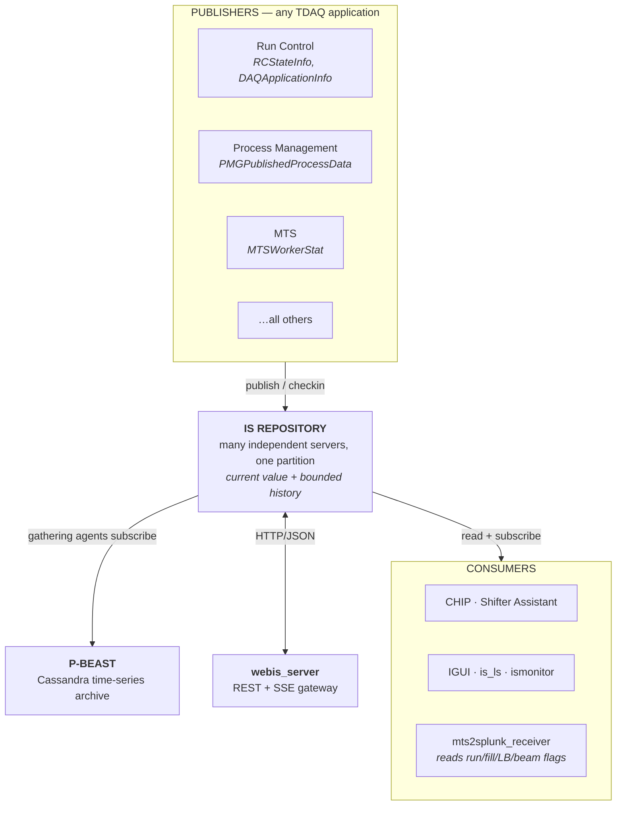
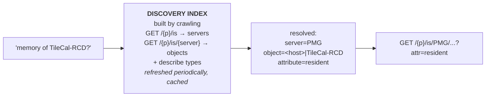

# The Information Service (IS)

**A complete working guide to the shared live-state store at the centre of ATLAS TDAQ — and the REST gateway that changes how an agent should reach it.**

Everything factual here is verified against the current source of the `is`, `webis_server`, `webdaq`, `pbeast` and `oh` repositories. All clone anonymously — no CERN credentials, no SSO:

```bash
git clone --depth 1 https://gitlab.cern.ch/atlas-tdaq-software/is.git
git clone --depth 1 https://gitlab.cern.ch/atlas-tdaq-software/webis_server.git
git clone --depth 1 https://gitlab.cern.ch/atlas-tdaq-software/webdaq.git
git clone --depth 1 https://gitlab.cern.ch/atlas-tdaq-software/pbeast.git
```

> ### ⭐ The headline finding, up front
>
> The prior IS study named the `webis_server` HTTP/JSON interface as its **highest-priority open item** — "endpoint paths, request and response field structures, and whether subscription or streaming access is available over HTTP … has not been directly inspected."
>
> **It is now inspected, and the answer is better than hoped.** The repository ships a complete **1,578-line OpenAPI 3 specification** at `doc/openapi.yaml`. The server is written in **Python** (Twisted). And subscriptions **are** exposed over HTTP, as **Server-Sent Events**.
>
> It also does not stop at IS. One gateway covers **IS, Online Histograms, OKS, IPC, event sampling, and ERS** — including a live SSE subscription to ERS issues using the MTS filter grammar.
>
> This materially changes the WP2 architecture recommendation. See §7 and §10.1.

---

## Contents

1. [Where IS sits](#1-where-is-sits)
2. [Repository architecture](#2-repository-architecture)
3. [The data model](#3-the-data-model)
4. [Subscriptions](#4-subscriptions)
5. [The native API](#5-the-native-api)
6. [Server configuration and limits](#6-server-configuration-and-limits)
7. [The REST gateway — webis_server](#7-the-rest-gateway--webis_server)
8. [P-BEAST: the archive](#8-p-beast-the-archive)
9. [Traps](#9-traps)
10. [Building an MCP agent for IS](#10-building-an-mcp-agent-for-is)
11. [Source index and status of open items](#11-source-index-and-status-of-open-items)

---

## 1. Where IS sits

IS is the mechanism by which TDAQ applications share **live operational state** — with each other, and with operators. Any application that needs to expose status does so by creating a named, typed object and publishing it. Others read it on demand, or subscribe to be notified when it changes.

The division of labour against its sibling services is clean:

| Service | Concerns |
|---|---|
| **IS** | Continuously available **current state** — "what is this value now?" |
| **ERS** | Discrete **faults and events** — "something happened" |
| **OKS** | Static **configuration** — "what should exist" |
| **P-BEAST** | **Long-term archive** of IS — "what was this value then?" |
| **OH** | Histograms — implemented as a *direct specialisation of IS* |



> **Everything the RC and PMG agents need is already in IS.** Run Control publishes `RCStateInfo` and `DAQApplicationInfo`; Process Management publishes `PMGPublishedProcessData` and `PMGPublishedAgentData`; MTS publishes its own health. IS is therefore not merely one of five services — it is **the common substrate three of the five are read through**.

---

## 2. Repository architecture

### 2.1 There is no single IS server

An IS "repository" is a **set of independent server processes**, each with a unique name, all within one TDAQ partition. Critically:

- **There is no global namespace.** Each server maintains its own independent set of objects.
- **There is no cross-server search.** A client must know — or discover by enumeration — which server holds the data it wants.
- A partition runs many servers concurrently, each specialising in a subsystem or application group.

This is the single most important architectural fact for an agent, and §10 returns to it.

### 2.2 Transport

IS is built on the TDAQ **IPC** layer, which is built on **CORBA**. The C++ implementation uses omniORB; the Java implementation uses JacORB. Both bindings are designed to be transport-independent in principle.

The three interaction roles named in the repository's own documentation:

| Role | Does |
|---|---|
| **Information Provider** | Creates, updates and deletes objects |
| **Information Reader** | Requests and retrieves objects |
| **Information Subscriber** | Registers for change notifications |

There is a fourth capability worth noting: an application can **send a command to a running information provider** (`is_cmd`, the IDL `provider::command`), provided at least one object from that provider exists in the repository. This is a control channel that is easy to overlook — and it is a *mutating* operation.

---

## 3. The data model

### 3.1 Naming

Every object's name has the fixed form:

```
ServerName.ObjectName
```

Exactly two dot-separated segments. A non-conforming name raises `InvalidName` in the client library. **The partition is not part of the name** — it is implicit in the connection context.

> The `ObjectName` part may itself contain further dots or slashes — `RunCtrl.Supervision.<app>` is server `RunCtrl`, object `Supervision.<app>`. The REST gateway maps slash-separated hierarchical names onto URL path segments.

### 3.2 The three-level model

| Level | What it is |
|---|---|
| **Meta-type declaration** | The structure of a custom type, declared in an OKS-style XML schema (this is exactly what `pmg_is_info.xml` is) |
| **Generated language types** | The schema is compiled into native C++ and Java classes |
| **Information instances** | Concrete objects published at runtime |

For simple values, IS ships ready-made wrappers for all C++ built-in types — boolean, char, short/int/long and unsigned variants, float, double, string — so basic data needs no custom schema.

### 3.3 Versioning: tag and time

Every published value carries:

- a **tag** — a 32-bit integer identifying that version
- a **timestamp** — microsecond precision (nanoseconds on the wire)

Two update modes:

| Mode | Behaviour |
|---|---|
| Default | The previous value is discarded |
| History | Prior values retained up to the server's configured limit (§6) |

A specific historical version can be retrieved directly **by its tag**.

### 3.4 The wire structures

Verified against `idl/is.idl`:

| Struct | Fields | Purpose |
|---|---|---|
| `type` | `id`, `name`, `code`, `nested_types[]` | Schema descriptor |
| `tagtime` | `tag`, `time` | A version identifier with its timestamp |
| `attributes` | `tag`, `time`, `address`, `ann[]` | Metadata for one value |
| `value` | `attr`, `data` | One stored value + metadata |
| `info` | `name`, `type`, `value` | One complete object snapshot |
| `info_history` | `name`, `type`, `values[]` | Multiple versions of one object |
| `event` | `name`, `type`, `attr` (tagtime) | **Change notification without payload** |

> The `event` structure is deliberately lighter than `info`. A subscriber that only needs to know *that* something changed can subscribe at the event level and avoid transferring the payload entirely. At IS's update rates this is not a micro-optimisation — it is the difference between a viable and an unviable subscription.

Note also `address` and `ann` (annotations) on `attributes` — metadata channels the prior study did not surface, carried alongside every value.

### 3.5 Change classification

Every change is classified by a `reason`:

```
Created · Updated · Deleted · Subscribed
```

`Subscribed` is the synthetic event delivered when a subscription is first established (it lets a subscriber prime itself with current state). The other three are real changes. This four-value enum is the filtering vocabulary for subscriptions.

---

## 4. Subscriptions

### 4.1 Criteria

Subscriptions are established over a **criteria** object combining:

- a **name regular expression** (with an `ignore` flag)
- a **type** constraint, with five modes: `Ignore`, `Exact`, `Not`, `Base`, `NotBase`
- a **logic** joining them: `And` / `Or`

The `Base` / `NotBase` modes are the interesting ones — they match on *inheritance*, so a subscription can catch every object derived from a base type without enumerating subclasses. C++ provides `&&` and `||` operators over `(regex, ISType)` pairs to build these fluently.

### 4.2 The repository interface

The full CORBA surface, classified for a read-only agent:

| Operation | | Purpose |
|---|---|---|
| `get_last_value(name)` | read | Current value |
| `get_value(name, tag)` | read | A specific historical version |
| `get_last_values(name, n, order)` | read | History, sorted `ByTag` or `ByTime` |
| `get_tags(name)` | read | Available versions |
| `get_type(name)` | read | Schema introspection |
| `contains(name)` | read | Existence check |
| `create_stream(criteria, stream, depth, order)` | read-heavy | Bulk sequential retrieval |
| `subscribe(criteria, callback, event_mask)` | **subscribe** | Register for notifications |
| `add_callback(name, callback, event_mask)` | **subscribe** | Per-object callback |
| `unsubscribe` / `remove_callback` | subscribe | Tear down |
| `checkin(info, keep_history, use_tag)` | **mutate** | Atomic upsert |
| `create(info)` | **mutate** | Create; raises `AlreadyExist` |
| `update(info, keep_history, use_tag)` | **mutate** | Update; raises `NotFound` |
| `remove(name)` | **mutate** | Delete one |
| `remove_all(criteria)` | **mutate** | Delete many — the most dangerous call |
| `provider::command(name, command)` | **mutate** | Send a command to a provider |

Typed exceptions: `AlreadyExist`, `InvalidCallback`, `InvalidCriteria`, `NotCompatible`, `NotFound`, `OutOfBounds`, `SubscriptionNotFound`. All clean, all convertible into calibrated refusals.

---

## 5. The native API

The C++ client classes, verified against the headers:

| Class | Capability |
|---|---|
| `ISInfoDictionary` | Point read/write — `insert`, `checkin`, `update`, `remove`, `getValue`/`findValue` (by name or name+tag), `getTags`, `getType`, `getValues<T>` |
| `ISInfoReceiver` | Push subscription — `subscribe`/`unsubscribe`, selectable event types, `Immediate` or `Delayed` policy |
| `ISInfoStream` | Efficient bulk sequential read from one server |
| `ISInfoRange` / `ISServerRange` | Discovery — enumerate servers in a partition, or objects in a server |
| `ISInfoDynAny` | **Generic, schema-agnostic** read/write, addressing attributes by name or position with runtime introspection |
| `ISInfoAny` | Older generic access; **deprecated** in favour of `ISInfoDynAny` |

> `ISInfoDynAny` is to IS what `ers::AnyIssue` is to ERS: the mechanism that lets a *generic* client work against types it was not compiled against. It is what makes a single agent viable across all ~230 servers without linking every schema in TDAQ.

### Command-line utilities

Present as working source in the repository, and directly usable for exploration:

| Utility | Function |
|---|---|
| `is_ls` | List servers in a partition, and objects in a server — with filters for name pattern, value display, history, tags, provider |
| `is_write` | Publish/update generically via `ISInfoDynAny` |
| `is_cmd` | Send a command string to a running provider |
| `is_rm` | Remove an object |
| `ismonitor` | Graphical repository browser |
| `print_info_any` | Dump an object generically |

### Native Python: none

Confirmed by exhaustive search of the `is` repository — **there are no `.py` files at all**. The tree contains C++, Java (including a pre-built JAR), and the CLI/GUI tools. This matches the equivalent finding for ERS's live path.

**But this no longer constrains the project** — see §7.

---

## 6. Server configuration and limits

Verified directly from `server/config.cc` and `server/main.cc`. Every parameter is per-server-instance and settable by environment variable:

| Parameter | Default | Environment variable |
|---|---|---|
| History depth (versions per object) | **100** (`-1` = unlimited) | `IS_SERVER_HISTORY_DEPTH` |
| History time range | **3,600,000 s = 1,000 hours** (stored as ns) | `IS_SERVER_HISTORY_TIME_RANGE` |
| Worker threads | **16** | `IS_SERVER_WORKER_THREADS` |
| Max tolerated callback timeouts before dropping a subscriber | **100** | `IS_SERVER_MAX_TOLERATED_TIMEOUTS` |
| Max callback queue size | **100,000** | `IS_SERVER_MAX_QUEUE_SIZE` |
| Receiver checkup period | **60** | `IS_SERVER_CHECKUP_THRESHOLD` |
| Forced history | **false** | `IS_SERVER_FORCED_HISTORY` |
| Callback delivery timeout | **10 ms** | `-c` / `--callback-timeout` (sets `omniORB::setClientCallTimeout`) |

The last two rows are additions to the prior study. `IS_SERVER_CHECKUP_THRESHOLD` and `IS_SERVER_FORCED_HISTORY` were not previously recorded.

> ### The subscriber-eviction rule matters more than it looks
>
> A subscriber gets **10 ms** to accept each callback. After **100** timeouts it is **dropped** — silently, from the subscriber's point of view. A slow consumer does not get backpressure; it gets disconnected.
>
> Any agent holding a live subscription must therefore (a) never do slow work inside the callback, and (b) treat "I stopped receiving updates" as a state it can actually be in. This is a real operational hazard for an LLM-backed consumer, where "slow" is the default.

---

## 7. The REST gateway — webis_server

This is the finding that reshapes the project's access story.

### 7.1 What it is

A gateway exposing TDAQ online services over **HTTP/JSON**. Two implementations ship in one repository:

| Implementation | Scope |
|---|---|
| **Python** (`webis_server`, Twisted) | The **full** API surface |
| **C++** (`webproxy`) | A **fast subset** — a "Phase II prototype for initial measurements when used with HLT and global monitoring jobs" |

The repository documents the gaps between them in `doc/api-coverage.md` — an unusually honest artefact that tells you exactly which endpoints and parameters the C++ path omits.

### 7.2 Running it

```bash
cm_setup tdaq-14-00-00
webis_server                       # → http://localhost:8080/info/current
```

| Option | Effect |
|---|---|
| `--port=N` / `--port=0 --port-file=F` | Fixed or random port |
| `--unix /tmp/www` | Unix domain socket instead of TCP |
| `--cert=cert.pem [--key=key.pem]` | Enable TLS — **and HTTP/2** |
| `--self-signed` | Generate a certificate internally |
| `--writable` | **Enable POST and DELETE.** Refused by default. |
| `--loglevel=INFO` | Default is `WARNING` |
| `--www=/path` | Serve the static `webis` pages at `/tdaq/web_is` |
| `-e` | Use `EventSampling` instead of EMON |

> **`--writable` is off by default.** The gateway is read-only unless explicitly started otherwise, and returns `403 permission_denied` for modifying operations. That is precisely the boundary a read-only agent wants, enforced by the server rather than by agent discipline.

### 7.3 The API surface

Base path: `/info/current`.

| Endpoint | Method | Purpose |
|---|---|---|
| `/info/current` | GET | List partitions |
| `/{partition}` | GET | List services in a partition |
| `/{partition}/is` | GET | **List IS servers** |
| `/{partition}/is/{server}` | GET | **List objects in a server** |
| `/{partition}/is/{server}/{object}` | GET | **Get object, or open an SSE subscription** |
| `/{partition}/is/{server}/{object}` | POST / DELETE | Create/update, delete (needs `--writable`) |
| `/{partition}/oh` | GET | List histogram providers |
| `/{partition}/oh/{path}` | GET / POST / DELETE | Histograms |
| `/{partition}/oks` | GET | **List OKS classes** |
| `/{partition}/oks/{class}` | GET | List objects of a class |
| `/{partition}/oks/{class}/{id}` | GET | **Get an OKS object** |
| `/{partition}/ipc` | GET | List IPC types |
| `/{partition}/ipc/{type}` | GET | List objects of an IPC type |
| `/{partition}/event` | POST | Create an event-data subscription |
| `/{partition}/event/{id}` | GET / DELETE | Read next event / cancel |
| `/{partition}/ers` | POST | **Post an ERS issue** |
| `/{partition}/ers/{subscription}` | GET | **SSE stream of ERS issues** |

### 7.4 Reading an IS object

`GET /info/current/{partition}/is/{server}/{objectName}` supports:

| Parameter | Effect |
|---|---|
| `format` | `json` (verbose attribute array) or `compact` |
| `attr` | Restrict to named attributes (comma-separated or repeated) |
| `multiple` | Treat `objectName` as a **regular expression**, return all matches |
| `type` | Filter by IS type name (implies `multiple`) |
| `tags` | Return **tag history** instead of the value |
| `listen` | Open an SSE subscription |

Responses carry a `Last-Modified` header in single-object mode. Content negotiation supports `application/json`, `application/xml`, and `text/event-stream`. Hierarchical names map onto path segments: `Category/Sub/Object` → `.../is/{server}/Category/Sub/Object`.

### 7.5 Live subscriptions over HTTP — Server-Sent Events

**This closes the prior study's highest-priority open item.**

Set `Accept: text/event-stream`, or add `?listen=`, and the same endpoint becomes a persistent stream.

| Aspect | Detail |
|---|---|
| Event types | `created`, `updated`, `deleted`, `subscribed` — the IS `reason` enum verbatim |
| `listen` values | `update` (default), `create`, `delete`, `subscribe` — repeatable |
| Payload, no `format` | `[name, type, timestamp]` — the lightweight `event` shape |
| Payload, `format=json` | Verbose attribute array, same as a single-object GET |
| Payload, `format=compact` | `[name, type, timestamp, {attr: value}]` |
| Keep-alive | `:keep-alive` comment every **15 s** |

```bash
# live push, from anything that speaks HTTP
curl -N -H 'Accept: text/event-stream' \
  'http://webis:8080/info/current/ATLAS/is/RunCtrl/RootController?listen=update&format=compact'
```

That is consumable from Python in a handful of lines with `httpx` or `requests`, with no CORBA, no TDAQ release, and no bridge process.

### 7.6 ERS over the same gateway

`GET /{partition}/ers/{subscription}` opens an SSE stream of ERS issues where `{subscription}` is a **URL-encoded MTS subscription expression** — the exact grammar documented in the ERS study.

- Each event has type `issue`; the payload is the ERS issue as JSON.
- Keep-alive every 15 s.
- **Multiple clients using the same expression share a single underlying MTS subscription** — the gateway multiplexes, so N agents do not cost N subscriptions on the production MTS workers.

`POST /{partition}/ers` injects an issue, with a documented JSON schema: `host`, `pid`, `tid`, `cwd`, `uid`, `user`, `app`, `pkg`, `file`, `line`, `func`, `msg` (the message ID), `sev` (`DEBUG|LOG|INFO|WARNING|ERROR|FATAL`), `time`, `message`, `qual[]`.

> **This supersedes a conclusion in the ERS study.** That document states there is no Python path to live ERS subscription and recommends building a bridge. There is one, it already exists, and it is the same gateway IS needs. The bridge does not have to be built.

### 7.7 The client library

`webdaq` is a **stand-alone** C++ client depending only on curl and nlohmann/json. It explicitly does **not** require a TDAQ or ATLAS release to build — it fetches its own dependencies if absent.

| Environment variable | Purpose |
|---|---|
| `TDAQ_WEBDAQ_BASE` | Gateway base, e.g. `http://pc-tdq-mon-01.cern.ch:5000` or `unix:/path/to/socket` |
| `TDAQ_WEBDAQ_COOKIEFILE` | Cookie file for libcurl (SSO) |
| `TDAQ_WEBDAQ_VERIFY` | TLS verification control |
| `TDAQ_WEBDAQ_PROXY` / `_PROXY_NEGOTIATE` | Proxy configuration |
| `TDAQ_WEBDAQ_VERBOSE` | curl verbosity |

`webdaq` also ships an **ERS output stream plugin**, so an application can send ERS over HTTP:

```bash
export TDAQ_ERS_STREAM_LIBS=webdaq-ers
export TDAQ_ERS_ERROR="webdaq(partition)"
```

---

## 8. P-BEAST: the archive

IS is transient by design — current value plus a bounded history window (§6). Durable storage is P-BEAST's job.

### 8.1 Pipeline

| Stage | What happens |
|---|---|
| **Gathering** | Independent agents subscribe to a defined subset of IS servers at start-up, then receive updates continuously |
| **Filtering** | A pluggable pipeline. A **duplicates filter** runs by default; an optional **smoothing filter** drops a numeric value within a configurable tolerance of the previous one — measured to cut storage by up to **38%** |
| **Insertion** | Written to a **Cassandra** time-series cluster |
| **Retrieval** | A common API; richer clients (ADAM/Grafana dashboards) translate HTTP into API calls and return JSON, XML or CSV |

> The duplicates filter exists for a specific reason worth internalising: **IS resends the entire object on every update**, including unchanged fields. There is no delta encoding. Most of what flows through a subscription is unchanged data.

### 8.2 The Python client — confirmed

The prior study recorded the P-BEAST Python client as *reported but not independently inspected*. It is now inspected. `python/pbeastpy.cpp` exposes a Boost.Python module `libpbeastpy` with a `ServerProxy` class:

| Method | Signature |
|---|---|
| `get_partitions()` | Names of P-BEAST partitions |
| `get_classes(partition)` | Class names in a partition |
| `get_attributes(partition, class)` | Attribute names of a class |
| `get_objects(partition, class, attribute, objects_mask, since, until)` | Matching object names |
| `get_data(partition, class, attribute, obj, is_regexp, since, until, ds_interval, all_updates, functions_config, use_fqn, prev_interval, next_interval, fill_ds_gaps)` | The time-series data itself |

Constructor: `ServerProxy(base_url, cookie_setup_type, user_cert_dir)`.

### 8.3 Authentication — and it is scriptable

The prior study asked whether P-BEAST "can be queried directly from an automated script or requires an interactive, browser-based authentication step." Resolved, from the `CookieSetup` enum:

| Mode | Meaning |
|---|---|
| `NotInitited` | Setup not yet done |
| `None` | **SSO not needed**; no cookie file created |
| `AutoUpdateKerberos` | Uses a valid CERN **Kerberos ticket** acquired by the user process |
| `AutoUpdateUserCertificates` | Uses `~/private/myCert.pem` + `myCert.key` |

**No browser step is required.** A `kinit` ticket or a user certificate is sufficient, both of which work in an automated context. This closes the medium-priority open item.

Dashboards: [Point 1](https://atlasop.cern.ch/tdaq/pbeastDashboard/), [Test Bed](https://vm-atlas-tdaq-cc.cern.ch/tbed/pbeast/grafana/). Note that as of tdaq-11-02-00 P-BEAST dropped its dependency on the obsolete CERN IT authentication and supports proxy Kerberos for general-purpose-network access.

### 8.4 Scale

| Figure | Value | Confidence |
|---|---|---|
| IS servers designated "of interest" to P-BEAST | 87 | confirmed |
| Gathering agents | 6 | confirmed |
| Cassandra cluster | 3 nodes | confirmed |
| Smoothing filter storage reduction | up to 38% | confirmed |
| Ingest rate | up to 500,000 attributes/s; ~200 kHz average over Run 2 | confirmed (CC literature) |
| Volume | ~20 TB/year compacted | confirmed |
| Retention | lifetime of the experiment | confirmed |
| Total IS servers across the farm | ~230 | **unverified** |
| Information objects / variables | ~200,000 objects, ~2,000,000 variables across the 87 | **unverified** |
| Peak update rates | tens of thousands/s on some servers; ~9,200 transactions/s average across the 6 agents | **unverified** |
| Early scaling test | 1,000 providers at 1 Hz + 15 consumers on one instance | **unverified** |

The four unverified rows are carried forward from the prior study unchanged. They remain plausible and consistent, and still want checking against a live test partition before appearing in a formal deliverable.

---

## 9. Traps

| # | Trap | Consequence |
|---|---|---|
| 1 | **No global namespace, no cross-server search.** | "Where is the memory usage of node X?" cannot be answered without enumerating servers. An agent needs its own discovery/index layer. |
| 2 | **Slow subscribers are evicted.** 10 ms per callback, 100 tolerated timeouts. | An agent that does model inference inside a callback will be silently disconnected. Buffer, then process. |
| 3 | **Every update resends the whole object.** | Subscription traffic is dominated by unchanged fields. Subscribe at `event` level when you only need change notification. |
| 4 | **History is bounded twice** — 100 versions *and* 1,000 hours, whichever binds first. | "What was this a month ago?" is a P-BEAST question, not an IS question. |
| 5 | **`Subscribed` is a synthetic reason**, not a real change. | Counting `reason` events as changes over-counts by exactly one per subscription. |
| 6 | **Name format is rigidly two-segment.** | `ServerName.ObjectName`; malformed names raise `InvalidName`. The server part is not optional. |
| 7 | **`remove_all(criteria)` exists** and takes a regex. | The highest-consequence call in the API. A read-only agent must never be able to reach it — and `--writable` off is the structural guarantee. |
| 8 | **`provider::command` is a control channel.** | Easy to misclassify as read-only because it lives in an information service. It is a mutation. |
| 9 | **The C++ `webproxy` is not the Python server.** | It omits SSE, `format`, XML, the `--writable` gate, error bodies, and several endpoints. Test against the implementation you will actually deploy. |
| 10 | **P-BEAST is filtered at ingestion.** | The duplicates filter (always) and smoothing filter (optional) mean the archive is a *lossy* representation of what IS published. Fine for trends, wrong for exact-value forensics. |

---

## 10. Building an MCP agent for IS

### 10.1 The architecture consequence

The RC/PMG study proposed a **Tier 3 IPC gateway** — "a Python process running inside the TDAQ environment, using native bindings to translate JSON requests into CORBA invocations." The ERS study proposed the same, noting it would be "one gateway pattern serving three services."

**That gateway already exists.** `webis_server` is a Python process, inside the TDAQ environment, translating HTTP/JSON into CORBA — for IS, OKS, IPC, OH and ERS, with an OpenAPI spec and a read-only default.

Revised recommendation for WP2:

| Need | Path |
|---|---|
| IS current values, discovery, history-by-tag | **webis_server REST** |
| IS live push | **webis_server SSE** |
| ERS live subscription | **webis_server SSE** (MTS grammar) |
| OKS configuration of a *running* partition | **webis_server REST** |
| OKS offline (no partition) | Native OKS reader — the gateway needs a live partition |
| Long-term history | **P-BEAST Python client** (Kerberos) |
| RC/PMG **state** | Via IS — already published there |
| RC/PMG **live control-plane calls** (`rc::commander`, PMG server IDL) | **Still needs a bespoke gateway** — not covered |

So the bespoke gateway shrinks from "the transport for everything" to "only the RC/PMG control-plane operations we have scoped out of this project anyway." For a **read-only** agent suite, `webis_server` plus P-BEAST may cover the entire requirement.

> **This should be validated before WP2 commits.** The claim rests on source inspection, not on a running instance. Standing up `webis_server` against a local test partition and confirming the SSE stream is the single highest-value experiment available right now — and it needs no Point 1 access.

### 10.2 The discovery problem

IS's lack of a global namespace is the agent-facing problem that has no upstream fix. An operator asks "how much memory is TileCal-RCD using?"; IS requires you to already know it is in server `PMG` as object `<host>|TileCal-RCD`.

The agent therefore needs a **discovery index** built on the enumeration primitives:



Build it once, in the shared semantic mapping layer, and all five agents inherit it. The REST gateway makes the crawl cheap — two GETs per server, plus type introspection.

### 10.3 Proposed tool surface

Consistent with the other agents:

| Tool | Effect | Purpose |
|---|---|---|
| `list_is_servers` | read | Servers in a partition |
| `find_is_objects` | read | Objects by name regex and/or type, across one or all servers (fan-out bounded and declared) |
| `get_is_object` | read | Current value; optional `attr` projection |
| `get_is_history` | read | Tag history from the server (bounded), or P-BEAST for anything older |
| `describe_is_type` | read | Schema introspection — attributes and types |
| `resolve_is_identifier` | read | Natural language → `Server.Object[.attribute]` via the discovery index. **The gate on every other tool.** |
| `watch_is_object` | **subscribe** | Time-boxed SSE subscription, buffered, never blocking |
| `is_server_health` | read | Queue length, dropped subscribers, update rates |

**Classify `watch_is_object` as `subscribe`, not `read`** — the same four-value taxonomy point raised for PMG's `link_client` and ERS's live stream. It holds a connection, consumes server resources, and can be evicted.

### 10.4 Envelope additions

The provenance envelope from the other studies carries over, with IS-specific fields:

```jsonc
{
  "identifier": {
    "kind":   "is.object",
    "server": "PMG",
    "object": "pc-tdq-onl-42.cern.ch|TileCal-RCD",
    "attribute": "resident",
    "resolved_from": "TileCal-RCD memory"
  },
  "values": [
    {
      "field":       "resident",
      "value":       1932744,
      "unit":        "kB",
      "vocabulary":  "pmg.process",              // §6 of the RC/PMG study
      "tier":        3,                          // live IS, not archive
      "tag":         48213,                      // IS version identifier
      "observed_at": "2026-08-21T03:14:22.881Z",
      "age_s":       4.1,
      "source":      "webis_server"
    }
  ],
  "caveats": [
    { "kind": "history_bound",
      "why": "IS retains 100 versions or 1000 hours per object; older values require P-BEAST" },
    { "kind": "archive_filtering",
      "why": "P-BEAST applies a duplicates filter and may apply smoothing — archived series are lossy" }
  ],
  "not_answered": []
}
```

The `tag` is worth carrying: it is IS's own version identifier, and it makes "is this the same value I saw last time?" answerable exactly rather than by comparing floats.

---

## 11. Source index and status of open items

### 11.1 Primary source

| Claim | Repo | Path |
|---|---|---|
| Wire structures, repository interface, criteria, reason enum, exceptions | `is` | `idl/is.idl` |
| Roles, architecture, three-level model | `is` | `README.md` |
| Client API classes | `is` | `is/infodictionary.h`, `inforeceiver.h`, `infostream.h`, `inforange.h`, `serverrange.h`, `infodynany.h`, `infoany.h` |
| Criteria construction, `Base`/`NotBase` logic | `is` | `is/criteria.h` |
| Server defaults (all seven parameters) | `is` | `server/config.cc` |
| Callback timeout default (10 ms) | `is` | `server/main.cc` |
| CLI utilities | `is` | `bin/is_ls.cc`, `is_write.cc`, `is_cmd.cc`, `is_rm.cc` |
| Absence of Python bindings | `is` | whole-tree search — no `.py` files |
| **Full REST/SSE API specification** | `webis_server` | `doc/openapi.yaml` |
| Server options, `--writable` default, TLS/HTTP2 | `webis_server` | `README.md`, `python/webis_server/server.py` |
| Python vs C++ implementation gaps | `webis_server` | `doc/api-coverage.md` |
| ERS SSE subscription, MTS-grammar reuse, multiplexing | `webis_server` | `doc/openapi.yaml` |
| ERSIssue JSON schema | `webis_server` | `doc/openapi.yaml` |
| Release history of the C++ proxy | `webis_server` | `doc/RELEASE_NOTES.md` |
| Stand-alone build, `TDAQ_WEBDAQ_*` variables, ERS output stream | `webdaq` | `README.md`, `src/common.cpp`, `src/ErsOutputStream.cpp` |
| P-BEAST Python `ServerProxy` API | `pbeast` | `python/pbeastpy.cpp` |
| `CookieSetup` authentication modes | `pbeast` | `pbeast/query.h` |
| Dashboards | `pbeast` | `README.md` |

### 11.2 Published literature

- **["A persistent back-end for the ATLAS TDAQ online information service (P-BEAST)"](https://cds.cern.ch/record/1402973)** — ATL-DAQ-PROC-2011-047. Architecture, filtering, Cassandra.
- **["ATLAS Operational Monitoring Data Archival and Visualization"](https://www.epj-conferences.org/articles/epjconf/abs/2020/21/epjconf_chep2020_01020/epjconf_chep2020_01020.html)** — CHEP 2019. Current rates, volumes, Grafana.
- **["The Controls and Configuration software of the ATLAS Data Acquisition System"](https://inspirehep.net/files/4e321dbd92144d58e81e10200ade63d1)** — ACAT 2019, *J. Phys. Conf. Ser.* **1525** 012036. Open access. IS in the wider CC architecture.
- **["Online Monitoring software framework in the ATLAS experiment"](https://arxiv.org/abs/hep-ex/0305096)** — CHEP 2003. Historical; the original IS/OH framework design.
- **["Operation of the ATLAS trigger system in Run 2"](https://arxiv.org/abs/2007.12539)** — confirms production use of P-BEAST-derived dashboards.
- *Information Service User's Guide*, S. Kolos — the official C++ API reference. Largely superseded by the repository `README.md`, which is the same content maintained in-tree.
- **[TDAQ release notes](https://atlas-tdaq-sw-releases.web.cern.ch/release-notes/)** — authoritative for release-specific behaviour.

### 11.3 Status of the prior study's open items

| Item | Prior status | Now |
|---|---|---|
| `webis_server` HTTP/JSON interface — paths, schemas, subscription support | **High priority, open** | ✅ **Closed.** Full OpenAPI 3 spec in-repo; SSE subscriptions confirmed. §7 |
| Live subscription reachable from Python without a bridge | **High priority, open** | ✅ **Closed — yes.** SSE over HTTP; no bridge, no CORBA, no TDAQ release. §7.5 |
| P-BEAST retrieval API and Python client | Medium, reported not inspected | ✅ **Closed.** `ServerProxy` API enumerated. §8.2 |
| P-BEAST authentication — scriptable or browser? | Medium, open | ✅ **Closed — scriptable.** Kerberos ticket or user certificate. §8.3 |
| Operational scale figures (~230 servers, ~200k objects, rates) | Unverified | ⏳ **Still unverified.** Needs a live test partition. §8.4 |
| No global cross-server search | Design consideration | ⏳ **Confirmed as a real constraint.** Mitigation designed in §10.2 |
| Full-object-update traffic impact | Design consideration | ⏳ **Mechanism confirmed** (it is why P-BEAST filters duplicates); magnitude still unmeasured |
| — | — | 🆕 **New:** validate `webis_server` against a live test partition before WP2 commits to it. §10.1 |
