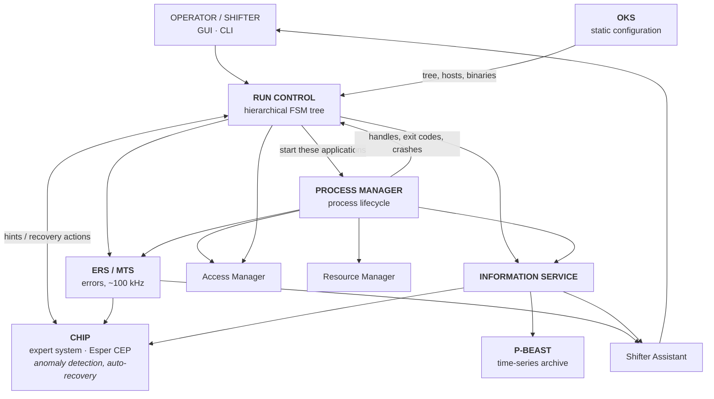
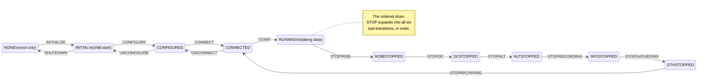
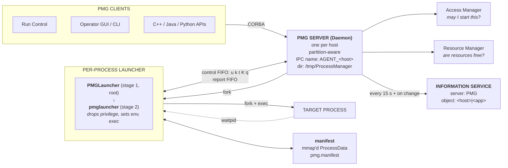
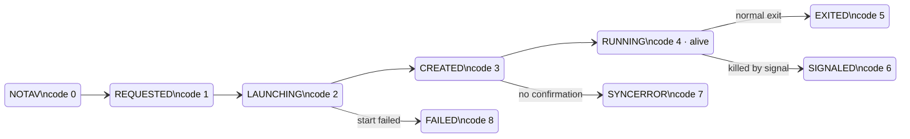
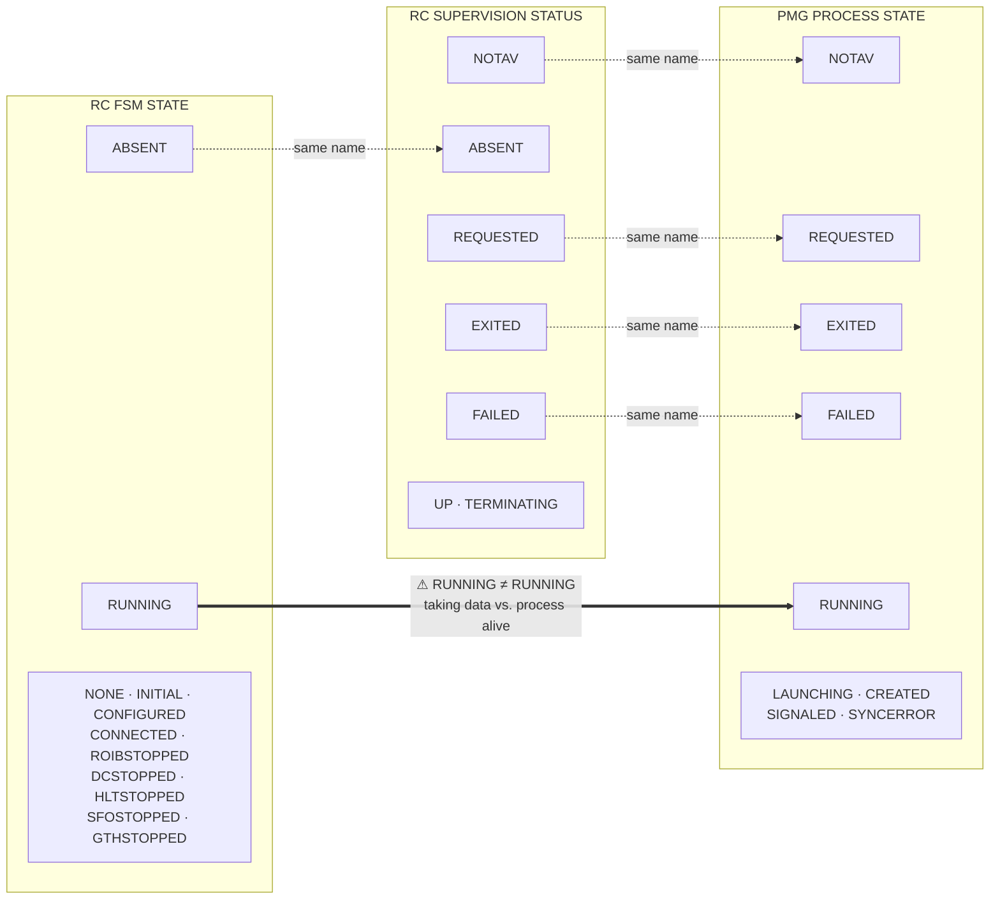
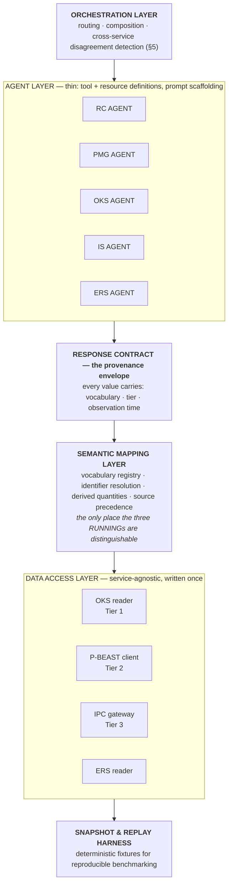

# Run Control and Process Management

**A complete working guide to the two ATLAS TDAQ services this track will wrap in LLM agents.**

Everything factual here is verified against the current source of the `RunControl` and `ProcessManager` repositories, cross-checked against the published literature where it exists. The repositories are Apache-2.0 and clone anonymously — no CERN credentials, no SSO, no Point 1 access:

```bash
git clone --depth 1 https://gitlab.cern.ch/atlas-tdaq-software/RunControl.git
git clone --depth 1 https://gitlab.cern.ch/atlas-tdaq-software/ProcessManager.git
```

> ### ⚠ Read this before anything else
>
> **Do not take the state model from the published papers.** Run Control was completely re-designed and re-implemented during Long Shutdown 1 (2013–2014) for LHC Run 2. The pre-2013 literature describes states — `BOOTED`, `READY`, `PAUSED` — and commands — `boot`, `pause`, `resume` — that **no longer exist**. Only three state names survive the rewrite.
>
> One specific trap: `prepareForRun` appears in old documentation as a *command*. In the current system it is the name of a **user-code callback**, invoked by the `START` transition. The command is `START`. Confusing the two produces an agent that offers a transition the system will reject.

---

## Contents

1. [Where these two services sit](#1-where-these-two-services-sit)
2. [The two services in one page](#2-the-two-services-in-one-page)
3. [Run Control](#3-run-control)
4. [Process Management](#4-process-management)
5. [How the two couple](#5-how-the-two-couple)
6. [The three-vocabulary trap](#6-the-three-vocabulary-trap)
7. [Where the data actually is](#7-where-the-data-actually-is)
8. [Building MCP agents on top](#8-building-mcp-agents-on-top)
9. [Source index and bibliography](#9-source-index-and-bibliography)

---

## 1. Where these two services sit

### 1.1 The scale of the problem

The numbers are what make this domain interesting, and they are worth having at hand when explaining the project to anyone:

| Quantity | Value |
|---|---|
| Machines in the TDAQ system | ~3,000 |
| Concurrent processes | >50,000 |
| Applications under control | >40,000 |
| Detector optical links | ~1,900 |
| Read-Out System servers | 102 |
| High-Level Trigger farm | ~2,000 nodes, up to 40,000 CPU cores |
| L1 trigger output rate | up to 100 kHz |
| HLT output rate | ~1 kHz average |
| Event data into the ROS | ~160 GB/s |
| Aggregate network throughput | >30 GB/s |
| Data logged to storage | ~1.5–3.2 GB/s |
| TDAQ software suite | 200+ packages, ~7,000 source files, >1.6 M lines |

Every one of those 40,000+ applications must start, run and stop **together**, without losing data or corrupting buffers. That is the problem Run Control and Process Management exist to solve.

### 1.2 The Control and Configuration service inventory

RC and PMG are two of about a dozen Control and Configuration (CC) services. The full set is worth knowing because the five-agent project touches several, and because operator questions cut across them:

| Service | Role |
|---|---|
| **Run Control (RC)** | Steers data taking; carries all elements through well-defined states |
| **Process Manager (PMG)** | Starts, supervises and terminates every TDAQ process |
| **Configuration Service (OKS)** | Static description of what should exist — the object persistence layer |
| **Information Service (IS)** | Shared publish/subscribe store for all operational state |
| **Error Reporting Service (ERS)** | Structured error and message reporting |
| **MTS** | Message Reporting and Transfer System — the transport layer under ERS; handles up to **100 kHz** of delivered messages |
| **CHIP** | Central Hint and Information Processor — the expert system, "the brain" of Run Control |
| **Shifter Assistant** | Complex-event-processing tool that alerts operators; 200+ expert-written directives |
| **Access Manager (AM)** | Per-user authorisation |
| **Resource Manager (RM)** | Prevents resource conflicts between applications |
| **Test Manager / DVS** | Functional verification and diagnostics of components |
| **IPC** | Inter-Process Communication — CORBA naming and transport |
| **P-BEAST** | Archives operational monitoring data long-term |
| **Run Number Service** | Allocates run numbers |
| **Logging Service, ELisA** | Log storage and the electronic logbook |



> **The project's competitive context, in one observation.** CHIP and Shifter Assistant already consume exactly the data streams an LLM agent would consume, and already take hundreds of automated recovery actions per physics run. The agents should **compose with these, not reimplement them**. The genuinely new capability is natural-language access and cross-service correlation on demand — not automated recovery, which is a solved and deployed problem here.

---

## 2. The two services in one page

| | **Run Control (RC)** | **Process Management (PMG)** |
|---|---|---|
| **Owns** | Logical state | Operating-system lifecycle |
| **Answers** | "Where is this component in the run?" | "Is this binary alive, and how is it behaving?" |
| **Shape** | Hierarchical tree running a finite state machine | Flat set of processes addressed by URL-style handles |
| **Unit** | A controller or controlled application | An OS process |
| **Identity** | Name in the IPC partition namespace | `pmg://host[:port]/partition/app/id` |
| **States** | 11 FSM states | 9 process states |
| **IS server** | `RunCtrl` (plus `RunParams`, `Setup`) | `PMG` |
| **IS cadence** | Event-driven, on status change | **Every 15 s**, plus on change |
| **Key question** | Is it taking data? | Is the process running? |

Those last two rows are the whole reason this pair is interesting — and the source of the trap in §6. **"Running" means something different in each service.**

Both publish everything they observe into the Information Service, which is why an agent can answer most questions without ever talking to either service directly.

---

## 3. Run Control

Run Control is the component that "steers the data acquisition by starting and stopping processes and by carrying all data-taking elements through well-defined states in a coherent way."

### 3.1 The control tree

- A **Root Controller** supervises the whole partition and takes commands from the operator GUI or external clients.
- **Segment Controllers** beneath it manage detector subsystems or functional groups, as defined by OKS segment definitions.
- **Leaf nodes** are controlled applications doing the real work — hardware configuration, buffer allocation, trigger unmasking, event processing.

Commands propagate **down**. A controller forwards a transition request to its children, waits for their asynchronous responses, aggregates the states they report, and only then updates its own. That aggregation is what makes command fan-out tractable across tens of thousands of nodes — and it means **a parent's state is a summary, not an observation.**

> ### The Root Controller runs a different state machine
>
> The FSM is a C++ template parameterised on its initial state, and only two initial states are legal: `NONE` for the Root Controller, `INITIAL` for every child controller and leaf application. The transition table is selected at compile time from that parameter, so a child's table **does not contain the NONE-state transitions at all** — they aren't guarded, they're absent.
>
> Practical consequence: `SHUTDOWN`, `INITIALIZE` and `RELOAD_DB` exist **only at the root**. "Which transitions are legal from here?" has different answers for the root and for a segment controller *in the same state*. An agent modelling one FSM for the whole tree will offer illegal transitions on the overwhelming majority of nodes.

The Root Controller additionally owns things no other node has: the master trigger, the run number, the detector mask, the SOR/EOR run parameters, and the ERS stream subscription. It also synchronises with CHIP whenever an FSM transition completes.

### 3.2 The finite state machine

Eleven states. This is the transition table as implemented:



Two structural points that surprise people:

- **Stopping is a six-step ordered drain, not one transition.** A partition mid-stop sits in a *named state*, not a vague "stopping".
- **The drain returns to `CONNECTED`**, not to `CONFIGURED`. A stopped run is one `START` away from running again — which is exactly what you want between luminosity blocks.

#### What the drain is actually draining

This is the part that makes the FSM make sense, and it's the best way to explain the system to someone new. Each drain step shuts down one stage of the physics dataflow, **in strict upstream-to-downstream order**, so that no stage is torn down while something upstream is still feeding it:

| Step | Transition | Stops | What that means physically |
|---|---|---|---|
| 1 | `STOPROIB` | Region-of-Interest Builder | Assembles RoI records from the L1 calorimeter, L1 muon, L1 topological and Central Trigger Processor. **Stopping it means triggers stop entering the system.** |
| 2 | `STOPDC` | Data Collection | The Data Collection Managers that pull event fragments from the 102 ROS servers. |
| 3 | `STOPHLT` | High-Level Trigger | The ~2,000-node, 40,000-core filtering farm. |
| 4 | `STOPRECORDING` | Sub-Farm Output | Event logging to the SFO's ~48 h temporary storage. **Recording to disk ceases here.** |
| 5 | `STOPGATHERING` | Gathering | Collection of remaining in-flight data. |
| 6 | `STOPARCHIVING` | Archiving | Final flush. Aliased as `EOR` — end of run. |

Reading it as a pipeline shutdown — *stop the tap, then drain each vessel in turn* — makes the six intermediate states obvious rather than arbitrary.

#### The eleven states

| # | State | Reachable by | Meaning |
|---|---|---|---|
| 0 | `ABSENT` | **never** | Default "no information" value. Never entered by a transition — treat as *unknown*, not as a condition. |
| 1 | `NONE` | Root only | Root Controller's initial state. Nothing created yet. |
| 2 | `INITIAL` | All nodes | Initial state of children and leaves. Process exists, nothing configured. |
| 3 | `CONFIGURED` | All nodes | Hardware and buffers configured; no inter-application connections yet. |
| 4 | `CONNECTED` | All nodes | Dataflow connections established, run not started. Also where a completed stop returns to. |
| 5 | `GTHSTOPPED` | Drain | Gathering stopped. |
| 6 | `SFOSTOPPED` | Drain | Recording to disk stopped. |
| 7 | `HLTSTOPPED` | Drain | High-Level Trigger stopped. |
| 8 | `DCSTOPPED` | Drain | Data Collection stopped. |
| 9 | `ROIBSTOPPED` | Drain | RoI Builder stopped; triggers no longer entering. |
| 10 | `RUNNING` | All nodes | **Taking data.** ⚠ Not the same as the PMG `RUNNING` — see §6. |

The string published to IS is identical to the enumerator name for all eleven — unlike PMG (§4.2). String matching is safe here.

The numeric order is deliberate and the source explicitly asks that it be preserved: it follows the run lifecycle, and the shortest-path routine that computes "how do I get from state A to state B" builds a Boost graph using the enumeration index as the vertex ID, then runs Dijkstra over it.

#### The commands

| Command | Kind | Effect |
|---|---|---|
| `INITIALIZE` | transition | `NONE → INITIAL`. Root only. |
| `CONFIGURE` | transition | `INITIAL → CONFIGURED` |
| `CONNECT` | transition | `CONFIGURED → CONNECTED` |
| `START` | transition | `CONNECTED → RUNNING`. Aliased `SOR`. |
| `STOPROIB` … `STOPARCHIVING` | transition | The six drain steps |
| `DISCONNECT` | transition | `CONNECTED → CONFIGURED` |
| `UNCONFIGURE` | transition | `CONFIGURED → INITIAL` |
| `SHUTDOWN` | transition | Any state → `NONE`. Root only. Legal even from within `NONE`, to interrupt an in-flight transition. |
| `CONFIG` | **multi-step** | `CONFIGURE` then `CONNECT` |
| `STOP` | **multi-step** | All six drain steps in order |
| `UNCONFIG` | **multi-step** | `DISCONNECT` then `UNCONFIGURE` |
| `RESYNCH` | in-state | Re-sync broadcast. Only in `RUNNING`. Carries the extended L1ID, not just the ECR counter. |
| `RELOAD_DB` | in-state | Reload configuration. Only in `NONE` — **deferred elsewhere, not rejected**. |
| `USERBROADCAST` | in-state | Run a user command and broadcast to children. Legal in every state. |
| `INIT_FSM`, `STOP_FSM`, `NEXT_TRANSITION`, `SUB_TRANSITION` | internal | Never operator-visible. |

> **Trap: `RELOAD_DB` is queued, not refused.**
> Outside `NONE` it goes into a *deferred queue holding exactly one event* — the FSM back-end uses a circular queue container sized specifically for this. "The command was accepted" can be true while nothing has happened, possibly indefinitely. Any honest answer must distinguish **accepted / deferred / applied**.

#### Transitions invoke named user hooks

Each transition dispatches to a virtual method on `daq::rc::Controllable`, which is the base class every controlled application implements. This mapping is where the old documentation's vocabulary went:

| Transition | User hook |
|---|---|
| `CONFIGURE` | `configure()` |
| `CONNECT` | `connect()` |
| `START` | **`prepareForRun()`** |
| `STOPROIB` | `stopROIB()` |
| `STOPDC` | `stopDC()` |
| `STOPHLT` | `stopHLT()` |
| `STOPRECORDING` | `stopRecording()` |
| `STOPGATHERING` | `stopGathering()` |
| `STOPARCHIVING` | `stopArchiving()` |
| `DISCONNECT` | `disconnect()` |
| `UNCONFIGURE` | `unconfigure()` |
| `RELOAD_DB` | `reloadDB()` |

Plus non-transition hooks: `publish()`, `publishFullStats()`, `user()`, `enable()`, `disable()`, `resynch()`, `subTransition()`, `onExit()`.

Note there is **no `boot()`** — what the old docs called "boot" is now process creation, delegated to PMG (§5).

### 3.3 Error and busy are not states

There is **no `ERROR` state** in the FSM. Error is carried alongside the state:

| Field | Meaning |
|---|---|
| `errorReasons` | List of strings. Empty = healthy. Non-empty = **in error while still occupying a normal FSM state.** This is the real answer to "what's broken?" |
| `badChildren` | Child names this node considers unhealthy. How error localises down the tree. |
| `busy` | Executing a command. |
| `transitioning` | Mid-transition — the reported state is stale by construction. |
| `fault` | The controller's *own* internal error, as distinct from a problem it's reporting about children. |
| `fullyInitialized` | Handshake with PMG complete. See §5. |

The refusal vocabulary confirms this from the other side. A rejected command reports one of four reasons — `BUSY`, `NOT_ALLOWED` (Access Manager), `IN_ERROR`, `UNEXPECTED`. Busy and in-error are *separate* causes, which they couldn't be if error were a state.

There is also an explicit `IGNORE_ERROR` command, and error can be injected externally via `setError` carrying a list of `{applicationName, errorDescription, errorType}` items.

> **Consequence: state must never be reported alone.** A node can be `RUNNING` with two entries in `errorReasons`. That's a normal and important condition, and reporting just `RUNNING` makes it invisible.

### 3.4 The non-FSM command set

Beyond FSM transitions there are sixteen operational commands. These matter for an agent because they define *what an operator can actually do*, and therefore what "what are my options?" should return:

| Command | Purpose |
|---|---|
| `STARTAPP` / `STOPAPP` / `RESTARTAPP` | Start, stop or restart named applications |
| `TESTAPP` | Run the DVS/Test Manager checks on applications |
| `ENABLE` / `DISABLE` | Change component membership in the running configuration |
| `IGNORE_ERROR` | Clear/ignore the current error condition |
| `DYN_RESTART` | Dynamic restart of segments |
| `PUBLISH` / `PUBLISHSTATS` | Force an IS publication now |
| `CHANGE_PROBE_INTERVAL` | Change the status publication interval |
| `CHANGE_FULLSTATS_INTERVAL` | Change the full-statistics interval |
| `USER` | Application-specific user command |
| `EXIT` | Terminate the application |
| `MAKE_TRANSITION` | Drive the FSM |
| `UPDATE_CHILD_STATUS` | Internal tree bookkeeping |

`STARTAPP`, `STOPAPP`, `RESTARTAPP`, `TESTAPP`, `ENABLE` and `DISABLE` accept **regular expressions** — a name ending in `//r` is treated as a regex, and one command can target many applications.

> **Note for the read-only scope.** Almost all of these are mutating. The two publication intervals are configured from OKS or the environment (`TDAQ_PROBE_INTERVAL`, `TDAQ_PUBLISHSTATISTICS_INTERVAL`), and per-segment action/exit timeouts come from the OKS segment definition — so the agent can *read* the cadence without issuing any command.

### 3.5 What Run Control publishes

RC writes into IS server `RunCtrl`, with a companion server `RunParams`:

| Object | IS class | Carries |
|---|---|---|
| `RunCtrl.<app>` | `RCStateInfo` | FSM state + full health record — **the primary RC agent source** |
| `RunCtrl.Supervision.<app>` | `DAQApplicationInfo` | RC's *view of the process* behind the application |
| `RunCtrl.TriggerState` | `TriggerStateNamed` | Trigger state (Root Controller) |
| `RunCtrl.LastStartTime` | — | Run start time (Root Controller) |
| `RunParams.RunParams` | `RunParamsNamed` | Current run parameters |
| `RunParams.SOR_RunParams` | `RunParamsNamed` | Start-of-run snapshot |
| `RunParams.EOR_RunParams` | `RunParamsNamed` | End-of-run snapshot |
| `RunParams.LumiBlock` | `LumiBlockNamed` | Luminosity block |
| `RunParams.TDAQ_DQ_Flags` | `RCDataQualityNamed` | Data-quality flags |

Also published: `ApplicationTestInfo` (DVS results) and `DAQApplicationInfo`. There is a third IS server, `Setup`.

**`RCStateInfo` attributes:**

`state` · `busy` · `transitioning` · `fault` · `errorReasons[]` · `badChildren[]` · `transitionTime` · `currentTransitionName` · `currentTransitionArgs[]` · `currentTransitionFull` · `lastTransitionName` · `lastTransitionArgs[]` · `lastTransitionFull` · `lastCmdName` · `lastCmdArgs[]` · `lastCmdFull` · `fullyInitialized` · `action_timeout` · `short_timeout`

**`DAQApplicationInfo` attributes:**

`applicationName` · `host` · `status` · `membership` · `restarting` · `notResponding` · `exitCode` · `exitSignal` · `parentName`

Three publisher behaviours worth knowing:

1. **`*Args` fields are omitted** when the argument list is just the command name repeated. An absent field means "no distinct arguments", not "no data".
2. **Out-of-order updates are dropped** by time tag, with an "Out of order IS update detected!" log line. IS holds latest-by-tag, not latest-by-arrival.
3. **Everything is published twice** — once to IS, once to CHIP (`daq::es::rc::StateInfo` and `daq::es::rc::ProcessInfo`), on separate thread pools. The `Destinations_t` flag selects `IS_SERVER`, `EXPERT_SYSTEM`, or both.

> `parentName` in `DAQApplicationInfo` is the cheapest way to reconstruct the entire control tree from IS alone, without touching OKS.

### 3.6 The CORBA interface

One operator-relevant interface: **`rc::commander`** — not `rc::controller`, which appears in older documentation. `Controllable` is a C++ base class and never appears on the wire.

| Method | | Purpose |
|---|---|---|
| `status(out)` | read | The node's own status |
| `childStatus(in, out)` | read | Status of one named child. Raises `UnknownChild` — a clean, typed "no such thing". |
| `makeTransition(sc, cmd)` | mutate | Drives the FSM |
| `executeCommand(sc, cmd)` | mutate | Non-transition commands |
| `setError(sc, errorItems)` | mutate | Injects error state |
| `updateChild(desc)` | mutate | Internal tree bookkeeping |

Every mutating call carries a `SenderContext` — `{userName, hostName, applicationId}` — which is how the Access Manager attributes actions to people. A second interface, `rc::sender`, provides a `commandExecuted` callback for asynchronous completion notification.

Both read methods return an **encoded string**, not a structure. It must be deserialised by the same command class that produced it. The decoded record carries application name, FSM state, `transitioning`, `busy`, `fullyInitialized`, an error-reason list, **and two timestamps**.

> ### 🛑 Trap: the two timestamps are not interchangeable
>
> One is an *information time tag*, one is *wall time*, both in nanoseconds. The source is explicit that the time tag **"may have no relationship at all with the clock time"** — it is a monotonic ordering token used to discard stale updates, not a clock reading. Only the wall time is a real timestamp.
>
> Render the time tag as a date and you get precise, plausible, entirely fictitious answers to "when did this happen" — the worst possible failure shape for a shifter-facing tool.

### 3.7 The error vocabulary

Run Control declares **70 distinct ERS issue types**. They are worth having because they are the structured, typed vocabulary an agent should map onto rather than parsing free text. Grouped by what they tell you:

| Group | Issues |
|---|---|
| **Command refusal** | `Busy` · `FSMBusy` · `InErrorState` · `NotAllowed` · `TransitionNotAllowed` · `OngoingTransition` · `BadCommand` · `InvalidState` · `InvalidStatus` |
| **Transition failure** | `TransitionFailed` · `TransitionTimeout` · `TransitionInterrupted` · `TransitionPropagationFailure` · `UserRoutineFailed` · `EventNotProcessed` · `FSMPathError` · `BadSubtransition` · `CompletedTransition` |
| **Application lifecycle** | `ApplicationExited` · `ApplicationSignaled` · `ApplicationLaunchFailure` · `ApplicationStartingFailure` · `ApplicationStopFailure` · `ApplicationRestartingFailure` · `ApplicationLookupFailure` · `ApplicationPingFailed` · `ApplicationReconnectionFailure` · `LeftoverKillingFailure` |
| **Tree health** | `BadChildren` · `ChildUpdateFailure` · `ParentUpdateFailure` · `UnknownChild` · `BadSegment` · `DependenciesFailure` · `DependencyCycle` |
| **PMG interaction** | `PMGError` · `PMGSystemError` · `BadPMGCallback` |
| **Infrastructure** | `CorbaException` · `IPCLookup` · `HostDisabled` · `BackupHostsDisabled` · `OnlineServicesFailure` · `DBReloadFailure` · `ConfigurationIssue` |
| **Run lifecycle** | `StartOfRun` · `EndOfRun` · `RunNumber` · `RunParams` · `MasterTriggerNotDefined` |

ERS severities are: `Debug`, `Log`, `Information`, `Warning`, `Error`, `Fatal`.

Note the presence of `ApplicationExited` and `ApplicationSignaled` as *distinct* RC-level issues — RC does receive the crash/clean-exit distinction from PMG even though its `DAQApplicationInfo.status` field collapses it (§6).

---

## 4. Process Management

Process Management "performs basic process control on behalf of the software components of the DAQ system... able to create, destroy and monitor the basic status of software components on the DAQ workstations and front-end processors."

### 4.1 Architecture



**The launcher is per-process, not per-host.** This is the most commonly mis-stated part of PMG's architecture. There is:

- **one PMG server (`Daemon`) per host** — it owns the partition table, the client list, the Access Manager and Resource Manager bridges, and an `IPCAlarm` that drives periodic IS updates;
- **one launcher process per managed process**, forked by the server, in two stages: `PMGLauncher` (stage 1, root-privileged) then `pmglauncher` (stage 2), which drops privilege to the target service account, sets the environment, and execs the binary.

Server and launcher communicate over two named FIFOs plus a memory-mapped **manifest** (`pmg.manifest`, signature `pmg`) holding the shared `ProcessData` structure. The control FIFO carries single-character commands:

| Code | Command |
|---|---|
| `u` | Update resource-usage statistics |
| `s` | Send a signal to the process |
| `t` | SIGTERM |
| `k` | SIGKILL |
| `K <timeout>` | SIGTERM, then SIGKILL if not exited within the timeout ("soft kill") |
| `q` | Quit — tells the launcher's control thread to exit |

**Supervision is event-driven, not polled.** The launcher blocks on `waitpid` and learns of an exit or crash immediately; a signal handler catches `SIGTERM`/`SIGINT` and writes to the report FIFO.

If the server restarts after a machine crash, it frees all local-host RM resources and rediscovers running launchers, restoring handle-to-PID mapping without disturbing active processes.

#### Hard timing constants

These come straight from source and are exactly what an agent's staleness model needs:

| Constant | Value | Meaning |
|---|---|---|
| `IS_UPDATE_PERIOD` | **15 s** | **IS publication cadence.** PMG data in IS is at most ~15 s stale. |
| `LAUNCHER_TIMEOUT` | 5 s | Launcher start timeout |
| `APP_NOTAV_STATE_TIMEOUT` | 120 s | How long a process may sit in `NOTAV` |
| `IPC_READY_PERIOD` | 20 s | IPC readiness poll (long variant: 3600 s) |
| `SINGLETON_SERVER_QUERY_PERIOD` | 10 s | Singleton server query |
| `FIFO_SELECT_PERIOD` | 120 s | FIFO select timeout |
| `AM_MAX_RETRY` | 3 | Access Manager retry count |

Metrics are read from `/proc/<pid>/stat` and `/proc/<pid>/statm`. The server port is recorded in `/com/pmg_port`.

### 4.2 The process lifecycle



| Code | State | **Published string** | Meaning |
|---|---|---|---|
| 0 | `NOTAV` | `"not defined"` | No information available |
| 1 | `REQUESTED` | `"requested"` | Start has been requested |
| 2 | `LAUNCHING` | `"launching"` | Launcher started, binary not yet exec'd |
| 3 | `CREATED` | `"created"` | `System::Process` object created |
| 4 | `RUNNING` | `"running"` | **Process is alive.** Says nothing about data taking. ⚠ §6 |
| 5 | `EXITED` | `"exited"` | Exited normally; `exit` holds the code |
| 6 | `SIGNALED` | `"signaled"` | Killed by a signal — **this is the crash case** |
| 7 | `SYNCERROR` | `"sync error"` | Confirmation timeout elapsed |
| 8 | `FAILED` | `"failure"` | Failed to start at all |

> ### ⚠ Trap: the published string is not the enumerator name
>
> `NOTAV` → `"not defined"`. `SYNCERROR` → `"sync error"` (with a space). `FAILED` → `"failure"` (a different word). Filtering IS on the `state` string using enumerator names silently returns **empty results for exactly the failure conditions you most need to find.**
>
> Filter on the numeric `state_code`; use the string only for display.

> **`SYNCERROR` is the state most likely to mislead.** It means the process failed to create its sync file within the timeout — so PMG's record and reality may disagree, and the process may well be alive. Report it as *"PMG cannot confirm this process"*, never as *"the process is down"*.

### 4.3 The PMG Handle

```
handle ::= "pmg://" host [ ":" port ] "/" partition "/" application "/" id

host        ::= fully-qualified host name     // non-empty
port        ::= integer                       // omitted when 0 (the default)
partition   ::= partition name                // non-empty
application ::= OKS application name          // non-empty
id          ::= integer                       // disambiguates reuse of the same app name

pmg://pc-tdq-onl-42.cern.ch/ATLAS/TileCal-RCD/17
pmg://pc-tdq-onl-42.cern.ch:9876/ATLAS/TileCal-RCD/17
```

Three things a parser must get right:

1. **The port belongs to the host field** and is split off *after* tokenising on `/`. A naive `/` split leaves `host:port` as the host, which matches nothing.
2. **The port is suppressed on output when it is 0**, so the same process can be described by two different handle strings. Handle equality must be **structural, not textual**.
3. All four of host, partition, application and id are rejected if empty — raising `Invalid_Handle`, a well-defined validation error an agent can turn into a refusal.

> **The `id` field is why every PMG answer needs a timestamp.** It exists to disambiguate multiple processes with the same application name in the same partition — across restarts and across runs. So *"TileCal-RCD is running"* is not answerable. *"`pmg://…/TileCal-RCD/17` was running as of 03:14:22"* is.

### 4.4 What Process Management publishes

The IS schema **ships in the repository** as an OKS schema file, fully attributed and described — no live partition needed to build against it.

**IS naming:** server `PMG`, object `<host>|<application_name>` — the separator is a literal pipe. So the full IS name is `PMG.<host>|<app>`.

**`PMGPublishedProcessData`** (44 attributes):

| Group | Attributes |
|---|---|
| **Identity** | `handle` `pid` `partition` `host` `app_name` `app_id` `user_name` `host_requesting` |
| **State** | `state` `state_code` `exit` `signal` `error_msg` |
| **Timing** | `start` `stop` — both **strings**, not typed times |
| **Execution** | `executable` `arguments` `environment` `workingdir` `library_paths` `std_out` `std_err` `std_in` |
| **CPU** | `utime` `stime` `cutime` `cstime` `num_threads` (ms) |
| **Memory** | `size` `resident` `share` `text` `data` `rsslim` (kB) |
| **Faults/swap** | `minflt` `cminflt` `majflt` `cmajflt` `nswap` `cnswap` |
| **Scheduling** | `token` (Resource Manager) |

**`PMGPublishedAgentData`** carries per-*host* and per-agent data: `totalram` `freeram` `sharedram` `bufferram` `cachedram` `ram%` `totalswap` `freeswap` `swap%` `nCPU` `procs` `fs` `load1` `load5` `load15`, plus the agent process's own `utime` `stime` `size` `resident` `num_threads`. Host-scoped attributes are marked `(GLOBAL)` in the schema — **don't report host load as agent load.**

> ### 🛑 Two traps in the metrics
>
> **Cumulative counters.** `utime`, `stime` and the fault counters are monotonically increasing totals since process start. "How did CPU behave over the last hour" requires **differencing two samples**. Reporting the raw value answers a different question, in units an operator will misread as recent activity.
>
> **Metrics freeze on exit.** Low-level `/proc` data is only refreshed while the process is in `RUNNING` state. For an exited or crashed process, the memory and CPU figures in IS are the **last values seen while it was alive** — which is often exactly what you want for a post-mortem, but must be labelled as such rather than presented as current.

### 4.5 The server interface

| Method | | Purpose |
|---|---|---|
| `alive()` | read | Server liveness probe |
| `exists(handle)` | read | Does this process exist |
| `lookup(app, partition)` | read | Application name → handle |
| `processes(partition)` | read | Handles in a partition |
| `processes_info(partition)` | read | Full status for a partition |
| `all_processes()` | read | Every handle, all partitions |
| `all_processes_info()` | read | Full status everywhere — **the heaviest call** |
| `get_info(handle)` | read | Full status for one process |
| `agentInfo()` | read | Host load, RAM, swap |
| `procFiles(name, maxSize)` | read | stdout/stderr — **unbounded untrusted text** |
| `link_client(...)` | subscribe | Status callbacks — **creates server-side state** |
| `request_start` / `really_start` | mutate | Two-phase process start |
| `signal` / `stop` / `kill` / `kill_soft` | mutate | Signal or terminate |
| `kill_partition` / `kill_all` | mutate | Mass termination |
| `exit()` | mutate | Shut down the server |

Every mutating call carries `userCredentials` and `hostName` for Access Manager attribution. The `ProcessStatusInfo` structure returned by the read calls contains: `state`, `failure_str`, `failure_str_hr` (a human-readable variant), `start_time`, `stop_time`, `start_info`, `resource_usage`, `info`, `out_is_available`, `err_is_available`.

Clients may connect **linked** (callbacks fire on process status change) or **unlinked** (simple request/response).

> Two calls fit neither "read" nor "mutate" cleanly: `link_client` changes nothing an operator would call state but consumes server resources and persists after the query; `procFiles` is read-only but pipes arbitrary production output into a model's context. Worth a four-way classification — **read / read-heavy / subscribe / mutate** — rather than a binary flag.

### 4.6 The error vocabulary

PMG declares around 48 ERS issue types. The operationally meaningful groups:

| Group | Issues |
|---|---|
| **Authorisation** | `AM_Not_Allowed` · `Signal_Not_Allowed` · `Bad_User_Name` |
| **Resources** | `No_RM_Resources` · `RM_Resources_NotFreed` |
| **Start failure** | `Failed_Start` · `Launch_Process_Failed` · `Binary_Not_Found` · `Failed_Start_Thread` |
| **Launcher health** | `Launcher_Not_Running` · `Launcher_Timeout` · `Launcher_FIFO_Error` · `Launcher_Signal_Failed` · `Launcher_Update_State_Error` |
| **Lookup** | `Failed_Lookup` · `Failed_Multiple_Lookup` · `Application_NotFound_Invalid` · `Process_Not_Found` · `Process_Already_Exited` |
| **Server health** | `No_PMG_Server` · `Bad_PMG_Server` · `No_Agents` · `Internal_Server_Error` · `Server_Internal_Error` · `IPC_Port_Error` · `Reconnection_Error` · `Invalid_CORBA_Ref` |
| **IS publication** | `Failed_Create_IS` · `Failed_Publish_IS` · `Failed_Remove_IS` · `Failed_Collect_Info` |
| **Manifest / FIFO** | `Manifest_Not_Mapped` · `Manifest_Not_Unmapped` · `Application_Manifest_Already_Unmapped` · `FIFO_Error` |
| **Identity** | `Invalid_Handle` |

The IDL additionally defines a typed `SignalException` enum: `NOT_ALLOWED_BY_AM`, `APPLICATION_NOTFOUND_INVALID`, `MANIFEST_UNMAPPED`, `LAUNCHER_NOT_RUNNING`, `FIFO_ERROR`, `UNEXPECTED`, `UNKNOWN`.

### 4.7 Authorisation and resources

Before any process starts, the server makes two checks:

- **Access Manager** (`AMBridge`) — `allowStart()` and `allowSignal(signal)`. Authorisation is per-user and per-signal, retried up to three times.
- **Resource Manager** (`RMBridge`) — `reserve_resources()` returns a token, recorded in the IS `token` attribute. Resources are freed by token, by handle+PID, or by PID; `freeLocalHostResources()` handles the machine-crash recovery case.

> **This is the constraint that shapes deployment.** Authorisation is enforced **per caller** at both services. A gateway process authenticating as a single service account collapses every operator into one identity and erases the accountability the Access Manager exists to provide. It needs settling with the operations group early, because it bounds what a deployed agent is allowed to do — and it applies to reads, not just writes.

---

## 5. How the two couple

They are distinct services but tightly coupled during a run.

**On boot:** the Root Controller queries OKS for applications and host assignments → delegates process creation to PMG → receives PMG Handles. As each application initialises it registers its CORBA servant with the IPC directory; the parent RC node locates it, binds it into the tree, and advances it out of `INITIAL`.

**On failure:** an unhandled segfault → the local launcher detects termination via `waitpid` → the PMG server raises an ERS alert → the parent RC node marks the child bad, sets its busy flag, and halts trigger distribution across the partition to prevent collecting corrupted data.

**The join key is `fullyInitialized`** — documented in source as "the application has already done the PMG synch". This is what connects the two state models.

```mermaid
sequenceDiagram
    participant OKS
    participant RC as Root Controller
    participant PMG as PMG Server
    participant L as Launcher
    participant A as Application
    participant IS

    RC->>OKS: which applications, on which hosts?
    OKS-->>RC: segment tree + host assignment
    RC->>PMG: request_start(app, host)
    PMG->>PMG: AM: allowStart? RM: reserve?
    PMG->>L: fork launcher
    L->>A: fork + exec (privilege dropped)
    PMG-->>RC: PMG Handle
    A->>IS: register CORBA servant (IPC)
    RC->>A: locate + bind into tree
    RC->>RC: fullyInitialized = true
    Note over RC,A: INITIAL reached — PMG synch complete

    rect rgba(200,80,80,0.12)
    A--xL: SIGSEGV
    L->>PMG: waitpid → SIGNALED + signal
    PMG->>IS: state = "signaled"
    PMG-->>RC: status callback (linked client)
    RC->>RC: badChildren += app; busy = true
    RC->>IS: errorReasons populated
    end
```

> ### The diagnostic neither service can make alone
>
> A node reports FSM state `INITIAL` with `fullyInitialized = false`, while PMG reports its process as `RUNNING` with a healthy resident set.
>
> Neither service alone explains this. Together they do: **the process is alive and consuming memory, but Run Control never completed its handshake with it.** That's a hung startup, not a crash — and the remedy is completely different.
>
> This is the concrete form of *"why did TileCal stop?"*, and it is the case an orchestration layer exists for: not merging two answers, but **detecting that two sources disagree and reporting the disagreement as the finding.**

Two more couplings worth knowing:

- **RC's supervision status is derived from PMG, not observed independently.** `DAQApplicationInfo.status`, `exitCode` and `exitSignal` are RC's *cached copy* of what PMG told it, delivered through the linked-client callback. When they disagree, **PMG is authoritative and RC is stale.**
- **The Access Manager sits on both paths.** RC refuses with `NOT_ALLOWED`; PMG with `NOT_ALLOWED_BY_AM`. Same underlying service, two vocabularies.

---

## 6. The three-vocabulary trap

**This is the single most important thing to understand about the pair, and it has no fix at the agent layer.**

RC and PMG do not share one notion of what a component is doing. There are **three** state vocabularies, and they overlap by name while differing in meaning:

1. **RC FSM state** — 11 values, in `RCStateInfo.state`. *Where a node sits in the run lifecycle.*
2. **RC supervision status** — 7 values (`NOTAV`, `ABSENT`, `REQUESTED`, `UP`, `TERMINATING`, `EXITED`, `FAILED`), in `DAQApplicationInfo.status`. *RC's belief about the process.*
3. **PMG process state** — 9 values, in `PMGPublishedProcessData.state`. *What PMG observes of the OS process.*



| Token | RC FSM | RC supervision | PMG | Risk if conflated |
|---|---|---|---|---|
| `RUNNING` | Taking data | — (uses `UP`) | Process alive | **SEVERE** — a partition can be fully `RUNNING` in PMG terms, every process healthy, and taking **no data at all**. |
| `ABSENT` | Default — means "unknown" | No longer running, cause undetermined | — | **SEVERE** — "we have no data" vs. "it died and we don't know why". Opposite implications for the shifter. |
| `NOTAV` | — | Initial, or PMG unreachable | No information | *moderate* — RC's may specifically mean PMG is unreachable, itself a reportable fault. |
| `REQUESTED` | — | RC asked PMG to start it | PMG received the request | low — two ends of one handshake. Divergence between them is itself diagnostic. |
| `EXITED` | — | RC observed the exit | Exited normally, with a code | *moderate* — RC's does **not** distinguish clean exit from crash; PMG splits `EXITED` / `SIGNALED`. Answering from RC loses the crash signal. |
| `FAILED` | — | Failed to start | Failed to start | low — aligned in meaning. Note PMG publishes it as `"failure"`. |

> ### Why this cannot be fixed with a system prompt
>
> - **It is a retrieval problem before it is a generation problem.** By the time text reaches the model, a tool has already returned `state: "RUNNING"`. The ambiguity is *in the data* — no prompting recovers a distinction the payload never carried.
> - **It multiplies across agents.** Five agents means five prompts to keep synchronised against a schema none of them own. The first divergence gives two agents different answers to the same question.
> - **It cannot be tested.** A prompt-level convention is not unit-testable. A typed mapping layer is.
>
> **The fix is structural: every state value must be typed by its vocabulary before it reaches the model** — `rc.fsm:RUNNING` and `pmg.process:RUNNING` as distinct values that cannot compare equal.

---

## 7. Where the data actually is

Three access paths, very different in cost and reach:

| | Source | Answers | Needs |
|---|---|---|---|
| **Tier 1** | **OKS** (static config) | Controller tree, segment membership, host assignment, binaries, arguments, timeouts | A release + OKS files. **No running partition.** |
| **Tier 2** | **P-BEAST** (archive) | State at a past time, state history, memory/CPU across a run, crash history | Credentials. HTTPS/REST or CORBA. Works outside Point 1. |
| **Tier 3** | **IPC / CORBA** (live) | Current FSM state, busy flag, live process status | A gateway process **inside** a partition. Bounded by Point 1 segregation. |

Most operator questions resolve at **Tier 1 or Tier 2**. Tier 3 is only needed for genuinely present-tense questions — so build Tiers 1 and 2 first and defer the hardest access problem.

### What is known about P-BEAST

| Fact | Value |
|---|---|
| Purpose | Archives operational monitoring information for later analysis |
| Storage | Google Protocol Buffers for persistence; time-series database |
| Interfaces | **REST** (via libmicrohttpd) and **CORBA**; C++, Python and Java APIs |
| Ingest rate | Up to **500,000 attributes/second** during data taking; ~200 kHz average update rate over Run 2 |
| Volume | ~20 TB/year of compacted, compressed data |
| Retention | Stores raw operational monitoring data **for the lifetime of the experiment** |
| Visualisation | Grafana-based dashboard |
| Coverage | "Most of the Run 2 operational data"; "an important fraction of operational data" |

> ### The one thing to verify before building on Tier 2
>
> The literature is consistent that P-BEAST archives *an important fraction* / *most* of the operational data — never *all* of it. Whether `RCStateInfo` and `PMGPublishedProcessData` are specifically in that fraction is **not documented anywhere public**, and it decides whether Tier 2 delivers the RC/PMG state-history capability at all.
>
> Make a class-by-class coverage check the **first query** run once credentials exist. If `RCStateInfo` history is not archived, "when did this last change state" moves from Tier 2 to Tier 3, and the whole build sequencing changes.

Also relevant: as of tdaq-11-02-00, P-BEAST dropped its dependency on the obsolete CERN IT authentication and supports proxy Kerberos for access from the general-purpose network — which is good news for reaching it from a development environment.

---

## 8. Building MCP agents on top

### 8.1 The layered pattern

The five agents are not five independent integrations. They sit on a common stack, and **everything that could diverge between two agents answering the same question lives below the contract boundary and is written once.**



The **semantic mapping layer** is load-bearing, not a convenience. It owns:

- **the vocabulary registry** — per vocabulary: token set, published string, numeric code, one-line meaning, known collisions
- **identifier resolution** — free text → typed identifier (PMG handle, controller name, segment)
- **derived quantities** — differencing cumulative counters, parsing the string `start`/`stop` times, once and identically for everyone
- **source precedence** — PMG beats RC's cached copy when they disagree (§5)
- **staleness rules** — PMG IS data is ≤15 s old; RC IS data is event-driven; both carry a monotonic tag that is not a clock

Isolating this means a schema change touches one module rather than five agents.

> **The IPC gateway must be a separate process inside the TDAQ environment.** External runtimes must not link the C++ CORBA or OKS libraries directly — the memory-management and ABI constraints make that fragile. Translate JSON to CORBA in a small in-partition process using the native Python bindings, and keep everything above it language-agnostic.

### 8.2 A small generic tool surface

Do not hand-write a tool per operation per service. Because RC state and PMG status are both IS objects differing only by class, **one lookup surface serves both**:

| Tool | | Purpose |
|---|---|---|
| `find_objects` | generic | Objects by IS class + name pattern. Underlies every "which things are…" question. |
| `get_object` | generic | All attributes of one named object |
| `get_history` | generic | Attribute over a time range (Tier 2) |
| `describe_class` | generic | Schema introspection — reaches data not anticipated at design time |
| `resolve_identifier` | generic | Free text → typed identifier. **The gate on every other tool.** |
| `rc_node_health` | wrapper | state + transitioning + busy + fault + errorReasons + badChildren, one call |
| `rc_subtree` | wrapper | Tree beneath a node, own vs. aggregated state kept distinct |
| `pmg_process_report` | wrapper | Identity + state + exit cause + **differenced** metrics for one handle |

Fewer tools means less drift under schema change. Expose **OKS configuration as MCP resources, not tools** — it is static and addressable, which is what resources are for.

**Scope: read-only.** No transitions, no signalling, no spawning. But classify every tool as `read` / `read-heavy` / `subscribe` / `mutate` **from the start**, so a future mutation-capable version does not require restructuring.

> One design problem worth naming now: **MCP has no native long-running-job model.** That is fine for a read-only system, but any later work involving transitions — which take minutes to complete across thousands of nodes — will hit it squarely.

### 8.3 The provenance envelope

This is the mechanism that makes the §6 collision structurally unrepresentable. **No value reaches the model bare.**

```jsonc
// PMG agent answering: "is TileCal-RCD running?"
{
  "identifier": {
    "kind":   "pmg.handle",
    "value":  "pmg://pc-tdq-onl-42.cern.ch/ATLAS/TileCal-RCD/17",
    "resolved_from": "TileCal-RCD"             // what the operator said
  },
  "values": [
    {
      "field":       "process_state",
      "vocabulary":  "pmg.process",            // cannot compare to rc.fsm
      "value":       "RUNNING",
      "code":        4,                        // filter on this, not the string
      "display":     "running",                // the published string (§4.2)
      "means":       "the OS process is alive", // never "taking data"
      "tier":        2,
      "observed_at": "2026-08-21T03:14:22.881Z", // wall clock, not the time tag
      "age_s":       41.2,
      "max_staleness_s": 15                    // PMG IS cadence (§4.1)
    },
    {
      "field":     "cpu_utime_delta_ms",
      "value":     18422,
      "derived":   "difference of cumulative counter over window",
      "window_s":  300,                        // §4.4 — never report raw
      "tier":      2
    }
  ],
  "not_answered": [
    { "question": "is it taking data?",
      "why": "requires rc.fsm vocabulary — route to the RC agent" }
  ]
}
```

| Field | What it buys |
|---|---|
| `vocabulary` + `means` | The model **cannot** say "TileCal is running" unqualified, because the payload never contained an unqualified `RUNNING`. |
| `code` alongside `display` | Encodes the §4.2 string/enumerator divergence once, so no agent filters on the wrong one. |
| `tier` + `observed_at` + `age_s` + `max_staleness_s` | Every answer is self-dating against a known publication cadence. Staleness is visible rather than inferred. |
| `not_answered` | Turns calibrated refusal from a prompt-level hope into a **schema-level obligation** — and gives the orchestrator a machine-readable routing signal. |

### 8.4 Two things to build early

**The collision test.** For every pair of vocabularies, assert that no bare token from one can compare equal to a token from the other, and that every colliding name has a distinct `means` string. Seed it with the six collisions in §6. A new service that introduces a seventh collision then *fails the build* rather than shipping an ambiguity.

**The replay harness.** Output consistency cannot be measured against a live system — the system changes between invocations and agent nondeterminism becomes inseparable from infrastructure drift. Worse, RC's publisher *discards out-of-order updates*, so the observable IS record depends on arrival ordering the agent cannot control.

A fixture must capture: the OKS configuration in force; every relevant IS object with all attributes; **both** the monotonic time tag and the wall time of each record; the tier each value came from; and the **vocabulary registry version** at capture. (A fixture captured under one registry and replayed under another silently tests the wrong thing — and the failure looks like agent nondeterminism.)

Build it in WP2, not at WP4. It is substantially cheaper early, and — since testing against live Point 1 is prohibited — reproducible benchmarking against captured production state is the only defensible evaluation story available.

---

## 9. Source index and bibliography

### 9.1 Primary source — every claim above is re-checkable

| Claim | Repo | Path |
|---|---|---|
| FSM states, enumeration order | RunControl | `RunControl/FSM/FSMStates.h` |
| FSM state published strings | RunControl | `src/FSM/FSMStates.cxx` |
| FSM commands, multi-step semantics | RunControl | `RunControl/FSM/FSMCommands.h` |
| Command strings, EOR/SOR aliases | RunControl | `src/FSM/FSMCommands.cxx` |
| Transition table: CONFIGURED→RUNNING, drain chain | RunControl | `RunControl/FSM/Details/FSMActive.h` |
| Transition table: NONE/INITIAL, root-only commands, RELOAD_DB deferral | RunControl | `RunControl/FSM/Details/FSMInitial.h` |
| Transition → user-hook map, sub-transitions, chained transitions | RunControl | `RunControl/FSM/Details/FSMInternals.h` |
| Dijkstra path-finding over states | RunControl | `RunControl/FSM/Details/FSMGraph.h` |
| `Controllable` user API (`prepareForRun` etc.) | RunControl | `RunControl/Common/Controllable.h` |
| Status record fields; the two time semantics | RunControl | `RunControl/Common/RunControlCommands.h` |
| The 16 non-FSM command names | RunControl | `src/Common/RunControlCommands.cxx` |
| Full client command API | RunControl | `RunControl/Common/CommandSender.h` |
| IS server names (`RunCtrl`, `Supervision`, `Setup`, `RunParams`) | RunControl | `RunControl/Common/Constants.h` |
| `RCStateInfo` / `DAQApplicationInfo` attributes, naming, out-of-order drop, CHIP dual publication | RunControl | `src/Controller/InformationPublisher.cxx` |
| `TriggerState`, `LastStartTime`, ERS stream `mts`, `TDAQ_DB_VERSION` | RunControl | `src/Controller/Root/RootController.cxx` |
| `RunParams.*` object names, run number, detector mask | RunControl | `src/Controller/Root/RunParameters.cxx` |
| Supervision status vocabulary | RunControl | `RunControl/Controller/ApplicationSupervisorInfo.h` |
| Publication interval env vars, segment timeouts | RunControl | `src/Controller/RunControlApplication.cxx`, `ControllerApplication.cxx` |
| 70 ERS issue types | RunControl | `RunControl/Common/Exceptions.h` |
| `rc::commander`, `FailureReason`, `ErrorItem`, `SenderContext` | RunControl | `idl/rc.idl` |
| PMG process states, codes, published strings, `AGENT_` prefix | ProcessManager | `ProcessManager/defs.h` |
| Timing constants, FIFO codes, `/proc` paths, IS separator | ProcessManager | `ProcessManager/private_defs.h` |
| Handle grammar, optional port, validation | ProcessManager | `src/lib/Handle.cxx` |
| Handle field semantics; the disambiguating id | ProcessManager | `ProcessManager/Handle.h` |
| Server (Daemon) responsibilities, AM/RM sequencing | ProcessManager | `ProcessManager/Daemon.h` |
| Launcher two-stage fork, FIFOs, signal handling, sync loop | ProcessManager | `ProcessManager/Launcher.h` |
| Manifest memory map, filenames | ProcessManager | `ProcessManager/Manifest.h`, `src/libcore/Manifest.cxx` |
| Access Manager bridge | ProcessManager | `ProcessManager/AMBridge.h` |
| Resource Manager bridge | ProcessManager | `ProcessManager/RMBridge.h` |
| IS publication naming, RUNNING-only metric refresh | ProcessManager | `src/daemon/Application.cxx`, `src/daemon/ISBridge.cxx` |
| PMG ERS issue types | ProcessManager | `ProcessManager/Exceptions.h` |
| Server interface, exceptions | ProcessManager | `idl/pmgpriv/pmgpriv.idl` |
| `ProcessStatusInfo`, `AgentInfo`, `ProcessState` | ProcessManager | `idl/pmgpub/pmgpub.idl` |
| IS schemas | ProcessManager | `data/pmg_is_info.xml` |
| Release history, `daq tokens`, regex commands, CHIP sync | both | `doc/RELEASE_NOTES.md` |

### 9.2 Published literature

Use these for **context and scale**, not for the state model.

- ["The Controls and Configuration software of the ATLAS Data Acquisition System"](https://inspirehep.net/files/4e321dbd92144d58e81e10200ade63d1) — ACAT 2019, *J. Phys. Conf. Ser.* **1525** 012036. The single most useful paper: CC architecture, RC/CHIP redesign rationale, MTS, Resource Manager, P-BEAST. Open access.
- ["The ATLAS Data Acquisition System in LHC Run 2"](https://ceur-ws.org/Vol-2023/46-52-paper-7.pdf) — NEC'2017. Dataflow components (ROS, RoIB, DCM, SFO) and all the scale numbers in §1.1. **Read this to understand what the drain chain drains.** Open access.
- ["The Controls and Configuration Software of the ATLAS Data Acquisition System: evolution towards LHC Run 3"](https://www.epj-conferences.org/articles/epjconf/abs/2021/05/epjconf_chep2021_04019/epjconf_chep2021_04019.html) — CHEP 2021, *EPJ Web Conf.* **251** 04019.
- ["The Process Manager in the ATLAS DAQ System"](https://ieeexplore.ieee.org/document/4382744) — IEEE RT 2007. The only dedicated PMG paper. Predates the current implementation; treat structurally, not literally.
- ["Process Management Inside ATLAS DAQ"](https://ui.adsabs.harvard.edu/abs/2002ITNS...49.2459A/abstract) — *IEEE Trans. Nucl. Sci.* **49** 2459 (2002). Historical.
- ["A Persistent Back-End for the ATLAS TDAQ On-line Information Service (P-BEAST)"](https://cds.cern.ch/record/1402973) — the original P-BEAST paper.
- ["ATLAS Operational Monitoring Data Archival and Visualization"](https://www.epj-conferences.org/articles/epjconf/abs/2020/21/epjconf_chep2020_01020/epjconf_chep2020_01020.html) — CHEP 2019. Current P-BEAST rates, volumes and Grafana.
- ["Experience with Shifter Assistant"](https://cds.cern.ch/record/2648925) — CHEP 2018, *EPJ Web Conf.* **214** 01028. The CEP tool, its 200+ directives, and what "operator assistance" already means here.
- ["The AAL project: automated monitoring and intelligent analysis for the ATLAS data taking infrastructure"](https://www.semanticscholar.org/paper/ef57522368179e7d3c42e1ed4ffb29b4ba63fb2f) — origin of the Shifter Assistant work.
- ["Supervision of the ATLAS High Level Trigger System"](https://arxiv.org/pdf/hep-ex/0305093) — CHEP 2003. The clearest statement of the *hierarchical* control principle, though its FSM and its `DSA_Supervisor` are both obsolete.
- ["Verification and Diagnostics Framework in ATLAS Trigger/DAQ"](https://arxiv.org/pdf/hep-ex/0305106) — CHEP 2003. Background for DVS / Test Manager and the `TESTAPP` command.
- [ATLAS HLT/DAQ/DCS Technical Design Report](https://www.idiap.ch/~aanjos/papers/cern-tdaq-tdr-2003.pdf) — CERN-LHCC-2003-022. The foundational document; architectural intent only.
- [TDAQ release notes](https://atlas-tdaq-sw-releases.web.cern.ch/release-notes/) — **treat as the current source of truth for anything release-specific.** tdaq-11-02-00 (Dec 2023) targets `x86_64-el9-gcc13-opt`.

### 9.3 A note on terminology

Recent documentation uses *session* and *partition* interchangeably. Both services use **`partition`** consistently throughout their current source — in the handle grammar, the IS schemas, the IDL and the internal APIs. Standardise on *partition* for this track and record the equivalence once in the vocabulary registry rather than in each agent.
