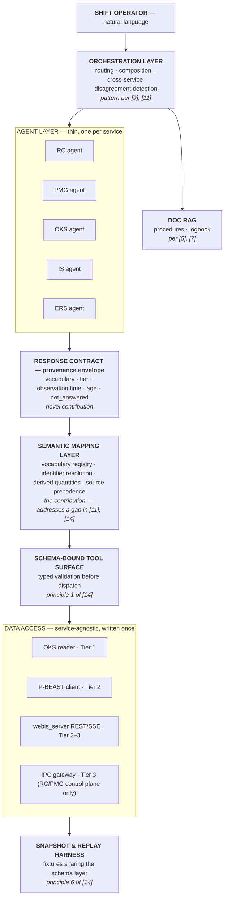
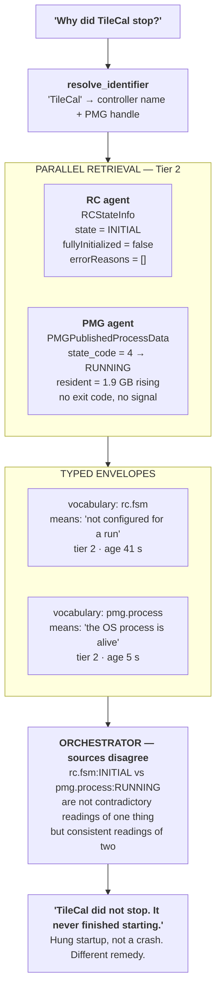

# Agentic Architectures for LLM Agents over Live Scientific Control Infrastructure

**A literature review, state-of-the-art assessment, and proposed MCP framework for the ATLAS TDAQ DAQ-agent project**

Work Package DAQ-WP2 · Preparatory literature review
Citation format: IEEE · Language: English

---

## Abstract

Large language model agents have moved from research demonstrations to deployed operational tools in scientific facilities within roughly three years. This review surveys the state of the art across four areas relevant to building agents over the ATLAS Trigger and Data Acquisition (TDAQ) system: agent architectures and orchestration patterns; deployed agents on scientific and control infrastructure; tool-protocol design, with emphasis on the Model Context Protocol; and evaluation, reliability, and abstention. Twenty-one sources were screened and annotated.

Three findings shape the project's positioning. First, the adjacent space is more crowded than the project's working documents assume: a ReAct-based operator assistant has been deployed at DESY since 2024, a multi-agent orchestrator for CMS operations was published in 2026, and a CERN-wide AI assistant effort for ATLAS operations was presented in September 2025. Second, the design principles independently proposed for MCP control of scientific instruments converge closely on those derived from first-principles analysis of TDAQ in WP1, which raises confidence in the approach while reducing its claim to originality. Third, one problem identified in WP1 does not appear anywhere in the surveyed literature: the collision of state vocabularies across services that share token names but not meanings. This is proposed as the project's principal contribution.

The review closes with a proposed MCP framework grounded in both the literature and the WP1 service studies, a concrete demonstration architecture that can be built and evaluated without Point 1 access, and an evaluation design addressing the reliability dimensions the literature identifies as unsolved.

**Keywords:** LLM agents; Model Context Protocol; scientific control systems; trigger and data acquisition; agent evaluation; abstention; tool use; multi-agent orchestration

---

## Contents

1. [Scope and method](#1-scope-and-method)
2. [Theme A — Agent architectures and orchestration](#2-theme-a--agent-architectures-and-orchestration)
3. [Theme B — Agents on scientific and control infrastructure](#3-theme-b--agents-on-scientific-and-control-infrastructure)
4. [Theme C — Tool protocols and the Model Context Protocol](#4-theme-c--tool-protocols-and-the-model-context-protocol)
5. [Theme D — Evaluation, reliability, and abstention](#5-theme-d--evaluation-reliability-and-abstention)
6. [Synthesis: what the state of the art establishes](#6-synthesis-what-the-state-of-the-art-establishes)
7. [Positioning: an honest assessment of novelty](#7-positioning-an-honest-assessment-of-novelty)
8. [Proposed MCP framework](#8-proposed-mcp-framework)
9. [Proposed demonstration architecture](#9-proposed-demonstration-architecture)
10. [Evaluation design](#10-evaluation-design)
11. [Limitations of this review](#11-limitations-of-this-review)
12. [References](#12-references)

---

## 1. Scope and method

### 1.1 Research question

The review addresses one question: *what agentic architecture should be used to give ATLAS TDAQ shift operators natural-language access to five live runtime services, and what does the existing literature already establish or leave open?*

Four sub-questions bound the search, corresponding to the four themes below. Sub-question B carries the most weight, because it determines whether the project is entering an empty field or a populated one.

### 1.2 Search strategy

Searches were conducted in August 2026 across arXiv, the CERN Document Server, IEEE Xplore, ACM Digital Library, Springer, Nature Portfolio, Science, EPJ Web of Conferences, and CERN Indico. Query families combined:

- architecture terms (`agent`, `multi-agent`, `orchestration`, `tool use`, `ReAct`, `planning`, `memory`)
- domain terms (`particle accelerator`, `control system`, `scientific instrument`, `data acquisition`, `operations`, `SCADA`, `laboratory automation`)
- protocol terms (`Model Context Protocol`, `MCP`, `function calling`, `tool schema`)
- reliability terms (`benchmark`, `hallucination`, `abstention`, `calibration`, `refusal`, `selective prediction`)

### 1.3 Screening and inclusion

Sources were included where they satisfied at least one of three criteria: they define an architectural pattern the project may adopt; they report a deployed or evaluated system in a scientific or industrial control setting; or they establish an evaluation method the project's benchmarking must account for.

Twenty-one sources passed screening. Every one was verified to exist by direct retrieval of the publisher or preprint record; none is cited from memory. Where a source was reachable only through a bot-protected repository, its bibliographic record was confirmed through an independent index.

### 1.4 A note on what this review is not

The review does not attempt systematic-review completeness. The field moves faster than a PRISMA-style protocol can track, and several of the most relevant sources are conference presentations and preprints rather than indexed journal articles. Coverage of Themes A and D is deliberately selective, favouring works that established a pattern over works that incrementally improved one. Coverage of Theme B aims at completeness, because that is where the project's novelty claim is decided.

---

## 2. Theme A — Agent architectures and orchestration

### 2.1 Annotated sources

**[1] Yao et al., "ReAct: Synergizing Reasoning and Acting in Language Models," ICLR 2023.**

Establishes the interleaving of reasoning traces with tool actions as a single generation loop. Reasoning traces let the model induce and revise plans and handle exceptions; actions let it query external sources. The pattern's durability is its most relevant property here: three years later it remains the loop underneath most deployed operator assistants, including GAIA [7]. For this project ReAct is the assumed inner loop rather than a contribution, and its known weakness matters more than its strengths. The loop has no principled stopping rule and no native representation of "I cannot answer this," which Theme D shows must be supplied externally.

**[2] Shinn et al., "Reflexion: Language Agents with Verbal Reinforcement Learning," NeurIPS 2023.**

Agents reflect verbally on failure signals and store the reflections in an episodic buffer, improving across trials without weight updates. The mechanism is attractive for an operations setting where the same failure recurs across shifts. It is also the mechanism most exposed to the WP1 finding on vocabulary collisions: a reflection stored as free text inherits any ambiguity in the observation that produced it, and can propagate a wrong reading of `RUNNING` across every subsequent trial. Reflexion is therefore recommended only above a typed observation layer, not directly over raw service data.

**[3] Wang et al., "A Survey on Large Language Model Based Autonomous Agents," *Frontiers of Computer Science*, vol. 18, art. 186345, 2024.**

The first published survey of the field, offering a unified construction framework across profile, memory, planning, and action modules. Its value here is taxonomic rather than technical: it provides the vocabulary in which this project's architecture can be described and compared. Its engineering-applications section is thin on control systems, which is itself informative about how recent Theme B work is.

**[4] Wu et al., "AutoGen: Enabling Next-Gen LLM Applications via Multi-Agent Conversation," arXiv:2308.08155, 2023.**

Multi-agent orchestration through conversational patterns, with customizable agents combining models, humans, and tools. AutoGen represents the design lineage the project's proposed orchestration layer sits in. The relevant caution is that conversational orchestration between agents introduces a second natural-language boundary. Every such boundary is a place where a typed fact can degrade into prose, which is precisely the failure the WP1 findings argue against.

**[5] Lewis et al., "Retrieval-Augmented Generation for Knowledge-Intensive NLP Tasks," NeurIPS 2020.**

The foundational RAG formulation, combining parametric and non-parametric memory. RAG is directly applicable to the documentation and procedure half of a shifter's questions, and GAIA [7] shows it working in exactly this role. The distinction this project must maintain is that RAG serves *documentation* retrieval, while live service state requires typed tool calls. Conflating the two produces an agent that answers "what is the state of TileCal" from a wiki page.

### 2.2 What Theme A settles

The inner loop is not an open research question for this project. ReAct with tool calling, RAG for documentation, and an orchestrator above per-domain agents constitute a well-established pattern. The open questions are all at the boundary between the agent and the instrument, which is Themes B and C.

---

## 3. Theme B — Agents on scientific and control infrastructure

This is the theme that determines the project's novelty claim, and it is more populated than the project's working documents assume.

### 3.1 Annotated sources

**[6] Boiko et al., "Autonomous chemical research with large language models," *Nature*, vol. 624, no. 7992, pp. 570–578, 2023.**

Coscientist, a GPT-4-driven system that designs, plans, and executes experiments using internet and documentation search, code execution, and laboratory automation. Demonstrated across six tasks including optimization of palladium-catalysed cross-couplings. Its significance for this project is as an existence proof at the highest level of autonomy, and as a boundary marker: Coscientist *acts* on apparatus, whereas the TDAQ project is deliberately read-only. Publication in *Nature* also indicates the level at which this class of work is taken seriously.

**[7] Mayet, "GAIA: A General AI Assistant for Intelligent Accelerator Operations," arXiv:2405.01359, 2024.**

The closest published analogue to this project's stated goal. GAIA couples an open-weights model (Mixtral 8x7B Instruct, 8-bit quantized, running locally on a single A100 in the DESY Maxwell cluster) with a high-level machine control system, an electronic logbook, and design documentation, using ReAct to drive a multi-expert RAG system. It assists with knowledge retrieval, interacts with the machine where needed, and writes control scripts.

Three properties deserve attention. The model runs **locally**, which matters for a facility that will not permit cloud inference over operational data. The architecture is a **single assistant with multiple retrieval experts**, not multiple service agents behind an orchestrator. And its machine interaction is via a **high-level control framework**, not a per-service protocol layer. The last two are where this project's architecture differs, and the difference needs to be argued rather than assumed.

**[8] Kaiser, Eichler, and Lauscher, "Large Language Models for Human-Machine Collaborative Particle Accelerator Tuning through Natural Language," arXiv:2405.08888, 2024; published in *Science Advances*.**

Demonstrates that an LLM can tune an accelerator from a natural-language prompt, benchmarked against Bayesian optimization and reinforcement-learning optimizers on a non-linear real-world objective. Establishes that language models can act as optimizers in this domain, not merely as interfaces to it. For a read-only project the relevance is indirect but real: it sets the trajectory that a mutation-capable successor would follow, and strengthens the argument for designing the read/mutate boundary carefully from the start.

**[9] Sulc, Hellert, Kammering, Hoschouer, and St. John, "Towards Agentic AI on Particle Accelerators," ML4PS Workshop, NeurIPS 2024, arXiv:2409.06336.**

Proposes a decentralized multi-agent framework for accelerator control, with agents specialized to individual components, self-improvement through experience, and human-in-the-loop expert guidance. Three worked examples validate viability. This is a position paper rather than a deployment report, and its architecture is close to the one this project proposes: specialized per-component agents rather than one monolithic assistant. It provides citable support for the multi-agent choice while establishing prior claim to the general idea.

**[10] "Agentic Artificial Intelligence for Multistage Physics Experiments at a Large-Scale User Facility Particle Accelerator," arXiv:2509.17255, 2025; *Physical Review Research*.**

Reports what is described as the first language-model-driven agentic system to autonomously execute multi-stage physics experiments on a production synchrotron light source. The system translates natural-language prompts into structured execution plans combining archive data retrieval, control-system channel resolution, automated script generation, controlled machine interaction, and analysis.

The pipeline stages map almost one-to-one onto the tier model developed in WP1. *Archive data retrieval* corresponds to Tier 2 (P-BEAST); *control-system channel resolution* is the identifier-resolution problem this project calls `resolve_identifier`; *controlled machine interaction* is Tier 3. That an independent group converged on the same decomposition is evidence the decomposition is right, and evidence that it is not novel.

**[11] Lugato et al., "Archi: Agentic Operations at the CMS Experiment," arXiv:2606.04755, 2026.**

The most directly competing work, and it is at the sister LHC experiment. Archi is a multi-agent orchestrator built on LangGraph, with RAG, spaCy-based language processing, and specialized agents connected to CMS operational infrastructure including WMCore, Rucio, HTCondor, the File Transfer Service, and CMS monitoring. Evaluated over a 270-query workload with runtime distribution analysis. The author list spans CMS operations and MIT computer science, including database and systems researchers.

Notably, Archi **does not use MCP**. It uses LangGraph as its orchestration substrate and bespoke integrations per subsystem. This leaves the protocol-level contribution open, and is the single most useful fact in this review for positioning the present project.

Archi's domain is also distinct: it targets *computing and data-management* operations (workflow management, data transfer, job execution), not *detector runtime control*. The distinction is real and worth stating explicitly in any publication, because a reviewer familiar with Archi will otherwise assume overlap.

**[12] "AI Assistant for ATLAS operations and beyond," AI RCS Strategy Workshop, CERN Indico event 1566094, September 2025.**

A CERN-wide effort, presented internally, aiming to transform how operators interact with the detector using an open-source LLM with RAG over documentation, evaluating inference engines including CERN-developed options. Explicitly frames decision-making as remaining human-driven, with the HL-LHC era as the motivating horizon.

This is institutional context the project cannot ignore. An ATLAS-wide operator-assistant programme already exists. The DAQ-agent project should establish early whether it is a component of that programme, a parallel effort, or a research prototype feeding it. That is a coordination question, not a technical one, but it affects publication framing and the deployment path.

### 3.2 What Theme B settles

Four things.

The feasibility question is closed. LLM agents on scientific control infrastructure are deployed, evaluated, and published in venues including *Nature*, *Science Advances*, and *Physical Review Research*. A proposal framed as "can this work?" would be answering a question the field settled two years ago.

Local, open-weights inference is the facility-appropriate default [7], [12]. Any architecture assuming cloud inference over operational data will meet resistance.

The multi-agent-with-orchestrator pattern has prior claim [9], [11]. The project can adopt it, but cannot claim it.

The decomposition into archive retrieval, identifier resolution, and live interaction has been independently derived at least twice [10], and matches WP1. This is convergent validation, not novelty.

---

## 4. Theme C — Tool protocols and the Model Context Protocol

### 4.1 Annotated sources

**[13] Anthropic, "Introducing the Model Context Protocol," November 2024; specification at modelcontextprotocol.io.**

MCP is an open standard giving LLM applications a uniform way to connect to external tools, data sources, and prompts. Its central argument is combinatorial: *M* applications against *N* data sources requires *M×N* bespoke connectors without a standard, and *M+N* with one. The architecture is client-server, with servers exposing tools, resources, and prompts.

The *resources* concept is directly useful here and under-exploited in most MCP deployments. Static, addressable content belongs in resources rather than tools, which is exactly the right home for OKS configuration as identified in WP1. The *prompts* concept is exploited well by [14] and should be adopted.

**[14] dos Reis and Dravid, "Schema-Bound LLM Control of Scientific Instrumentation through Model Context Protocol Skills," arXiv:2607.17012, 2026.**

The most important source in this review for framework design. It connects local LLMs to scientific instruments via MCP, addressing three frictions the authors identify: vendor APIs that load only inside the acquisition host process, facility policies discouraging cloud-hosted agents, and the need for physically bounded execution at tool boundaries. All three have direct TDAQ analogues.

The architecture has four components: a schema-bound tool surface using Pydantic v2 models that validate arguments against physical bounds *before any vendor API call*; a vendor-neutral adapter contract with 24 capability families; persistent live-processing jobs exposing a four-state lifecycle (start, status, result, stop) as typed tools; and skills as MCP prompts, six declarative multi-step protocols discoverable via `prompts/list`. Surface metrics: 30 typed tools, 5 live-job types, 6 skills.

Validation is entirely software-based against a physics-plausible simulator sharing the schema layer with live adapters, with 120 deterministic hardware-independent tests and 15 local-LLM integration tests across several open-weight models.

The seven design principles the authors state are reproduced here because six of them were independently derived in this project's WP1 analysis:

1. Centralize schema validation before dispatch, so rejection paths are auditable and independent of model phrasing.
2. Define a vendor-neutral abstract contract to keep tool layers swappable.
3. Expose long-running state as first-class typed tools rather than forcing busy-waiting.
4. Register multi-step procedures as discoverable prompts, not hidden in examples.
5. Implement loopback-default networking with an explicit layered safety model separating schema validation, hardware interlocks, and operator approval.
6. Build a physics-plausible simulator sharing the schema layer, enabling reproducible regression testing without instrument occupancy.
7. Make the protocol surface introspectable via continuous-integration probes measuring actual tool and prompt counts on every push.

Principle 6 is the replay-harness argument this project has been making since WP1, stated independently and with an implementation behind it. Principle 3 addresses the long-running-job gap that WP1 flagged as a real problem for any future mutation-capable version. Principle 1 is the typed-boundary argument.

### 4.2 What Theme C settles

MCP is an appropriate substrate, and the design pattern for using it against scientific instruments has been articulated with an implementation. This is good news for feasibility and bad news for originality: a paper proposing schema-bound MCP tools over a scientific facility now has a direct predecessor and must cite it.

What remains genuinely open is MCP over *distributed, multi-service, live runtime infrastructure*. Reference [14] addresses a single instrument with a vendor API. TDAQ presents five heterogeneous services, tens of thousands of applications, a hierarchical control tree, and cross-service correlation requirements. Archi [11] addresses comparable distribution but does not use MCP. The intersection is unoccupied.

---

## 5. Theme D — Evaluation, reliability, and abstention

### 5.1 Annotated sources

**[15] Yao et al., "τ-bench: A Benchmark for Tool-Agent-User Interaction in Real-World Domains," arXiv:2406.12045, 2024.**

Evaluates agents interacting with simulated users and programmatic APIs while following domain-specific policies. Three components: realistic databases and tool APIs, policy documents dictating required behaviour, and an LLM-based user simulator. Results are sobering. Across twelve models from four vendors, the best performer achieved under 50% average success across two domains, and the benchmark explicitly measures *consistency* across repeated trials, where performance degrades further.

Two design lessons transfer directly. The policy-document component is the right model for encoding operational constraints, which for TDAQ means the read-only boundary and the escalation rules. And the pass^k consistency metric addresses exactly the "output consistency" dimension in this project's benchmark plan, giving a citable precedent rather than a bespoke metric.

The sub-50% headline figure should be carried into the project's own expectations. An agent that answers three-quarters of shifter questions correctly would be above the state of the art on comparable benchmarks, not below it.

**[16] Wen et al., "Know Your Limits: A Survey of Abstention in Large Language Models," *Transactions of the ACL*, 2024; arXiv:2407.18418.**

Surveys abstention from three perspectives: the query, the model, and human values. Catalogues methods including calibrators trained on internal representations, and metrics including Abstain ECE, Coverage@Acc, and area under the risk-coverage curve.

This is the source that makes the project's "calibrated refusal" dimension rigorous. Rather than inventing a refusal metric, the benchmark can adopt Coverage@Acc, which measures the fraction of questions answerable while maintaining a target accuracy. For a night-shift tool where a wrong answer costs more than no answer, Coverage@Acc at a high accuracy threshold is arguably the single most decision-relevant number the project can report.

### 5.2 What Theme D settles

Evaluation methodology exists and should be adopted rather than invented. Consistency and abstention both have established metrics. Absolute performance on realistic tool-agent tasks remains poor enough that honest reporting is more likely to be interesting than embarrassing.

---

## 6. Synthesis: what the state of the art establishes

Reading the four themes together produces five conclusions.

**The architecture is largely determined.** ReAct inner loop [1], RAG for documentation [5], [7], per-service agents behind an orchestrator [9], [11], MCP as the tool substrate [13], [14], local open-weights inference [7], [12]. None of these choices is contentious, and each has a citable precedent in or adjacent to this domain. The project should present this as an informed synthesis, not as a design contribution.

**The hard problems have moved to the data boundary.** Every source that reports a deployed system describes the interface to the instrument as the difficult part: vendor API host-process binding [14], control-system channel resolution [10], subsystem-specific integration [11]. The literature has converged on schema-bound typed tools as the mitigation. What it has not addressed is what happens when the *semantics* rather than the *syntax* of the underlying data are ambiguous.

**Evaluation is a solved-enough problem.** τ-bench [15] supplies consistency methodology and a realistic performance baseline; the abstention survey [16] supplies refusal metrics. The project's six-dimension benchmark plan should be re-expressed in these established terms wherever possible, which will make it far easier to defend in review.

**Reproducibility through simulation is established practice.** Reference [14] validates entirely against a simulator sharing the schema layer with live adapters, explicitly to enable reproducible regression testing without instrument occupancy. This is precisely the replay-harness argument from WP1, and it now has a precedent that makes it defensible rather than merely sensible.

**The competitive landscape is active and institutional.** Between GAIA at DESY [7], the synchrotron work [10], Archi at CMS [11], and the CERN-wide ATLAS assistant programme [12], the project is not entering an empty field. It is entering a field with at least four active efforts, one of them inside ATLAS itself.

---

## 7. Positioning: an honest assessment of novelty

The project's working documents state that "no MCP framework currently exists for any of the five TDAQ live runtime services" and treat the reusable agent-to-service pattern as the principal technical contribution. The first half of that claim survives this review. The second half needs revision.

### 7.1 Claims that no longer hold

| Claim | Status after review |
|---|---|
| "First LLM assistant for facility operators" | **Superseded.** GAIA has been deployed at DESY since 2024 [7]. |
| "Multi-agent architecture for control infrastructure is novel" | **Superseded.** Proposed in [9], deployed in [11]. |
| "Decomposition into config / archive / live tiers is our design" | **Convergent, not novel.** Independently derived in [10]. |
| "Schema-bound MCP tools over a scientific facility" | **Superseded.** [14] articulates this with an implementation and seven design principles. |
| "Reproducible benchmarking via captured state is our methodology" | **Convergent.** Principle 6 of [14]. |
| "No agentic system exists for LHC experiment operations" | **Superseded.** Archi at CMS [11]. |

### 7.2 Claims that survive

**No MCP framework exists for the five TDAQ live runtime services.** Verified. Archi does not use MCP [11]; GAIA predates MCP [7]; [14] addresses single instruments.

**MCP over distributed multi-service live runtime infrastructure is unoccupied.** The intersection of [11] (distributed, no MCP) and [14] (MCP, single instrument) is empty.

**Measured cross-service generalisation is unaddressed.** No surveyed source reports a quantified ledger of how much of a framework survived reuse across heterogeneous services. The project's proposed generalisation ledger, with predictions registered before WP3, would be a genuine methodological contribution.

### 7.3 The contribution that is actually novel

One WP1 finding appears nowhere in the surveyed literature.

TDAQ carries three distinct state vocabularies across Run Control and Process Management. They share six token names and do not share meanings. `RUNNING` in the Run Control finite state machine means *taking data*; `RUNNING` in Process Management means *the operating-system process is alive*. A partition can be `RUNNING` in the second sense, with every process healthy, while taking no data at all. `ABSENT` means "no information" in one vocabulary and "it died and we do not know why" in another.

No source in this review addresses semantic collision across services. Reference [14] validates *syntax and physical bounds* before dispatch, which catches "tilt to 95°" but would not catch a value that is well-formed and means something different from what the model assumes. Archi [11] integrates per-subsystem without reporting a cross-subsystem semantic layer. The accelerator work [8], [9], [10] operates largely within one control system with one vocabulary.

The generalisable claim is this: **in a mature, heterogeneous facility built incrementally over decades, independently developed services evolve overlapping state vocabularies with divergent semantics, and an agent layer that does not type values by vocabulary before they reach the model will produce confident, well-formed, wrong answers.** Schema validation is necessary and insufficient. The missing layer is semantic, not syntactic.

This is defensible, generalises beyond ATLAS to any facility of comparable age and heterogeneity, is testable through the collision test described in §8.4, and has a concrete failure mode that a reviewer can evaluate. It should be the paper's headline, with framework reuse as supporting evidence rather than the main claim.

### 7.4 Recommended framing

> *We identify semantic vocabulary collision as an unaddressed failure mode for LLM agents over mature heterogeneous scientific infrastructure, demonstrate it concretely in the ATLAS TDAQ system, and present an MCP framework whose semantic mapping layer makes the collision structurally unrepresentable. We evaluate generalisation across five heterogeneous services with predictions registered in advance.*

Two additional recommendations. Establish the relationship to the CERN-wide ATLAS assistant programme [12] before submission, since a reviewer inside ATLAS will know it exists. And cite Archi [11] prominently and early, distinguishing computing operations from detector runtime control, rather than leaving a reviewer to discover the overlap.

---

## 8. Proposed MCP framework

The framework below synthesises the literature with the WP1 service studies. Each element cites either a source or a specific WP1 finding.

### 8.1 Layered architecture

### 8.2 The semantic mapping layer

The load-bearing component, and the one with no precedent in the surveyed literature. It owns five responsibilities:

| Responsibility | Derived from |
|---|---|
| **Vocabulary registry** — per vocabulary: token set, published string, numeric code, one-line meaning, declared collisions | WP1 §5 (RC/PMG), §6 (ERS) |
| **Identifier resolution** — free text to typed identifier | "control-system channel resolution" in [10] |
| **Derived quantities** — differencing cumulative counters, parsing string timestamps, once for all agents | WP1 PMG §4.5 |
| **Source precedence** — PMG authoritative over RC's cached copy when they disagree | WP1 §5 (RC/PMG coupling) |
| **Staleness rules** — PMG publishes every 15 s; RC is event-driven; IS carries a monotonic tag that is not a clock | WP1 IS §6, RC §3.4 |

### 8.3 The provenance envelope

No value reaches the model bare. Each carries its vocabulary, its meaning in that vocabulary, the access tier it came from, its observation time, its age, and the publication cadence bounding that age. A mandatory `not_answered` slot records what the agent knows it cannot address and why.

The `not_answered` field converts abstention from a prompt-level hope into a schema-level obligation, which is what makes the Coverage@Acc metric of [16] measurable over structured output rather than free text.

### 8.4 The collision test

For every pair of vocabularies, assert that no bare token from one can compare equal to a token from the other, and that every colliding name carries a distinct meaning string. Seeded with the six collisions documented in WP1. A new service introducing a seventh collision fails the build.

This is the mechanism that makes the paper's central claim falsifiable, and it follows principle 7 of [14]: make the protocol surface introspectable through continuous-integration probes.

### 8.5 Tool surface and effect taxonomy

Eight tools serve all services: five generic (`find_objects`, `get_object`, `get_history`, `describe_class`, `resolve_identifier`) and per-service semantic wrappers. Static configuration is exposed as MCP **resources**, not tools, per [13].

WP1 established that a binary read/mutate classification is insufficient. Process Management's `link_client` creates server-side subscription state without changing operator-visible state; `procFiles` is read-only but returns unbounded production text into the model's context, making it a prompt-injection surface. A four-value taxonomy is proposed:

| Class | Meaning | Read-only build |
|---|---|---|
| `read` | No side effects, bounded cost | permitted |
| `read-heavy` | No side effects, unbounded fan-out | rate-limited |
| `subscribe` | Creates server-side state that persists | refused |
| `mutate` | Changes system state | refused by construction |

Reference [14] principle 5 supports this: an explicit layered safety model separating schema validation from interlocks from operator approval.

---

## 9. Proposed demonstration architecture

The demonstrator answers one question: *does the semantic mapping layer prevent a class of wrong answer that an otherwise identical agent produces?* Everything else is scaffolding.

### 9.1 The demonstration case

The canonical query is "why did TileCal stop?", chosen because WP1 established that no single service can answer it and the useful answer comes from detecting that two sources disagree.

### 9.2 The ablation

The demonstrator must be built **twice**, differing in one layer:

| Arm | Configuration | Predicted behaviour |
|---|---|---|
| **Control** | Raw IS records to the model; system prompt describes the ambiguity in prose | Reports "TileCal is running" or "TileCal is in INITIAL" — one vocabulary, chosen arbitrarily |
| **Treatment** | Identical, plus semantic mapping layer and typed envelope | Detects disagreement; reports hung startup |

Without this ablation, the demonstrator shows that a system works. With it, the demonstrator shows that a *specific architectural choice* is load-bearing, which is the publishable result.

### 9.3 Build sequence

The transport question is largely resolved by WP1's discovery of `webis_server`, a Python REST and Server-Sent-Events gateway over IS, OKS, IPC, Online Histograms, and ERS, read-only by default with an in-repository OpenAPI specification.

| Step | Deliverable | Blocked by |
|---|---|---|
| 1 | Vocabulary registry encoding the three RC/PMG vocabularies plus ERS `msgID`s; collision test in CI | nothing |
| 2 | Replay fixtures captured from a local partition, sharing the schema layer per [14] principle 6 | local test partition |
| 3 | MCP server over the fixtures: five generic tools, schema-bound validation, provenance envelope | steps 1–2 |
| 4 | Validate `webis_server` against a live local partition; confirm SSE | local test partition |
| 5 | PMG agent (WP3 pilot) against fixtures, then live | steps 1–4 |
| 6 | RC agent; record the generalisation ledger | step 5 |
| 7 | Orchestrator with disagreement detection; run the ablation | steps 5–6 |

Steps 1 and 3 are unblocked today. Nothing on the critical path requires Point 1 access.

### 9.4 Model and deployment

Local open-weights inference, following [7] and [12]. GAIA's configuration (Mixtral 8x7B Instruct, 8-bit, single A100) is a documented working point at a comparable facility and a reasonable starting reference. Cloud inference over operational data should be assumed unacceptable until explicitly permitted.

---

## 10. Evaluation design

The six-dimension plan from the project's working documents is retained, re-expressed in established terms where the literature supplies them.

| Dimension | Metric | Source |
|---|---|---|
| **Correctness** | Accuracy against a ground-truth set independently derivable from OKS and IS | project-specific |
| **Calibrated refusal** | Coverage@Acc at a high accuracy threshold; Abstain ECE | [16] |
| **Output consistency** | pass^k across repeated trials on identical replayed input | [15] |
| **Reliability** | Success rate under service unavailability, gateway restart, partial data | project-specific |
| **Robustness** | Behaviour under malformed input, ambiguous phrasing, nonexistent identifiers, adversarial prompting, mid-transition partitions | [15] policy-adherence component |
| **Performance** | End-to-end latency by tier; token consumption; query load imposed on IS and P-BEAST | project-specific |

Two additions the literature motivates.

**A vocabulary-collision test set.** Queries constructed so that the naive answer differs from the correct one specifically because of a collision. This is the set on which the §9.2 ablation is scored, and it is the direct evidence for the paper's central claim.

**Expectation calibration.** τ-bench reports the best of twelve models below 50% average success on realistic tool-agent tasks [15]. The project should state its target relative to that baseline rather than to an implicit expectation of near-perfect performance.

Reporting remains per-agent, as five separate report cards. Framework reuse does not imply comparable behaviour across services, and the generalisation ledger records reuse separately from performance.

---

## 11. Limitations of this review

Four limitations affect how much weight the conclusions can carry.

**Coverage is selective, not systematic.** Themes A and D were screened for pattern-establishing works rather than exhaustively. A systematic protocol would likely surface additional evaluation methodology, though it is unlikely to change the Theme B conclusions that drive the positioning argument.

**Two key sources are preprints.** References [11] and [14] are arXiv preprints without visible peer review at the time of writing. Both are recent and directly load-bearing for the positioning argument. Their claims are reported as stated by their authors and have not been independently verified.

**Two sources were not read in full.** Reference [12] is an internal CERN Indico contribution whose full content was not retrieved; it is cited from its published abstract and session metadata. Reference [10] was accessed through its abstract and indexing records rather than full text. Conclusions drawn from both are limited to what those records support.

**The competitive landscape is moving faster than the review.** Three of the Theme B sources postdate the project's own working documents. A re-screen immediately before submission is advisable, particularly for ATLAS-internal work that may not appear in public indexes.

---

## 12. References

[1] S. Yao, J. Zhao, D. Yu, N. Du, I. Shafran, K. Narasimhan, and Y. Cao, "ReAct: Synergizing reasoning and acting in language models," in *Proc. 11th Int. Conf. Learning Representations (ICLR)*, Kigali, Rwanda, 2023. arXiv:2210.03629.

[2] N. Shinn, F. Cassano, E. Berman, A. Gopinath, K. Narasimhan, and S. Yao, "Reflexion: Language agents with verbal reinforcement learning," in *Advances in Neural Information Processing Systems 36 (NeurIPS)*, 2023. arXiv:2303.11366.

[3] L. Wang, C. Ma, X. Feng, Z. Zhang, H. Yang, J. Zhang, et al., "A survey on large language model based autonomous agents," *Frontiers of Computer Science*, vol. 18, art. 186345, 2024. doi: 10.1007/s11704-024-40231-1.

[4] Q. Wu, G. Bansal, J. Zhang, et al., "AutoGen: Enabling next-gen LLM applications via multi-agent conversation," arXiv:2308.08155, 2023.

[5] P. Lewis, E. Perez, A. Piktus, F. Petroni, V. Karpukhin, N. Goyal, H. Küttler, M. Lewis, W. Yih, T. Rocktäschel, S. Riedel, and D. Kiela, "Retrieval-augmented generation for knowledge-intensive NLP tasks," in *Advances in Neural Information Processing Systems 33 (NeurIPS)*, 2020.

[6] D. A. Boiko, R. MacKnight, B. Kline, and G. Gomes, "Autonomous chemical research with large language models," *Nature*, vol. 624, no. 7992, pp. 570–578, Dec. 2023. doi: 10.1038/s41586-023-06792-0.

[7] F. Mayet, "GAIA: A general AI assistant for intelligent accelerator operations," arXiv:2405.01359, May 2024.

[8] J. Kaiser, A. Eichler, and A. Lauscher, "Large language models for human-machine collaborative particle accelerator tuning through natural language," *Science Advances*, 2025. arXiv:2405.08888. doi: 10.1126/sciadv.adr4173.

[9] A. Sulc, T. Hellert, R. Kammering, H. Hoschouer, and J. St. John, "Towards agentic AI on particle accelerators," in *Machine Learning and the Physical Sciences Workshop, NeurIPS 2024*, Dec. 2024. arXiv:2409.06336.

[10] "Agentic artificial intelligence for multistage physics experiments at a large-scale user facility particle accelerator," *Physical Review Research*, 2025. arXiv:2509.17255. doi: 10.1103/jtqy-9jz1.

[11] P. Lugato, L. Lavezzo, J. Mohoney, H. Ozturk, M. H. Ahmed, J. P. Salas, V. Ohm, K. Phornsiricharoenphant, G. Benelli, M. D'Alfonso, M. Joshi, W. Nam, A. Soha, S. Sunnarborg, A. Swinney, J. Tucker, D. Kovalskyi, T. Kraska, and C. Paus, "Archi: Agentic operations at the CMS experiment," arXiv:2606.04755, Jun. 2026.

[12] "AI assistant for ATLAS operations and beyond," presented at the AI RCS Strategy Workshop, CERN, Sep. 2025. CERN Indico event 1566094, contribution 6690058.

[13] Anthropic, "Introducing the Model Context Protocol," Nov. 2024. [Online]. Available: https://www.anthropic.com/news/model-context-protocol. Specification: https://modelcontextprotocol.io/specification.

[14] R. dos Reis and V. P. Dravid, "Schema-bound LLM control of scientific instrumentation through Model Context Protocol skills," arXiv:2607.17012, Jul. 2026.

[15] S. Yao, N. Shinn, P. Razavi, and K. Narasimhan, "τ-bench: A benchmark for tool-agent-user interaction in real-world domains," arXiv:2406.12045, Jun. 2024.

[16] B. Wen, J. Yao, S. Feng, C. Xu, Y. Tsvetkov, B. Howe, and L. L. Wang, "Know your limits: A survey of abstention in large language models," *Transactions of the Association for Computational Linguistics*, 2024. arXiv:2407.18418. doi: 10.1162/tacl_a_00754.

### Domain references (ATLAS TDAQ, from WP1)

[17] S. Kolos, A. Kazarov, and L. Papaevgeniou, "The error reporting in the ATLAS TDAQ system," ATL-DAQ-PROC-2014-027, CERN, Sep. 2014.

[18] A. Kazarov et al., "The controls and configuration software of the ATLAS Data Acquisition System," in *Proc. ACAT 2019*, *J. Phys. Conf. Ser.*, vol. 1525, art. 012036, 2020.

[19] "Experience with Shifter Assistant: An intelligent tool to help operations of ATLAS TDAQ system in LHC Run 2," in *Proc. CHEP 2018*, *EPJ Web Conf.*, vol. 214, art. 01028, 2019.

[20] M. E. Pozo Astigarraga, "The ATLAS data acquisition system in LHC Run 2," in *Proc. XXVI Int. Symp. Nuclear Electronics & Computing (NEC'2017)*, Budva, Montenegro, Sep. 2017, pp. 46–52.

[21] "ATLAS operational monitoring data archival and visualization," in *Proc. CHEP 2019*, *EPJ Web Conf.*, vol. 245, art. 01020, 2020.

---

## Declarations

**Data availability.** No new data were generated. All literature sources are cited with persistent identifiers where available. The ATLAS TDAQ source analysis underlying §8 is reproducible from the public Apache-2.0 repositories listed in the WP1 service studies.

**AI usage disclosure.** This literature review was prepared with the assistance of an AI system (Claude, Anthropic) operating under direct human supervision. The AI conducted the literature search, retrieved and verified bibliographic records, and drafted the text. Every citation was verified against a publisher or preprint record during preparation; no citation was generated from model memory. Interpretive claims, the positioning argument in §7, and the proposed architecture in §§8–9 were produced by the AI and require independent review by the human author before submission. The limitations in §11, particularly regarding the two sources not read in full, apply directly to that review obligation.

**Conflict of interest.** None declared.

**Author contributions (CRediT).** To be completed by the human author. The AI system's contribution corresponds to *Investigation*, *Data curation*, and *Writing – original draft* under supervision.

**Funding.** To be completed.

**Limitations.** See §11.
