# MCP Servers for ATLAS Online Services — Architecture Guide

*A complete walkthrough of the project instructions ([`ref/instructions.pdf`](../ref/instructions.pdf)),
explained piece by piece, with what was actually built and observed for DAQ-1.*

> **How to read this.** Sections 1–3 explain the *problem and the vocabulary*. Sections 4–5
> explain the *infrastructure* you need before writing code. Sections 6–8 explain the
> *two projects* and the *AI stack*. Section 9 maps every line of the PDF to its status.
> Diagrams are Mermaid (render on GitHub, or in VS Code / Cursor with a Mermaid preview extension).

---

## Contents

1. [The idea in one picture](#1-the-idea-in-one-picture)
2. [Background: ATLAS, TDAQ and "operational data"](#2-background-atlas-tdaq-and-operational-data)
3. [Vocabulary you need](#3-vocabulary-you-need)
4. [Infrastructure: accounts, VPN, VM, TDAQ release](#4-infrastructure-accounts-vpn-vm-tdaq-release)
5. [The network path, and why a firewall broke it](#5-the-network-path-and-why-a-firewall-broke-it)
6. [Project DAQ-1 — current data from IS](#6-project-daq-1--current-data-from-is)
7. [Project DAQ-2 — historical data from P-BEAST](#7-project-daq-2--historical-data-from-p-beast)
8. [The AI side: MCP, FastMCP, LLM gateway, agent](#8-the-ai-side-mcp-fastmcp-llm-gateway-agent)
9. [PDF checklist: requirement → status](#9-pdf-checklist-requirement--status)
10. [Rules the whole system must obey](#10-rules-the-whole-system-must-obey)
11. [Lessons learned while building DAQ-1](#11-lessons-learned-while-building-daq-1)
12. [Quick reference](#12-quick-reference)

---

## 1. The idea in one picture

The PDF describes **two projects** with the same shape: a shifter asks a question in plain
English; an AI assistant answers it **only from real data**, which it fetches by calling
**tools** exposed by an **MCP server**. The two projects differ only in *where the data comes from*.

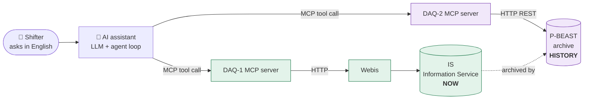

| | **DAQ-1** | **DAQ-2** |
|---|---|---|
| Question type | "What is happening **now**?" | "What happened **at time T**?" |
| Data service | **IS** (Information Service) | **P-BEAST** (archive of IS data) |
| Access path | **Webis** HTTP server in front of IS | P-BEAST **REST API** (`readSeries`) |
| Reference UI | **Run Status** web page (`ATLAS.html` + `ATLAS.js`) | **Grafana** "Basic dashboard for ATLAS" |
| Example question | "What is the current status of the ATLAS partition?" | "Was ATLAS running around 08:00 CERN time on 20 Oct 2025?" |
| Example answer | "The ATLAS partition is currently not running." | "Not at 08:00. It entered RUNNING at 08:16:30 CERN local time." |

The single most important sentence in the PDF appears in **both** projects:

> **"The answer must reflect the data returned by IS / P-BEAST."**

Everything else — the tools, the error handling, the agent guards — exists to make that true.

---

## 2. Background: ATLAS, TDAQ and "operational data"

**ATLAS** is one of the LHC experiments at CERN. Its detector produces collisions far faster
than can be stored, so a **Trigger and Data AcQuisition (TDAQ)** system decides what to keep,
moves the data, and writes it to disk.

TDAQ is not one program: it is **thousands of processes** on many machines, coordinated as
a tree. While they run, they continuously publish their *status* — state, counters, rates,
configuration keys. That status is **operational data**: data *about the system*, not physics data.

```
                      ┌─────────────────────────────────────────────┐
  collisions ──►      │  detector ─► trigger ─► dataflow ─► storage │ ──► physics data
                      └──────────────┬──────────────────────────────┘
                                     │ every process also publishes…
                                     ▼
                     operational data: "I am RUNNING", "LB 11",
                     "0 events recorded", "fault in HLT" …
                                     │
                     ┌───────────────┴───────────────┐
                     ▼                               ▼
               IS (current value)            P-BEAST (history)
```

**Shifters** are people on duty in the control room. Today they read web pages (Run Status)
and dashboards (Grafana). This project lets them *ask* instead.

---

## 3. Vocabulary you need

### 3.1 Partition

> *"A partition is a group of applications and resources configured and controlled together."* (PDF)

Think of a partition as **one independent instance of the DAQ system**. The real experiment
runs the partition called `ATLAS`. Developers and testers run their own small partitions.
There is always a special partition called **`initial`** holding shared infrastructure
(the PDF's Run Status page reads LHC beam information from it).

Observed on the testbed on 2026-11-20: `initial`, `mytest`, `GathererTest`, `LtiHGTD`,
`LtiStandalone`, and others. **There is no `ATLAS` partition on the testbed.**

### 3.2 Run control and its state machine

Each partition has a tree of **controllers**; the top one is the **RootController**.
Every controller runs the same **finite state machine (FSM)**. "Is the partition running?"
means **"is the RootController in state `RUNNING`?"** — exactly the rule `ATLAS.js` uses.

```mermaid
stateDiagram-v2
    direction LR
    [*] --> NONE
    NONE --> INITIAL: INITIALIZE
    INITIAL --> CONFIGURED: CONFIGURE
    CONFIGURED --> CONNECTED: CONNECT
    CONNECTED --> RUNNING: START
    RUNNING --> ROIBSTOPPED: STOPROIB
    ROIBSTOPPED --> DCSTOPPED: STOPDC
    DCSTOPPED --> HLTSTOPPED: STOPHLT
    HLTSTOPPED --> SFOSTOPPED: STOPRECORDING
    SFOSTOPPED --> GTHSTOPPED: STOPGATHERING
    GTHSTOPPED --> CONNECTED: STOPARCHIVING
    CONNECTED --> CONFIGURED: DISCONNECT
    CONFIGURED --> INITIAL: UNCONFIGURE
    INITIAL --> NONE: SHUTDOWN
```

(State machine as documented in [`docs/wp1/WP1-RunControl-ProcessManagement.md`](wp1/WP1-RunControl-ProcessManagement.md).)

Seen live in partition `mytest`: `INITIAL` in the morning (last transition `INITIALIZE`),
then `RUNNING` after someone issued `START`. A controller can also be **RUNNING *and*
faulty** (`fault: true`, with `bad_children` naming the guilty application) — so
"running" alone is not the full story.

### 3.3 IS — the Information Service

IS is a **live key-value store for operational data**. It keeps only the **latest value** of
each item; it has no history.

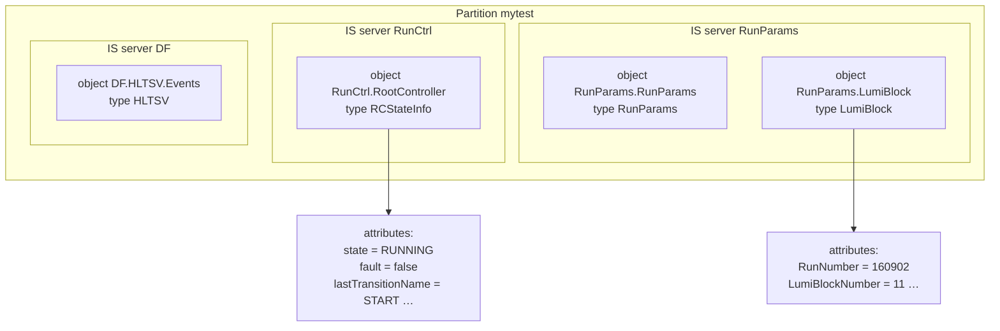

Four levels of naming:

| Level | Example | What it is |
|---|---|---|
| **Partition** | `mytest` | which DAQ instance |
| **IS server** | `RunCtrl` | a container for related objects (not an application!) |
| **Object** | `RunCtrl.RootController` | one published item; name always starts with the server name |
| **Attribute** | `state` | one typed field inside the object |

Every object also has an **IS type** (`RCStateInfo`, `RunParams`, …) and a **last-update time**.

### 3.4 Webis

IS natively speaks **CORBA** (a 1990s remote-object protocol) through the TDAQ **IPC** layer.
That is awkward for a Python web tool. **Webis** is a web server that translates:

> *"Webis is a web server that exposes IS (together with Online Histograms, the OKS database
> and the Error Reporting Service) over HTTP, so objects can be read with a plain HTTP request."* (PDF)

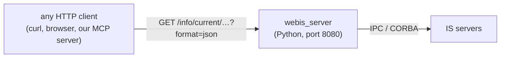

### 3.5 P-BEAST

**P-BEAST** archives values published in IS **over time**, so you can ask "what was the value
at 08:00 last month?". It returns **time series**: a list of (timestamp, value) points.
Grafana dashboards are built on top of it.

### 3.6 MCP, tools, servers, clients

**MCP (Model Context Protocol)** is a standard way for an AI application to call external
**tools**. An **MCP server** publishes a list of tools (name, description, input schema);
an **MCP client** inside the AI app calls them and gives the results to the LLM.

### 3.7 The rest, in one line each

| Term | Meaning |
|---|---|
| **TDAQ release** `tdaq-14-00-00` | The software version everyone must use (partition, IS tools, Webis). |
| **CVMFS** | Read-only network filesystem where CERN software is installed (`/cvmfs/atlas.cern.ch/…`). |
| **IPC** | TDAQ's inter-process communication layer (CORBA); also the "phone book" of partitions. |
| **lxplus** | CERN's public login cluster; a jump host into CERN's network. |
| **eduVPN** | VPN that puts your laptop *inside* CERN's network. |
| **OpenStack** | CERN's private cloud where you create your VM. |
| **FastMCP** | Python framework for writing MCP servers (the PDF's choice). |
| **CERN AI Gateway** (`aigw.cern.ch`) | CERN-hosted LLMs behind an OpenAI-compatible API. |
| **LangChain / LangGraph** | Python libraries for building an LLM *agent* that calls tools in a loop. |
| **Lumi block (LB)** | A ~minute-long slice of a run; the basic time unit of ATLAS data. |
| **SOR / EOR** | Start / End Of Run. |

---

## 4. Infrastructure: accounts, VPN, VM, TDAQ release

The PDF's "Prerequisites and initial setup" section, as a dependency chain:

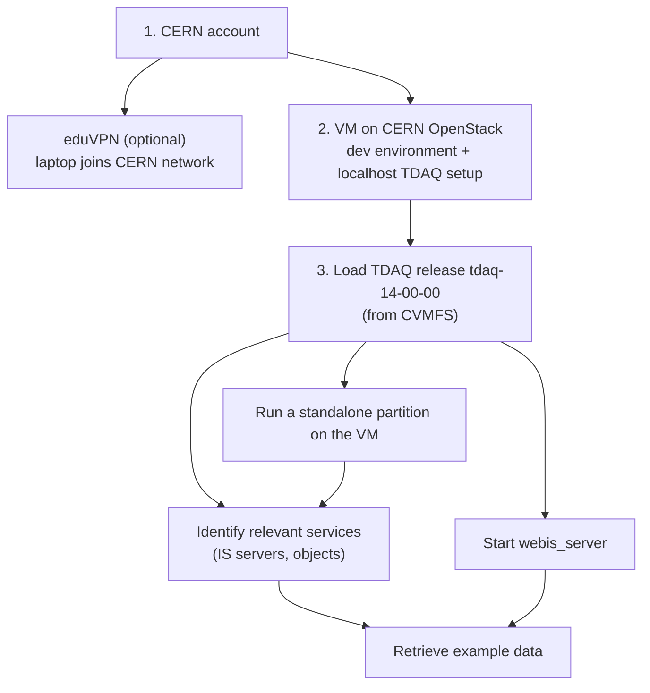

**VMs (provided by the supervisor):** one per project, kept separate —
`vm-onlsw-ai-is.cern.ch` for **DAQ-1** and `vm-onlsw-ai-pbeast.cern.ch` for **DAQ-2**.
Both mount AFS, EOS and CVMFS (TDAQ release), and accept login with the CERN user name.
On the IS VM the same two fixes were needed as described in §5: `glibc-devel`/`kernel-headers`
for Webis, and a firewall rule letting the testbed's IS servers connect back.

What each step looked like in practice:

| Step | Command / fact |
|---|---|
| Login path (no VPN) | Mac → `ssh lxplus.cern.ch` (password + 2FA) → `ssh vm-onlsw-ai-is.cern.ch` (Kerberos) |
| Login path (eduVPN) | Mac → `ssh vm-onlsw-ai-is.cern.ch` directly |
| Load TDAQ | `source /cvmfs/atlas.cern.ch/repo/sw/tdaq/tools/cmake_tdaq/bin/cm_setup.sh tdaq-14-00-00` |
| List partitions | `ipc_ls -P` |
| List IS servers / objects | `is_ls -p mytest` · `is_ls -p mytest -n RunCtrl` |
| Start Webis | `webis_server -p 8080 -a 127.0.0.1` (read-only: **never** `-W`) |
| First query | `curl -s "http://127.0.0.1:8080/info/current?format=json"` |

**Own partition (done).** `nkarki_daq1` runs on `vm-onlsw-ai-is` with a **private IPC**, so it
does not appear in the shared testbed list:

```bash
export TDAQ_IPC_INIT_REF=file:$HOME/tdaq/ipc_root.ref   # private phone book
ipc_server &                                            # private "initial" partition
pm_part_hlt.py -p nkarki_daq1                           # -> nkarki_daq1.data.xml
setup_daq -d nkarki_daq1.data.xml -p nkarki_daq1 -ng -ne -nc
rc_sender -p nkarki_daq1 -n RootController -c INITIALIZE   # then CONFIGURE, CONNECT, START, STOP
webis_server -p 8081 -a 127.0.0.1 &                     # second Webis, sees only the private IPC
```

All of this is wrapped in `daq1/vm/partition.sh`.

> **Note.** The IPC "phone book" on this VM (`TDAQ_IPC_INIT_REF`) points to the shared
> **TDAQ testbed** (`<testbed-ipc-host>`), so the partitions you see are other people's
> test partitions, not something running on your VM. The PDF also asks you to run **your own**
> standalone partition — still to do (see §9).

---

## 5. The network path, and why a firewall broke it

This is not in the PDF, but it is the part most likely to block a newcomer.

### 5.1 The full path of one request

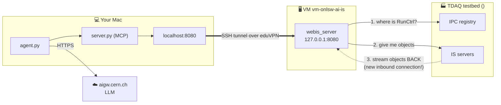

### 5.2 The firewall problem

When the VM asks an IS server for objects, the IS server **opens a new connection back to the
VM** to stream the answer (step 3). The VM's firewall (`firewalld`) only allowed SSH, so the
call-back was dropped:

```
Server "RunCtrl" contains 0 object(s):
… Received nothing in the last 1000ms, stream construction is terminated
```

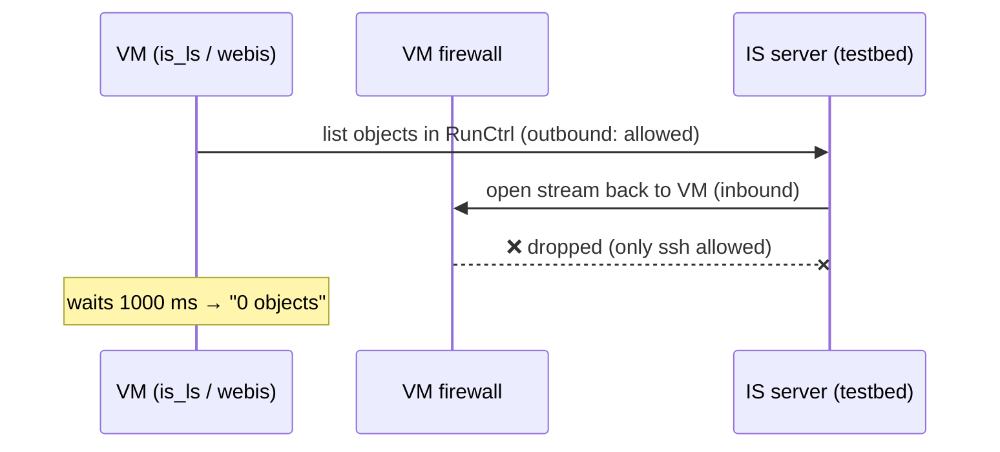

**Fix:** trust CERN-internal sources, including the testbed's private range `<testbed-private-range>`,
then make it permanent. After that, `RunCtrl` listed 57 objects.

### 5.3 The tunnel

Webis listens only on the VM's `127.0.0.1` (safe: nobody else can reach it). To use it from
the Mac, an **SSH tunnel** maps Mac port 8080 → VM port 8080:

```bash
ssh -N -o ServerAliveInterval=30 -o ExitOnForwardFailure=yes \
    -L 8080:127.0.0.1:8080 nkarki@vm-onlsw-ai-is.cern.ch
```

Run it **on the Mac**. (Running it on the VM fails with `Address already in use`, because
Webis already owns 8080 there.)

---

## 6. Project DAQ-1 — current data from IS

### 6.1 Goal (PDF)

> Implement an MCP server that lets an AI assistant retrieve a **selected subset** of the current
> operational data available in IS. Initial scope: a subset of the information shown on the
> **Run Status** webpage. The static HTML page and the JavaScript that queries IS via Webis
> can serve as a reference for identifying the relevant data.

### 6.2 How the Run Status page works (the reference)

The page is a static HTML file whose elements have IDs that **are** IS addresses. Every 30 s,
`ATLAS.js` turns each ID into a Webis URL and fills the element with the value.

```
 HTML id:   ATLAS . RunCtrl . RootController . state
            ─────   ───────   ──────────────   ─────
            partition server   object (may      attribute
                               contain dots)    (last segment)

 regex in ATLAS.js:  ([^.]+)\.([^.]+)\.(.*)\.([^.]+)

 Webis URL:  /info/current/ATLAS/is/RunCtrl/RunCtrl.RootController
                           ─────    ───────  ──────────────────────
                           partition server  server.object
```

The page's panels and the IS objects behind them:

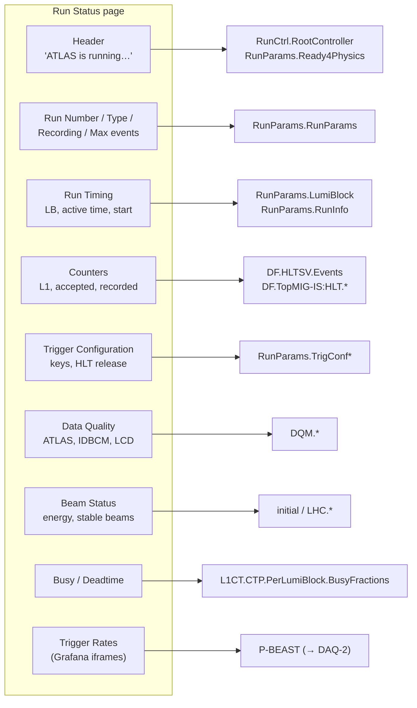

### 6.3 What Webis returns

```json
[ "RunCtrl.RootController",                 ← object name
  "RCStateInfo",                            ← IS type
  "20/11/26 10:42:47.605131",               ← last update (DD/MM/YY, no time zone)
  {"name": "state", "descr": "Current state of the controller",
   "type": "string", "value": "INITIAL"},   ← one dict per attribute
  {"name": "busy",  "type": "bool", "value": false},
  … ]
```

Errors are HTTP **404** with a reason:

| Situation | `error` |
|---|---|
| Partition does not exist | `invalid_partition` |
| IS server does not exist | `invalid_server` |
| Object not published | `invalid_object` |

Listings also exist: `/info/current` (partitions), `/info/current/<p>/is` (servers),
`/info/current/<p>/is/<server>` (objects).

The official API description (`doc/openapi.yaml` in the webis_server repository) also says:

- IS timestamps are **local time** of the Webis server (format `d/m/yy hh:mm:ss[.uuuuuu]`).
- The **ATLAS production** Webis is `https://atlasop.cern.ch`; a testbed one is `https://rhauser-c9s.cern.ch`.
  The real `ATLAS` partition is only reachable through production (needs approval and login).
- Useful options: `attr=` (only some attributes), `regex=` / `type=` (filter object lists),
  `format=compact`, and live update streams (Server-Sent Events) via `listen`.

### 6.4 The DAQ-1 implementation (layers)

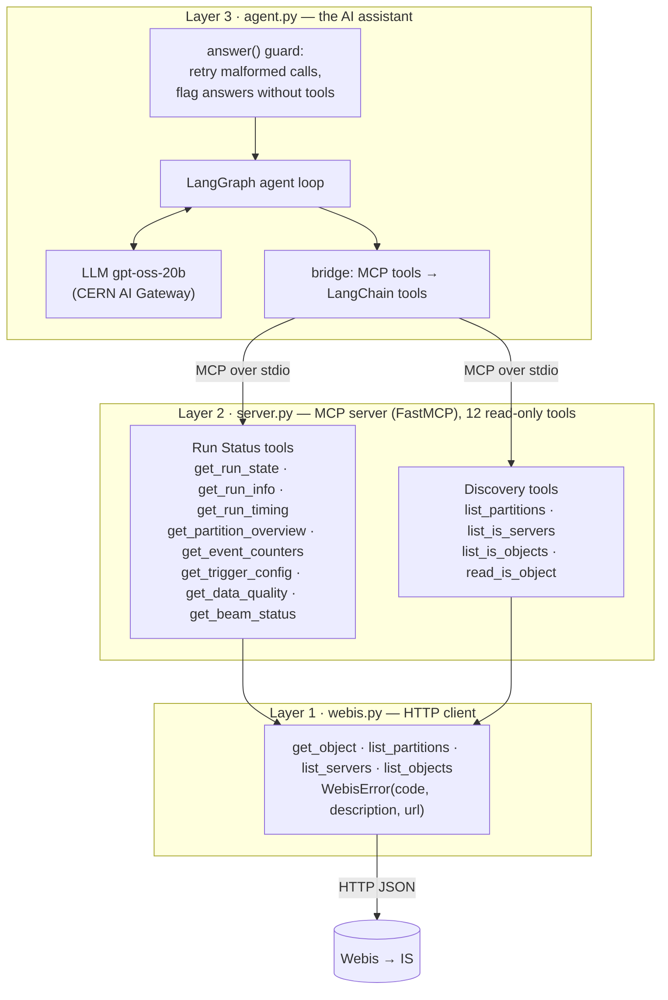

| Layer | File | Responsibility |
|---|---|---|
| 1 | `daq1/webis.py` | Build URLs, call Webis, turn any failure into a `WebisError` with a code. Never return a default. |
| 2 | `daq1/server.py` | Turn IS objects into shifter-meaningful answers, apply ATLAS.js rules, mark missing data `available: false`. |
| 3 | `daq1/agent.py` | Let an LLM decide which tools to call; enforce "no answer without a tool call". |

### 6.5 One question, end to end

```mermaid
sequenceDiagram
    autonumber
    actor U as Shifter
    participant A as Agent (LangGraph)
    participant L as LLM (aigw.cern.ch)
    participant M as MCP server
    participant W as Webis
    participant I as IS
    U->>A: "Is mytest running?"
    A->>L: question + list of 12 tools
    L-->>A: call get_run_state(partition="mytest")
    A->>M: MCP tools/call
    M->>W: GET /info/current/mytest/is/RunCtrl/RunCtrl.RootController
    W->>I: read object
    I-->>W: state=RUNNING, fault=false, …
    W-->>M: JSON array
    M-->>A: {"available":true,"state":"RUNNING","running":true,…,"source":…}
    A->>L: tool result
    L-->>A: "mytest is running; no faults."
    A-->>U: answer (checked: a tool was used)
```

### 6.6 The tools

| Tool | Answers | Reads | Live on testbed |
|---|---|---|---|
| `get_run_state` | Is it running? Any fault? Physics/StandBy mode | `RunCtrl.RootController`, `RunParams.Ready4Physics` | ✅ (mode: not published) |
| `get_run_info` | Run number, type, recording, start/end | `RunParams.RunParams` | ✅ |
| `get_run_timing` | Lumi block, active time | `RunParams.LumiBlock`, `RunParams.RunInfo` | ✅ |
| `get_partition_overview` | All three above in one call | — | ✅ |
| `get_event_counters` | L1 / accepted / recorded events | `DF.*` | ✅ (values 0) |
| `get_trigger_config` | Trigger keys, HLT release | `RunParams.TrigConf*` | ⚠️ not published |
| `get_data_quality` | DQ colours | `DQM.*` | ⚠️ not published |
| `get_beam_status` | Stable beams, energy | `initial` / `LHC.*` | ⚠️ not published |
| `list_partitions` | Which partitions exist | `/info/current` | ✅ |
| `list_is_servers` | Which IS servers | `/info/current/<p>/is` | ✅ |
| `list_is_objects` | Which objects | `/info/current/<p>/is/<s>` | ✅ |
| `read_is_object` | Any object, with field descriptions | any | ✅ |

Not built on purpose: **Busy/Deadtime** (its nested data format was never visible on the
testbed — parsing it would be guessing) and **Trigger Rates** (that is P-BEAST → DAQ-2).

### 6.7 What a good answer looks like

The tool result always carries the evidence:

```json
{ "partition": "mytest", "available": true,
  "state": "RUNNING", "running": true, "fault": false,
  "last_transition": "START",
  "last_transition_time": null,
  "last_transition_time_note": "not published by IS; is_updated is NOT this time",
  "is_updated": "20/11/26 12:07:30.206360", "is_updated_tz": "local time of the Webis server (not converted)",
  "source": "http://127.0.0.1:8080/info/current/mytest/is/RunCtrl/RunCtrl.RootController" }
```

And when data is missing, the answer *says so with a reason* instead of guessing:

```json
{ "partition": "ATLAS", "available": false,
  "reason": "invalid_partition", "detail": "No such partition: ATLAS" }
```

---

## 7. Project DAQ-2 — historical data from P-BEAST

*(Not built yet — this section explains the PDF so the design is ready.)*

### 7.1 Goal (PDF)

> Implement an MCP server that lets an AI assistant retrieve a selected subset of the
> **historical** operational data stored in P-BEAST. Initial scope: a subset of the Grafana
> **Basic dashboard for ATLAS**.

### 7.2 Current vs historical, visually

```
IS (DAQ-1)       ──────────────────────────────────────────────●  ← only "now"
                                                              RUNNING

P-BEAST (DAQ-2)  ●────────●───────────────●──────────●────────●  ← every change, stored
               07:30     07:58          08:16:30    09:10    now
              CONFIGURED CONNECTED      RUNNING     …

Question: "Was ATLAS running at 08:00?"  → look up the value in force at 08:00 → CONNECTED
                                          → "No. It entered RUNNING at 08:16:30 CERN local time."
```

### 7.3 Architecture (as the PDF describes it)

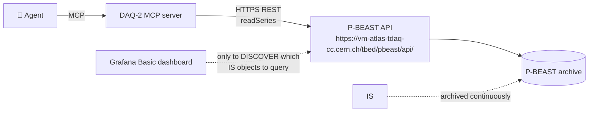

| PDF detail | Meaning |
|---|---|
| Base URL `https://vm-atlas-tdaq-cc.cern.ch/tbed/pbeast/api/` | Talk to P-BEAST **directly**, not through Grafana. |
| Health check `…/api/tdaq/pbeast/health` | Note the extra `/tdaq/pbeast` path. |
| Main endpoint: **`readSeries`** | Read a time series for one IS attribute over a time window. |
| Use Grafana's browser dev-tools (or panel editor) | To find out *which* IS objects/attributes the dashboard plots. |
| Pick a day in 2025 when ATLAS was taking data | So the archive has meaningful data. |
| **Avoid massive queries — a couple of hours at most** | Cap the time window in every tool. |
| Query and response **must indicate the time zone** | "08:00 CERN local time" ≠ "08:00 UTC" (1–2 h apart). |

### 7.4 What carries over from DAQ-1

- The same three layers (HTTP client → MCP server → agent) and the same agent and guard.
- The same "never invent values" rule, now including **time zones**: every time a tool returns
  should say which zone it is in (the DAQ-1 lesson about IS's unlabelled timestamps applies doubly here).
- A hard cap on the query window, enforced in the tool, not just in the prompt.

---

## 8. The AI side: MCP, FastMCP, LLM gateway, agent

### 8.1 Who does what

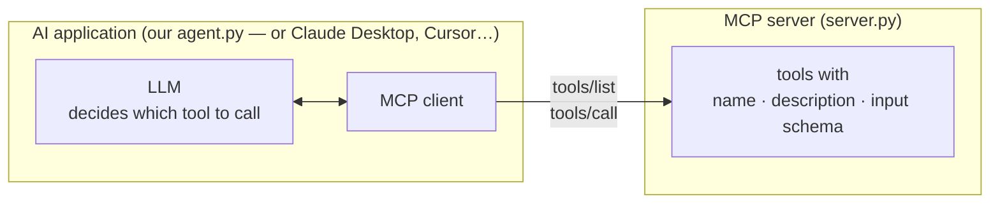

- The **LLM never touches IS**. It only sees tool descriptions and tool results.
- So the **tool descriptions are part of the system's correctness**: they tell the model what
  each field means (see lesson 1 in §11).
- Because MCP is a standard, the **same `server.py`** works with our agent, with the MCP
  Inspector, or with any MCP-capable assistant.

### 8.2 LLM access — CERN AI Gateway (PDF)

| PDF item | Practical detail |
|---|---|
| OpenAI-compatible gateway at `aigw.cern.ch` | `base_url="https://aigw.cern.ch/"` in any OpenAI client |
| Create an API key: Team = sandbox, Models = "All Team Models" | Key stored in `daq1/.env` (git-ignored, `chmod 600`) |
| Models page lists available models | Chat models tested for tool calling (below) |

Measured on 2026-11-20 (one tool-calling task):

| Model | Tool call | Answer | Time |
|---|---|---|---|
| **gpt-oss-20b** (default) | ✅ | ✅ literal, concise | 1.7 s |
| qwen3.8-27b-fp16 | ✅ | ✅ | 3.5 s |
| hf-qwen3-32b-awq | ✅ | ⚠️ added an unsupported claim | 2.2 s |
| qwen3.8-flash-next-int4 | ✅ | ✅ verbose | 4.9 s |
| glm-5.3-flash-int4 | ✅ | ✅ | 11.0 s |
| gemma-4-12b-it | — | not allowed for sandbox keys | — |

### 8.3 The agent loop (LangChain / LangGraph)

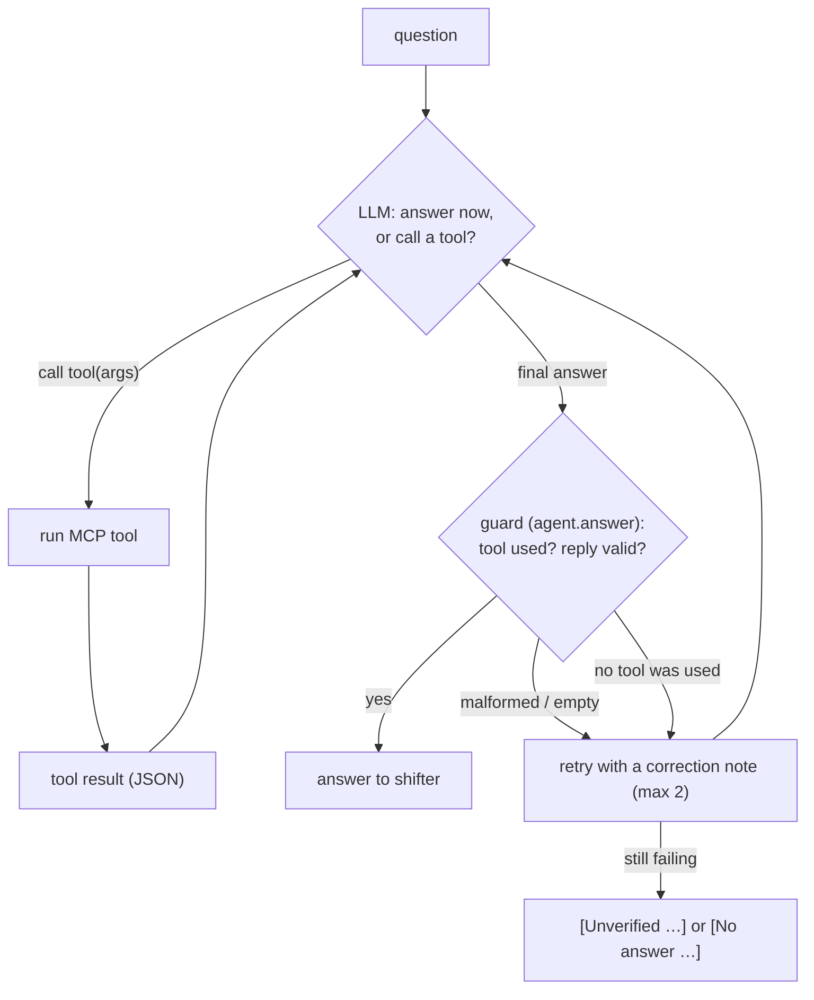

---

## 9. PDF checklist: requirement → status

| # | PDF requirement | Status | Where |
|---|---|---|---|
| 1 | CERN account; eduVPN optional | ✅ | — |
| 2 | VM on CERN OpenStack | ✅ provided by the supervisor: `vm-onlsw-ai-is` (DAQ-1); `vm-onlsw-ai-pbeast` is for DAQ-2 | §4 |
| 3 | Load tdaq-14-00-00 | ✅ | §4 |
| 4 | **Run a standalone partition on your VM** | ✅ `nkarki_daq1` on `vm-onlsw-ai-is`, private IPC, driven NONE → RUNNING → CONNECTED (`daq1/vm/partition.sh`) | §4 |
| 5 | Identify relevant services | ✅ RunCtrl, RunParams, DF, DQM, LHC | §6.2 |
| 6 | Retrieve example operational data | ✅ | §6.3 |
| 7 | Webis running; `curl …/info/current?format=json` | ✅ | §3.4, §5 |
| 8 | DAQ-1 MCP server over a subset of the Run Status page | ✅ all 23 page values (busy table excluded) · 8 tools + 4 discovery tools | §6.6 |
| 9 | Example: "current status of the partition?" | ✅ own partition: "RUNNING" / after STOP "CONNECTED but not running"; `ATLAS`: "not running – not present in IS" (production on 20 Nov 2026 listed only `initial`, checked in the browser) | §6.5 |
| 10 | Answers must reflect IS data | ✅ provenance on every value; guards; 39 tests; live evals | §6.7, §11 |
| 11 | FastMCP; test with any client | ✅ 39 tests via MCP client, `fastmcp call`, Inspector | §12 |
| 12 | LangChain/LangGraph agent on the CERN AI Gateway | ✅ `agent.py` | §8 |
| 13 | DAQ-2 (P-BEAST) | ⏳ not started | §7 |

---

## 10. Rules the whole system must obey

| Rule | Where it comes from | How it is enforced |
|---|---|---|
| Answers reflect the data | PDF, both projects | Tools return IS values unchanged + `source`; agent rejects answers with no tool call |
| Missing ≠ false | Good practice | `available: false` + reason; never "not running" when the truth is "unknown" (Webis down, object missing). Exception that is *not* a guess: partition not up in IS ⇒ `running: false`, as ATLAS.js `printHeader()` does |
| Read-only | Project rule | No write tools; `readOnlyHint`; Webis without `-W` |
| Time zones explicit | PDF (DAQ-2), applied to DAQ-1 | IS strings labelled "local time of the Webis server" (per the Webis API spec); real UTC only where IS gives epoch time |
| No massive queries | PDF (DAQ-2) | To do: cap the window in the DAQ-2 tools |
| Interpretations only from the reference | ATLAS.js | e.g. `running = state=="RUNNING"`, `recording = value==1`, DQ colours 0/1/2/3 |

---

## 11. Lessons learned while building DAQ-1

These are the things the PDF does not say, found by testing against live data.

1. **Real data, wrong event.** The agent reported the IS *refresh* time as the time of the
   `START` transition. Fixed *in the tool* (field meaning in the description, plus an explicit
   `last_transition_time: null`), so every MCP client benefits.
2. **Malformed tool calls from the gateway.** gpt-oss sometimes produced
   `list_partitions<|channel|>commentary` with args `{""}` (an internal token leaking into the
   tool name) and the run ended silently. Fixed: no zero-argument tools, plus retry; never return an empty reply.
3. **Fluent answer with no data behind it.** "Give me an overview of mytest" produced an
   *invented* partition list (including a non-existent `ATLAS`) in 4 of 4 runs, with no tool
   call. Fixed in code: such answers are retried and otherwise labelled `[Unverified]`.
4. **IS servers are not applications.** The model listed servers as "ROS applications".
   Fixed by explaining it in the tool description.
5. **IS time strings are local time.** `LumiBlock.Time` (nanoseconds since epoch) = 10:45:40 UTC
   was shown by IS as 11:45:40 → UTC+1 (CET). An unset time shows as `1/1/70 01:00:00`.
6. **Library mismatch.** `langchain-mcp-adapters` requires the old MCP SDK and cannot run with
   FastMCP 4; a 15-line bridge replaces it.
7. **Invented alternatives.** After "No such partition: ATLAS" the model offered made-up
   partitions ("ATLAS-01 (example)") although it had called a tool. Fixed in the tool: the
   error now carries the real `existing_partitions`.
8. **History questions.** IS has no history; tools and prompt now say so and point to P-BEAST.
9. **Infrastructure first.** Most of day one was firewall, missing headers
   (`glibc-devel`/`kernel-headers` for Webis), and the tunnel — not code.

> The common thread: **giving the model real data is not enough.** The tools must also say
> what each value *means*, and the code must check that the model actually used them.

---

## 12. Quick reference

```bash
# --- on the VM -----------------------------------------------------------
source /cvmfs/atlas.cern.ch/repo/sw/tdaq/tools/cmake_tdaq/bin/cm_setup.sh tdaq-14-00-00
ipc_ls -P                                   # partitions
is_ls -p mytest -n RunCtrl                  # objects in one IS server
pgrep -af webis_server || nohup webis_server -p 8080 -a 127.0.0.1 > ~/webis.log 2>&1 &

# --- on the Mac (eduVPN on) ---------------------------------------------
kinit nkarki@CERN.CH                        # Kerberos ticket (~1 day): password-free ssh/tunnel
ssh -N -o ServerAliveInterval=30 -o ExitOnForwardFailure=yes \
    -L 8080:127.0.0.1:8080 nkarki@vm-onlsw-ai-is.cern.ch      # keep open
curl -s "http://127.0.0.1:8080/info/current?format=json"            # tunnel check

cd daq1
uv run pytest                                                      # 39 offline tests
uv run fastmcp list server.py                                      # tools
uv run fastmcp call server.py get_run_state partition=mytest       # one tool
uv run fastmcp dev inspector server.py                             # browser UI
uv run python agent.py -v                                          # chat
uv run python eval_agent.py                                        # live evaluation
```

| File | What it is |
|---|---|
| [`ref/instructions.pdf`](../ref/instructions.pdf) | The project instructions this guide explains |
| [`ref/ATLAS.html`](../ref/ATLAS.html), [`ref/ATLAS.js`](../ref/ATLAS.js) | Run Status page (DAQ-1 reference) |
| [`daq1/README.md`](../daq1/README.md) | DAQ-1 setup, tools, findings |
| [`daq1/evals/`](../daq1/evals/) | Live evaluation transcripts |
| [`docs/wp1/`](wp1/) | Background studies: IS, Run Control, ERS |
